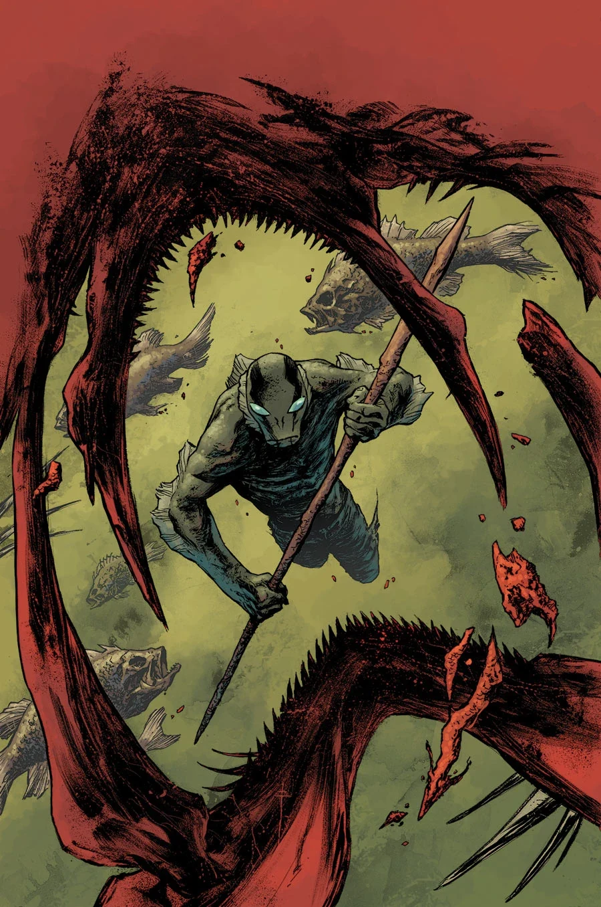

《**异象、幻梦与垂钓**》（Visions, Dreams, and Fishin'）是一个单期完结篇章，2014 年 7 月推出，由麦克斯·菲乌马拉（Max Fiumara）作画。

## 剧情简介

亚伯试图弄清，究竟是什么东西在纠缠与他同行的年轻女子；与此同时，他自己的过去也追了上来。亚伯潜入水中寻找答案，而一个疯狂的女巫声称，她掌握着他们两人都需要的答案。

## 画廊

**Category:Story** **Category:Abe Sapien story** **Category:Abe Sapien: Dark and Terrible story**
