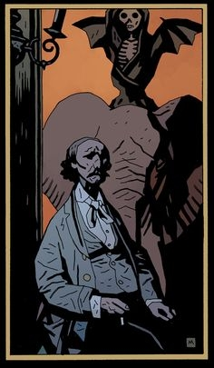

**Walter Edmond Heap** is an artist and writer. He is mainly remembered for his three prose works about [a small mechanical head](/entry/The%20Amazing%20Screw-On%20Head). He is the artist that painted "Death Riding an Elephant", a painting that [Sir Edward Grey](/entry/Edward%20Grey) is rather fond of.

Heap died in 1911 while travelling in India. He was in a railway accident and eaten by a tiger shortly after. A short biography about Heap appeared in [*Hellboy in Hell – Volume 1: The Descent*](/entry/Trade%20Paperback%20Collections) and in related its related [library edition](/entry/Hellboy%20Library%20Editions) and [omnibus edition](/entry/Omnibus%20Editions).

**Category:Characters** **Category:Male Characters**