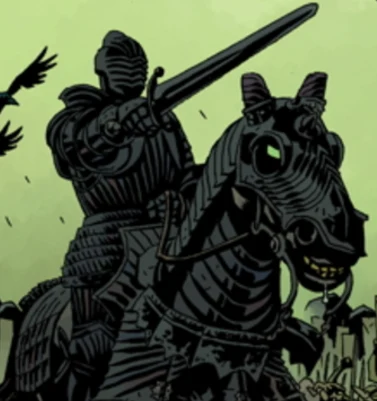

**War** is one of the Four Horsemen of the Apocalypse that appeared during Hellboy's battle with Nimue at the battleground of Vigrid. He led the battle against the resurrected British knight army led by the newly empowered George Washbrook. He perished in the aftermath of the battle.

**Category:Characters** **Category:Mythical Creature** **Category:Deceased Characters**