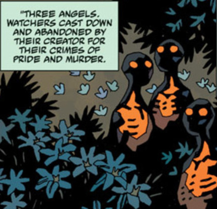

The **Watchers** were a race of beings that were created by [God](/entry/God).

## History

At the beginning of time, [God](/entry/God) created an order of spirits known as the Watchers. Of these, many of the greater spirits were sent to newborn Earth to oversee it and protect it. However, one of these spirits, the Watcher [Anum](/entry/Anum), reached into the sky and stole God's power. This power was called *Flamma Reconditus*, the Secret Fire, or [Vril](/entry/Vril). Using the Vril, Anum was able to create the [Ogdru Jahad](/entry/Ogdru%20Jahad) out of mud and fire. The other Watchers put their seals on it to bring the thing to life. However, it did not come life until nightfall and darkness filled it. The Ogdru Jahad was born and their first act was to birth their 369 children, the Ogdru Hem who became Earth's first lifeforms.

The Watchers, horrified by these monsters, went to war with the Ogdru Hem. The Ogdru Hem were eventually all disposed of, with many of them barely clinging to existence in some fashion, with the Ogdru Jahad sealed by their creator in a prison of crystal and placed in the heart of the abyss. Anum, no longer trusted by the Watchers, was slain by his brethren. This murder infuriated God, who then exacted his retribution on the Watchers for botching their task: some were cast down into the pit, while others were stranded on the Earth to breed monsters. The lesser spirits of the world were allowed to assume shape after this and eventually became the first race of man, the Hyperboreans.

 Three of them wound up in the garden of the Hyperboreans and gave the secrets of Heaven to the Hyperborean King, [Thoth](/entry/Thoth). They were slain by Hecate and their blood was drained and consumed by Hecate to overthrow the authority of the king.

In the pit of Hell, the First Angels led by the Watcher, [Pluto](/entry/Pluto), started a war for dominion over Hell itself against the following army of [Satan](/entry/Satan) and the secondary fallen angels and lost after one thousand years of war. The First Angels were mostly defeated and killed, with one being enslaved to build Satan's capital, [Pandemonium](/entry/Pandemonium), his seat of power. The remaining living angels were used as structural support for the capital and remained until Pandemonium was destroyed after Hellboy murdered Satan. The remaining Watchers were summoned by [Varvara](/entry/Varvara) to do battle with one of the Ogdru Jahad that landed on Earth as penance for their crimes, but they were all defeated and destroyed.

## Known Watchers

- [Anum](/entry/Anum)- Creator of the Odgru Jahad (deceased).
- [Pluto](/entry/Pluto)- Roman God of the Underworld and leader of the Watchers cast into the pit.
- [Satan](/entry/Satan)- Former Watcher turned Demon.

**Category:Species** **Category:Watchers**