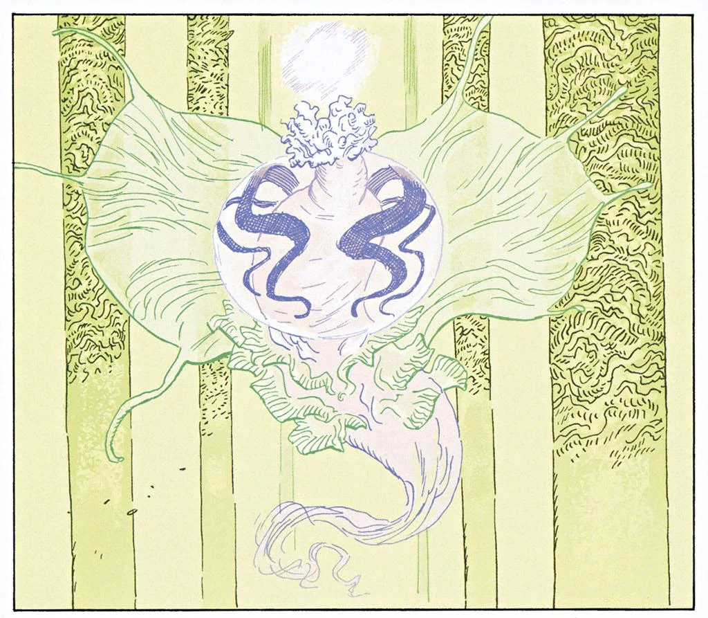

The **water spirit** was the catalyst that transformed Langdon Everett Caul into [Abe Sapien](/entry/Abe%20Sapien). Relatively little is known about this creature and many questions remain unanswered.

Although it is not clear, it is likely that this creature is named Num-Yabisc, or at the very least that its temple is called "the Caverns of Num-Yabisc."

## Transformation

After being impaled, [Abe Sapien](/entry/Abe%20Sapien) has a vision of the creature. He enters a massive underwater temple. Inside he sees the Water Spirit. Before his eyes time passes and the creature forms a sort of cocoon.

In the Victorian era a lone diver enters the now broken down temple and takes the cocoon. At a secret meeting of the [Oannes Society](/entry/Oannes%20Society), four men sit around the cocoon as Langdon Everett Caul stands before them. The Caul lifts the cocoon and begins chanting. The cocoon crumbles and the spirit is absorbed into the man. Suddenly Caul is able to see Abe, and yells at him to stay back. Abe approaches and merges with Caul. The men put him in water but eventually are forced to leave Caul when Abe Lincoln is shot.

## Daughter

In the middle ages the island of Saint-Sēbastien was struck with plague. A girl came out of the sea and told the people that if they worshiped the sea, it would protect them. The girl grew up and had a daughter of her own, the old woman in *[The Drowning](/entry/The%20Drowning)*. According to her, her father was the sea spirit. As Abe enters the church, he sees a vision of the water spirit.

## Connection to the Ogdru Hem?

According to Black Flame, [Abe Sapien](/entry/Abe%20Sapien) is a more evolved form of the frog monster. If this is correct it would seem to mean that the water spirit is in fact yet another Ogdru Hem.

There are some parallels in which the Water Entity shares with at least one Ogdru Hem. Abe had encountered the Mona, which was an egg containing a sleeping Ogdru Hem known as Istra-Hem. The vessel was similar to the egg that was found by the Oannes Society, and Abe believed there may have been a connection. Strangely however the Guardians of Mona, giant eels, regarded him as a threat who would bring about the end of the world.

However the connection with the Ogdru Hem is later proves to be untrue as a ancient Hyberoean priest explained that the frog monsters are actually crude imitations of Abe Sapien made by the Ogdru Hem.

The origins of this creature appeared thousands of years ago after the fall of Hyberborea. It manifested itself when two shamans, disciples of the Right Hand were tortured by the followers of Hecate to renounce their faith. One gave in, but the other refused and through his conviction, was transformed into a blinding aquatic creature of light that exorcised the dark followers. The creature then cocooned itself, casting its egg form in the sea, waiting for its true host to be born.

Abe Sapien was relieved to discover he was not an agent of the Apocalypse but actually an agent of Hope for the World to Come.

Its possible that the future envisioned by various doomsday cults where the Ogdru Jahad rule is a lie or perhaps wishful-thinking by the monsters, as Sapien represents a future in which a new power rises to replace the Ogdru Jahad and Ogru Hem exists. The powers of the end probably are aware of this and in order to become part of this future, most likely attempted to create the frogmen to ensure their survival in the coming age.

## Notes

<references/>

**Category:Characters**