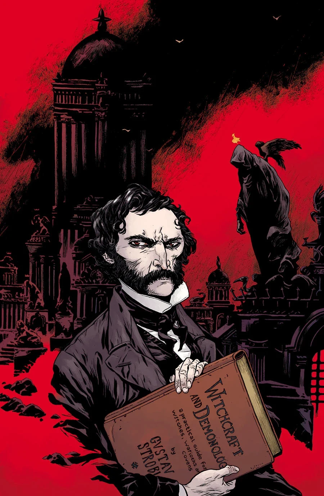

《**巫术与恶魔学**》（Witchcraft & Demonology）是一个关于[古斯塔夫·施特罗布尔](/entry/Gustav_Strobl)的回溯故事。

## 剧情简介

画廊艺术家[圣地亚哥·卡鲁索](/entry/Santiago_Caruso)借一位十九世纪死灵法师的生平，展现了西方神秘学的历史：此人曾往返地狱，心中只怀着一个目标——在世界终结之时为自己谋得一席之地，与魔鬼本人并肩而立。

## 画廊

\#30

**Category:Story** **Category:Abe Sapien story**
