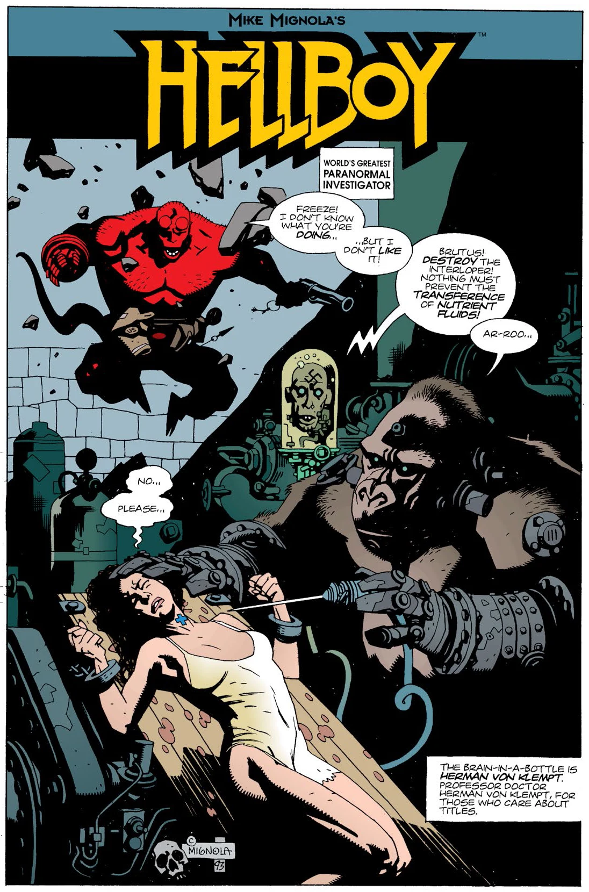

## Publication History

This four-page story was first published as a black-and-white mini-comic in *The Comic Buyer's Guide* \#1070. It was later reprinted in color in [*Hellboy – Volume 1: Seed of Destruction*](/entry/TPB), October 1994.

## Synopsis

[Hellboy](/entry/Hellboy%20%28character%29) fights [Herman von Klempt](/entry/Herman%20von%20Klempt) and his "kriegaffe" Brutus in von Klempt's laboratory. Hellboy saves the trapped woman, defeats von Klempt, and burns down the lab.

## Story Chronology

The story itself does not give us any clues as to its chronology. However, in *[Conqueror Worm](/entry/Conqueror%20Worm%20%28story%29)* \#2, we learn that Hellboy and von Klempt fought in Macapa, Brazil in 1959.

This is the same year as the events of *[The Corpse](/entry/The%20Corpse)* (1959), one year after *[The Penanggalan](/entry/The%20Penanggalan)* and *[The Crooked Man](/entry/The%20Crooked%20Man)* (1958), and two years before *[The Iron Shoes](/entry/The%20Iron%20Shoes)* and *[The Hydra and the Lion](/entry/The%20Hydra%20and%20the%20Lion)* (1961).

! colspan = 3 | [*Hellboy – Volume 1 Seed of Destruction*](/entry/TPB)

sv:World's Greatest Paranormal Investigator (CBG)

**Category:Story** **Category:Hellboy story**