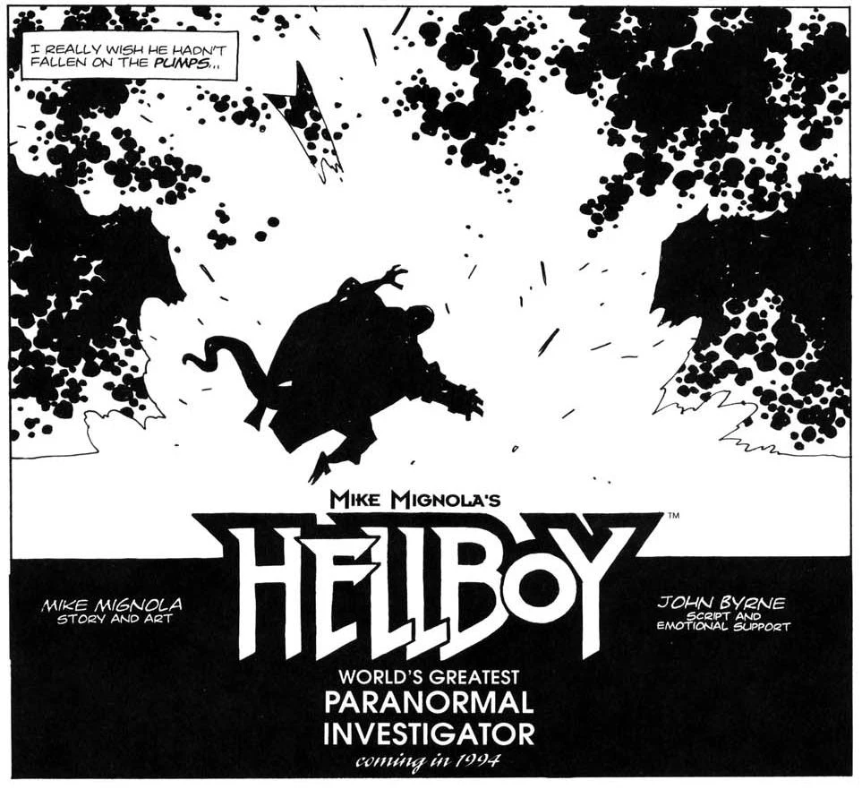

## Publication History

This four-page story was the first published [*Hellboy*](/entry/Hellboy%20%28series%29) story. It was first published in *San Diego Comic Con Comics* \#2 (Aug '93) in black and white. It was reprinted in color in [*Hellboy – Volume 1: Seed of Destruction*](/entry/TPB), October 1994. The story was recolored by Dave Stewart for the *San Diego Comic-Con International Events Guide 2018*, which commemorated the 25th Anniversary of Hellboy's first appearance.

## Synopsis

Hellboy travels to an abandoned town somewhere in the Midwest, one in a string of towns that have had all their residents disappear. Upon arrival, he notices a sign in the shape of a boot with an Egyptian scarab, and a swastika. He also encounters a lonely dog. The dog grows to immense size, and Hellboy realizes that it is Anubis, Egyptian god of mummification. Hellboy is able to defeat the beast, but is blown away, when Anubis lands on a flammable pump.

## Story Chronology

According to *Hellboy: The Companion*, this story takes place in June 1993, Mesquite Creek, Arizona.

## Trivia

Being the first *Hellboy* story, this means that Anubis is the first Hellboy villain.

! colspan = 3 | [*Hellboy – Volume 1 Seed of Destruction*](/entry/TPB)

**Category:Story** **Category:Hellboy story**