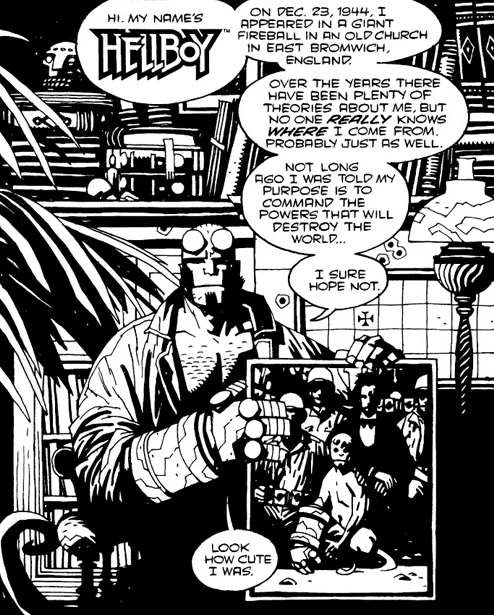

***"Hi, my name's Hellboy"*** is a one-page promotional strip that advertised Hellboy and his upcoming stories.

## Publication History

This page was originally published in October 1994, in "Celebrate Diversity." The page was reprinted in [*The Art of Hellboy*](/entry/TPB) in March 2003.

## Synopsis

The one page story introduces [Hellboy](/entry/Hellboy%20%28character%29), and tells something of his origin, as revealed in *[Seed of Destruction](/entry/Seed%20of%20Destruction)*. The page also gives a very brief introduction of [Abe Sapien](/entry/Abe%20Sapien). The bottom of the page is devoted to promoting the next Hellboy mini-series, *[Wake the Devil](/entry/Wake%20the%20Devil)*, and a group of four short stories that were to appear as back-ups to the first *Monkeyman & O'Brien* mini-series.

"Hi, my name's Hellboy" advertised *Wake the Devil* as a four-issue series, though it would end up as five issues. The back-ups in *Monkeyman & O'Brien* never happened but three of the stories were eventually printed elsewhere; *[Heads](/entry/Heads)*, *[The Nature of the Beast](/entry/The%20Nature%20of%20the%20Beast)* and *[The Baba Yaga](/entry/The%20Baba%20Yaga)*. It is possible that the fourth story, about "a possessed torture device" was in some way folded into *[Wake the Devil](/entry/Wake%20the%20Devil)*.

**Hi, My Name's Hellboy** **Hi, My Name's Hellboy** **Category:Out-of-continuity story**