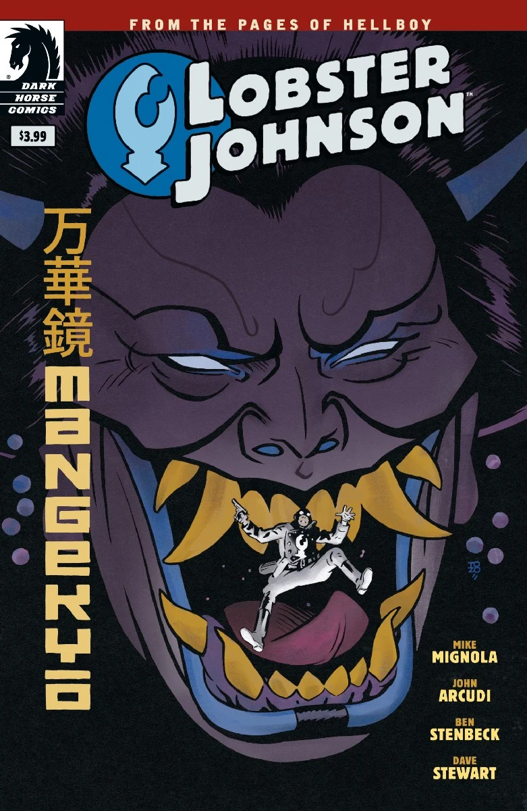

***万华镜 Mangekyō*** 是 *[大螯虾强生](/entry/Lobster%20Johnson%20%28series%29) 系列漫画中的一个短篇故事。*

作者是John Arcudi 以及 Mike Mignola ，画师是Ben Stenbeck. It takes place in the middle of [the Lobster's](/entry/The%20Lobster) career as a crime fighter in the 1930s.

## S故事梗概

The Lobster foils an attempted prison break, but must answer to the person behind it—the assassin, witch, and longtime enemy the Crimson Lotus, one of the most enigmatic villains of the Hellboy world..

## G相册

<File:Mangekyo.jpg%7CCover>

! colspan = 3 | [ Vol. 6 A Chain Forged in Life](/entry/TPB)

**Category:Story** **Category:Lobster Johnson story**