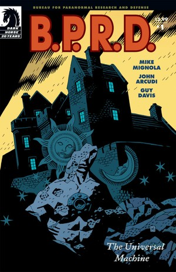
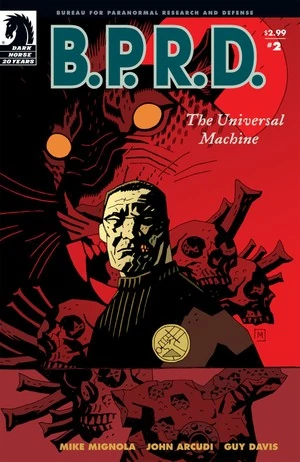
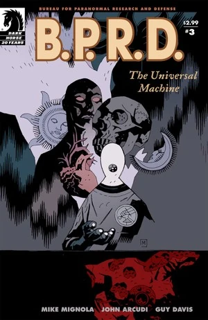
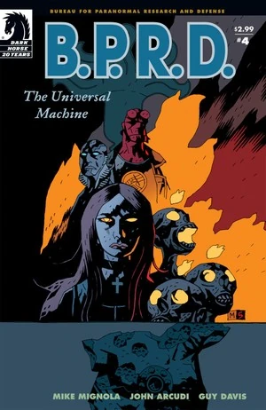
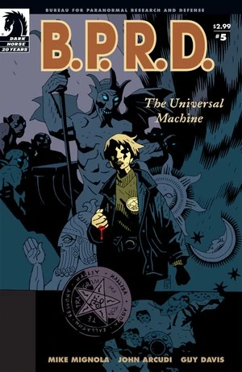

在***《万能机械》***（The Universal Machine）中，[凯特·考瑞根博士](/entry/Kate_Corrigan)前往法国乡间，寻找一本或能让[罗杰](/entry/Roger)起死回生的古籍。在 [B.P.R.D. 总部](/entry/Bureau_for_Paranormal_Research_and_Defense)，[戴米奥上尉](/entry/Benjamin_Daimio)讲述了自己死亡的经历，[约翰·克劳斯](/entry/Johann_Kraus)袒露了一场因降灵会而起的离奇三角恋，[亚伯](/entry/Abraham_Sapien)回忆起自己初入 B.P.R.D. 时与[地狱男爵](/entry/Hellboy_%28character%29)执行的一次任务，[丽兹](/entry/Elizabeth_Sherman)则讲述了她在觉醒控火能力时害死家人的诡异往事。

## 出版历史

这部五期限定连载于 2006 年 4 月至 8 月出版，2007 年 1 月收录进平装合订本《B.P.R.D.：万能机械》（*[B.P.R.D.: The Universal Machine](/entry/Trade_Collections)*）。迈克·米格诺拉亲自绘制了第 5 期的最后几页。

## 剧情简介

### 第一部

亚伯·塞皮恩和戴米奥上尉监督着对内布拉斯加州卡塔-赫姆（Katha-Hem）灾变现场——即《[黑焰](/entry/The_Black_Flame_%28story%29)》事件现场——的爆破。尽管这场袭击造成 1700 人死亡，戴米奥心里牵挂的却只有在袭击中丧生的罗杰。

凯特秘密会见[安德鲁·德文](/entry/Andrew_Devon)，后者向她提供了关于"Flama Reconditus"（[秘火](/entry/Vril)，The Secret Fire）的情报。他认为这是唯一一本记载着让[荷蒙克鲁斯](/entry/homunculus)（人造人）组织再生配方的书，或可借此让罗杰复生。两人前往法国的阿贝莱本（Ableben），与收藏者会面并商谈此书。1491 年，当地村民曾因[法布尔侯爵](/entry/Adoet_de_Fabre)把他们的孩子喂给自己的"怪物"，而捣毁了他的城堡。

两人见到了收藏者蒂埃里（Thierry）。他的店里藏品丰富，一边考问凯特，一边坚持让德文去用店外的电话亭。两人寻找那本书时，凯特对越来越古怪的器物起了戒心，意识到自己身处险境。德文给 B.P.R.D. 总部打电话时，看到橱窗上挂出了"停业"的牌子，便撞门冲回店内，却发现整间店已空空如也，只剩一幅城堡的画作。

在 B.P.R.D. 总部，戴米奥、约翰和丽兹·舍曼围绕罗杰展开讨论，最终戴米奥同意说出自己死亡的真相。

### 第二部

戴米奥上尉向 B.P.R.D. 讲述自己在玻利维亚丛林中死亡的经历。与此同时，凯特·考瑞根博士在法国乡间搜寻那本藏有复活罗杰之秘的隐秘典籍时，成了一家古怪商店的客人——商店所在之处，正是半个多世纪前被摧毁的城堡旧址。

### 第三部

就在凯特·考瑞根博士搜寻那本或藏有复活罗杰之秘的神秘典籍时，她被困在了一个诡异的法国村庄里；那里的一位神秘器物收藏者，对 B.P.R.D. 最宝贵的"资产"之一有着可怕的图谋。

### 第四部

地狱男爵与亚伯·塞皮恩在一段回忆故事中成为主角，故事发生在亚伯初入超自然调查防御署的岁月；丽兹·舍曼则讲述了她在觉醒控火能力时害死家人的诡异往事。而在欧洲，凯特·考瑞根博士为了死去的朋友罗杰的命运，与一个古老的邪恶存在讨价还价。

### 第五部

随着凯特在闹鬼的法国村庄中那段恶魔般的历险落下帷幕，罗杰的命运在一场异世界的对峙中尘埃落定；超自然调查防御署的每一位成员，也都独自面对了各自不得不直面的死亡真相。

## 内容

### 角色

#### [超自然调查防御署](/entry/Bureau_for_Paranormal_Research_and_Defense)（B.P.R.D.）

- [亚伯拉罕·塞皮恩](/entry/Abraham_Sapien)
- [本雅明·戴米奥](/entry/Benjamin_Daimio)
- [凯瑟琳·考瑞根](/entry/Kate_Corrigan)
- [丽兹·舍曼](/entry/Elizabeth_Sherman)
- [约翰·克劳斯](/entry/Johann_Kraus)
- [安德鲁·德文](/entry/Andrew_Devon)
- [罗杰](/entry/Roger)
- [汤姆·曼宁](/entry/Thomas_Manning)
- 其他探员与职员

#### 阿贝莱本线索

- [阿多埃·德·法布尔](/entry/Adoet_de_Fabre)（Adoet de Fabre）
- 阿贝莱本居民（被变为狼）
- [吸血鬼](/entry/Vampire_%28creature%29)
  - 博登（Boden）
- 拉格克（Lagerk，[荷蒙克鲁斯](/entry/Homunculus)）
- [埃德尔·米施拉斯](/entry/Edel_Mischrasse)（回忆出场）
- [罗杰的兄弟](/entry/Roger%27s_brother)（仅被提及）
- 奥安尼斯（Oannes，插图）
- [恶魔](/entry/Demon)
  - [玛尔科西亚斯](/entry/Marchosias)（Marchosias）
  - 伊布利菲卡（Iblifika）

#### 总部众人的故事

- 戴米奥的故事（回忆）
  - 士兵
    - 贝内特（Bennett）
    - 卡里略（Carillo）
    - 曼努埃尔·安东尼奥·查韦斯（Manuel Antonio Chaves）
    - 哈蒙（Harmon）
    - 兰德姆（Landham）
    - 拉米雷兹（Ramirez）
  - 美洲豹教团成员
  - 美洲巨兽（Jaguar Beast）
  - [能乐猿猴](/entry/Noh_monkey)（Noh Monkey）
  - 美洲豹神（梦境）
- 约翰的故事（回忆）
  - 帕旺·德利奇（Pavao Delic）
  - 伊娃（Eva，约翰的助手）
  - 森卡·德利奇（Senka Delic）
- 丽兹的故事（回忆）
  - 珍妮（Jenny，保姆）
  - 威尔（Will，梦境）
  - 布鲁诺（Bruno，狗）（梦境）
  - 舍曼夫人（梦境）
  - 舍曼先生（梦境）
- 亚伯的回忆
  - [奥安尼斯学社](/entry/Oannes_Society)成员
  - 伊迪丝·霍华德（Edith Howard）
  - [水之精灵](/entry/Water_Spirit)
- 亚伯的故事（回忆）
  - [地狱男爵](/entry/Hellboy_%28character%29)
  - 警探
  - [达里尔·泰农](/entry/Daryl_Tynon)（[温迪戈](/entry/Wendigo)）
  - 泰农一家（照片）

### 地点

- 美国
  - 内布拉斯加州林肯市
  - [B.P.R.D.](/entry/Bureau_for_Paranormal_Research_and_Defense) 总部（科罗拉多州）
  - 舍曼宅邸（堪萨斯城）（梦境）
  - 前 [B.P.R.D.](/entry/Bureau_for_Paranormal_Research_and_Defense) 总部（康涅狄格州费尔菲尔德）（回忆）
  - 圣特里尼安医院（华盛顿特区）（回忆）
    - [奥安尼斯学社](/entry/Oannes_Society)聚会地（回忆）
  - 考尔宅邸（罗德岛州利特尔波特）（回忆）
- 法国
  - 阿贝莱本（Ableben，旧称"法布尔公国"）
- 玻利维亚丛林（回忆）
- 罗马尼亚（回忆）
  - [埃德尔·米施拉斯](/entry/Edel_Mischrasse)在切杰城堡（Czege Castle）下的工坊（弗尔蒂切尼 Fălticeni）（回忆）
- 德国（回忆）
  - 克劳斯宅邸（慕尼黑）（回忆）
- 大西洋（回忆）
  - 努姆-亚比斯科洞窟（Caverns of Num-Yabisc）（回忆）
- 加拿大（回忆）
  - 阿农塔（Anonta，安大略省）（回忆）

### 重要物品

- [秘火](/entry/The_Secret_Fire)（The Secret Fire）
- 多具[荷蒙克鲁斯](/entry/Homunculi)尸体
- 所罗门王九戒之一
- [克洛阿西娜](/entry/Cloacina)雕像（罗杰的梦境）

## 趣闻

- 吸血鬼和侯爵最初由[盖·戴维斯](/entry/Guy_Davis)按 17 世纪服饰风格起稿，后来改成了 18 世纪的设计，因为[迈克·米格诺拉](/entry/Mike_Mignola)想向自己最喜爱的电影之一《[天师捉妖](/entry/The_Fearless_Vampire_Killers)》（The Fearless Vampire Killers）致敬。

## 画廊

 \#1

 \#2

 \#3

 \#4

 \#5

**Category:Story** **Category:B.P.R.D. story** **Category:B.P.R.D.: Plague of Frogs story**
