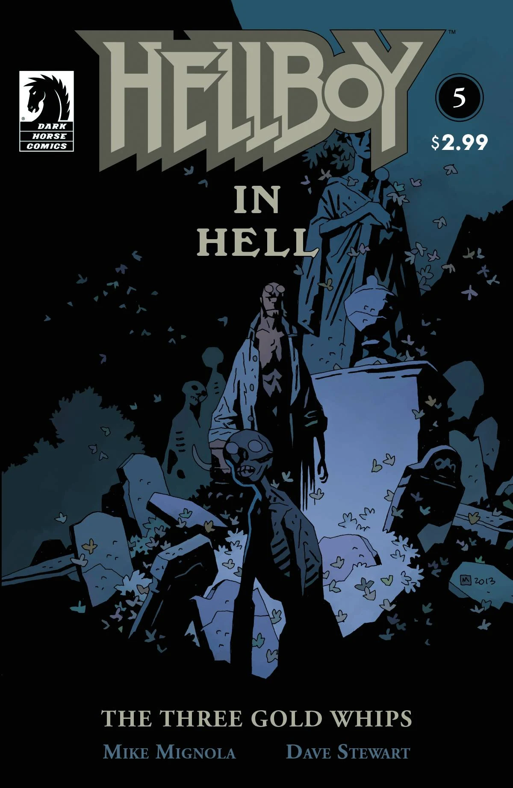
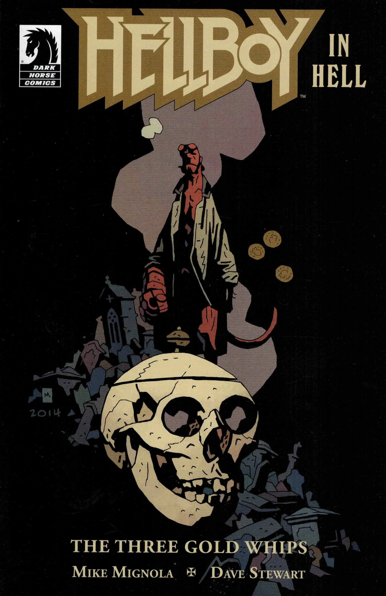

《**三条金鞭**》（The Three Gold Whips）是一个单期完结故事，也是《[地狱男爵在地狱](/entry/Hellboy_in_Hell_(series))》系列的第二个篇章。

## 出版历史

故事于 2013 年 12 月出版，取材自格林童话《魔鬼和他的祖母》（*The Devil and His Grandmother*）。

## 剧情简介

地狱男爵帮助了一个迷惘的男人——此人为了一条魔法皮鞭而出卖了自己的灵魂。这是一个由格林童话中较为古怪的一则所启发的故事。

## 画廊

封面均由 [迈克·米格诺拉](/entry/Mike_Mignola)（Mike Mignola）绘制。

\#5：《三条金鞭》

**Category:Story** **Category:Hellboy story** **Category:Hellboy in Hell story**
