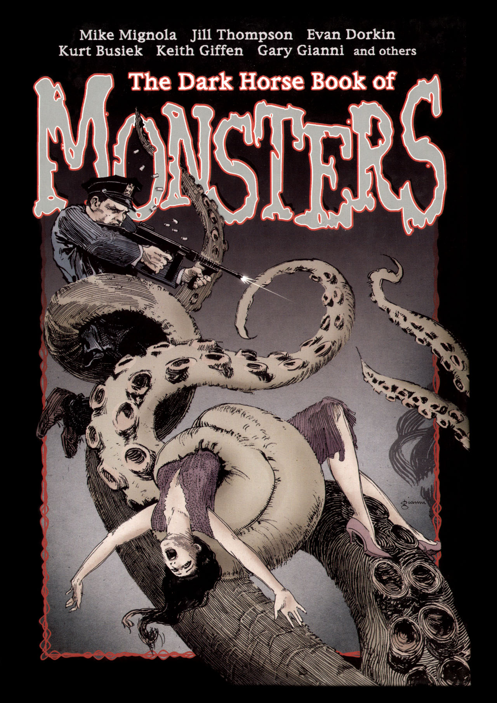

[Hellboy](/entry/Hellboy) investigates the appearance of a monster following the death of a circus strongman.

## Publication History

"The Hydra and the Lion" was first published as part of the anthology *The Dark Horse Book of Monsters* in December 2006 (dated November). The volume is part of \[<https://en.wikipedia.org/wiki/The_Dark_Horse_Book_of>... *Dark Horse Book of...*\] series of horror anthologies.

## Synopsis

In 1961, [Hellboy](/entry/Hellboy%20%28character%29) travels to Alaska. A former circus strong man, named Hercules, died, and since then monsters have haunted the area. Hellboy asks a local man that knew Hercules if the man was the Hercules of legend, but get no real answer.

Hellboy goes to investigate and sees a girl sitting on a sleeping monster. The girl is pulling out the hydra's teeth with a pair of pliers. Hellboy tells the girl to go home, but the girl says she is from Cithaeron. She asks Hellboy if he wants to see her collection of fantastical objects, from an iron feather to a drop of centaur blood to the tears of queen Magara for her murdered sons.

Hellboy insists the girl go home. She responds that she is half lion, and proves it with a roar. The noise wakes up the monster. Hellboy punches it breaking its jaw. The monster's head splits in two, revealing it to be the hydra. Soon two heads become three, and Hellboy is outnumbered. A lion appears, attacks the hydra, and then promptly disappears. Hellboy ties the hydra's three heads together. The job done, Hellboy returns to [B.P.R.D.](/entry/Bureau%20for%20Paranormal%20Research%20and%20Defense) headquarters.

[Trevor Bruttenholm](/entry/Trevor%20Bruttenholm) and another professor speculate on the identity of the mysterious girl. The professor notes that Hercules killed the Thespian lion in the woods of Cithaeron, and wore its skin for the rest of his life. But Hellboy finds it hard to believe the girl is the ghost of Hercules's cloak. Bruttenholm suggests another possibility. While driven mad by Hera, Hercules killed his wife Magara and their sons. His first labor was to slay the Nemean lion to atone for these murders. Perhaps then the girl is a manifestation of Hercules's unresolved guilt.

The story ends with the ghostly lion sitting before Hercules's tombstone.

## Story Chronology

The story takes place in 1961. This is the same year as *[The Iron Shoes](/entry/The%20Iron%20Shoes)*.

! colspan = 3 | [*Hellboy – Volume 7: The Troll Witch and Others*](/entry/TPB)

**Hydra and the Lion, The** **Hydra and the Lion, The**