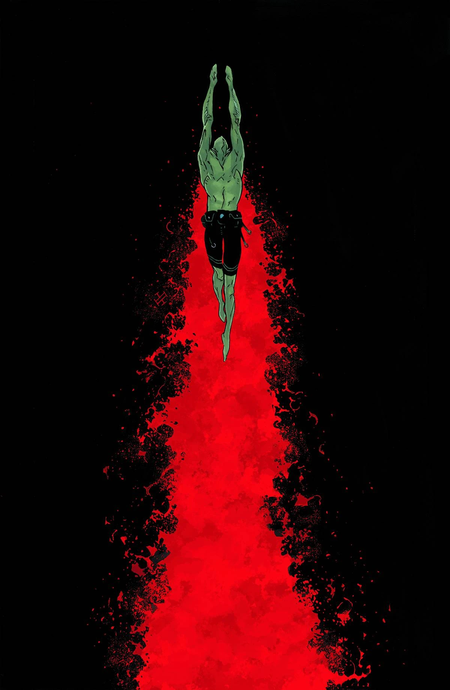
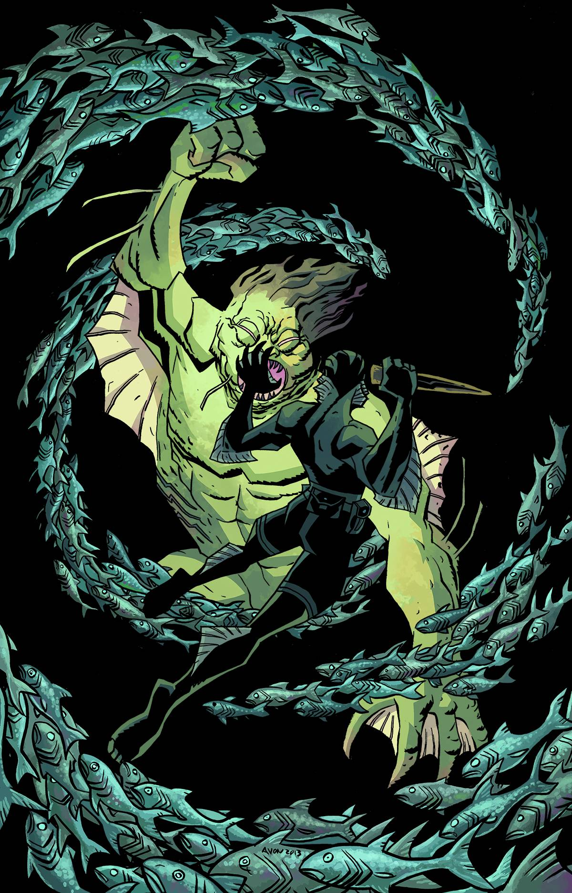

《**亡者之地**》（The Land of the Dead）是 2013 年 12 月出版的单期故事线，由 Michael Avon Oeming 作画。

## 出版历史

这是一个闪回故事，与玛雅文化以及[上一个故事线](/entry/The_Shape_of_Things_to_Come)有所关联，并与《[Hellboy in Mexico（地狱男爵在墨西哥）](/entry/Hellboy_in_Mexico_%28story%29)》相联系。

### 早期预告

故事的一鳞半爪曾作为 [Multiversity Comics 的《31 Days of Abe》](http://multiversitycomics.com/special/31-days-of-abe-day-11-michael-avon-oeming/)艺术作品之一发布，当时并未透露这是为某个故事所做的设计稿。五个月后，该故事才在 [Comic Book Resources](http://www.comicbookresources.com/?page=article&id=47435) 上正式公布。

## 剧情简介

1983 年，亚伯·塞皮恩进入墨西哥坎佩切的一处洞穴——一支考古发掘队在那里遭遇了一只怪物。亚伯下到洞中，遇到考察队的一名成员和几具尸体。随后他发现一间墓室，里面摆满棺材，棺中全是吸血鬼，极有可能来自 Madelyn Rose（玛德琳·罗斯）号——这艘船最早在《[The Pickens County Horror（皮肯斯县惊魂）](/entry/The_Pickens_County_Horror)》中被提及。房间里还有一只巨大的白色两栖生物，它曾经也是吸血鬼之一。亚伯随即将吸血鬼逐一斩杀。众人逃出洞穴后，那间发生过这一切的墓室却再也找不到了。

## 画廊

\#8
Max Fiumara 作画

\#8 变体封面
Michael Avon Oeming 作画
