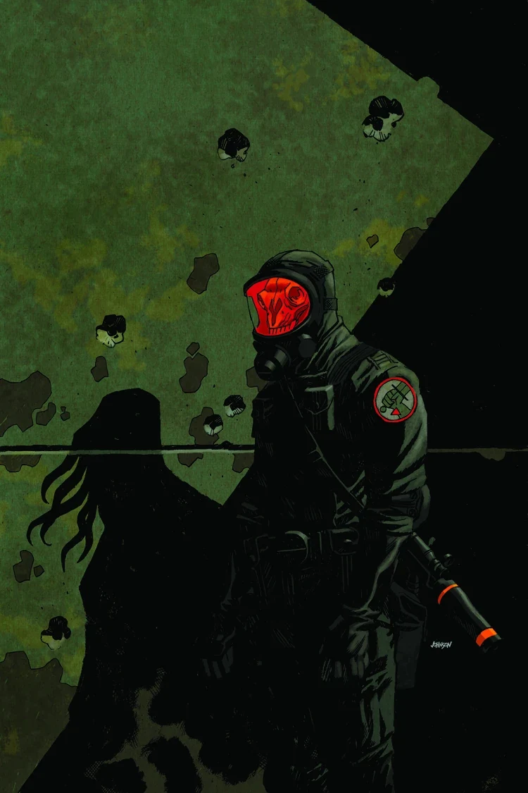
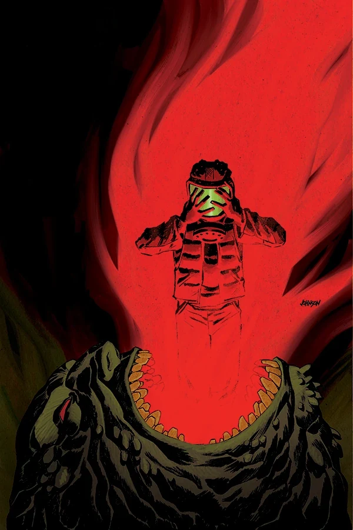
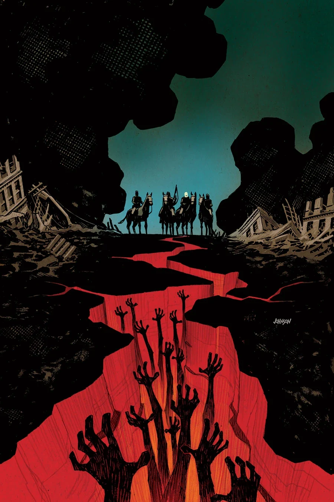

***《人人自危的荒原》***（Wasteland）是一部于 2013 年出版的三期限定连载，封面由[戴夫·约翰逊](/entry/Dave_Johnson)（Dave Johnson）绘制。

## 剧情简介

### 第一部

一支超自然调查防御署小队在芝加哥执行救援任务，设法寻找在《[B.P.R.D. 人间炼狱：时间的深渊](/entry/The_Abyss_of_Time)》中失踪的一群探员。等待他们的却是一座满目疮痍的城市——巨型奥格德鲁·赫姆横行街头，大批人类已异化为怪物。

### 第二部

一种传染病在芝加哥的荒原上蔓延，将这座“风城”的居民变成凶残的怪物。这些异化生物加上巨型蝙蝠脸怪物，能否阻止超自然调查防御署救出他们失踪的同僚？

### 第三部

探员们向芝加哥废墟深处挺进，终于找到了《[时间的深渊](/entry/The_Abyss_of_Time)》中失踪探员的最后安息之地。映入眼帘的是一个诡异的超自然凶案现场，以及一支变异人大军——他们挡住了探员们返回总部的路。

## 画廊

\#1

\#2

\#3

**Category:Story** **Category:B.P.R.D. story** **Category:B.P.R.D.: Hell on Earth story**
