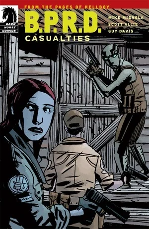

《**人员伤亡**》（Casualties）是一部短篇故事。

## 出版历史

《人员伤亡》最初于 2011 年 7 月作为「黑马漫画数字零售商独家」（Dark Horse Digital Retailer Exclusive）计划的一部分推出，仅以数字格式发售。此后它才以纸质形式收录于平装合订本《[B.P.R.D.：生而为人](/entry/Trade_Collections)》中。

这个故事也是沃恩探员（Agent Vaughn）的首次登场——他后来成为《[皮肯斯郡恐怖故事](/entry/The_Pickens_County_Horror)》的核心人物。

## 剧情简介

在调查一系列狼人袭击案时，亚伯犯下一个失误，险些导致一名队友丧命。

**Category:Story** **Category:B.P.R.D. story**
