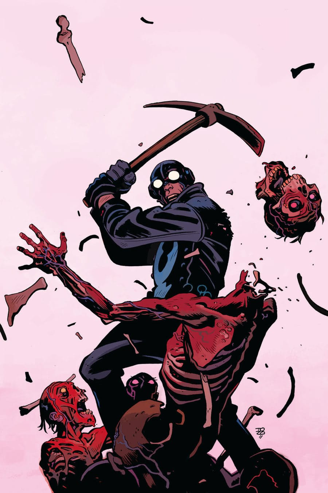

The story takes place in the middle of [the Lobster's](/entry/The%20Lobster) career as a crime fighter in the 1930s.

## Publication History

This one-shot will be published in January 2017, featuring a cover by Tonči Zonjić.

## Synopsis

When an undead hit man goes after the NYPD, the Lobster steps in to figure out if it’s a zombie—or something worse.

## Gallery

<File:Garden_of_Bones.jpg%7CCover>

! colspan = 3 | [ Vol. 6 A Chain Forged in Life](/entry/TPB)

**Category:Story** **Category:Lobster Johnson story**