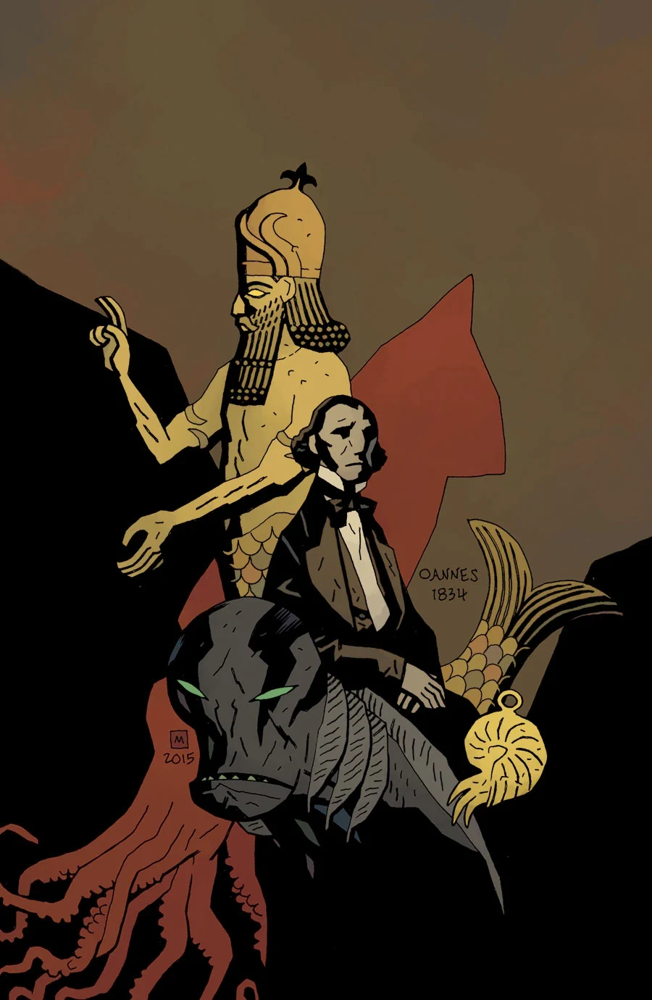

《**人鱼族**》（Icthyo Sapien）是一个设定在 1834 年的回溯故事，主角是[兰登·考尔](/entry/Abraham_Sapien)（Langdon Caul）。为了[《亚伯·塞皮恩：溺亡及其他故事》全集版](/entry/Omnibus_Editions)，这个故事曾被扩写，从而与《[B.P.R.D.：现世终章——万魔殿](/entry/Pandemonium_%28story_arc%29)》串联起来。

## 剧情简介

当各个秘密社团为一件足以证明人类真正起源的器物争斗不休时，[亚伯](/entry/Abraham_Sapien)关于自己在十九世纪身为人类时的记忆，也随之浮现心头。

## 画廊

**Category:Story** **Category:Abe Sapien story**
