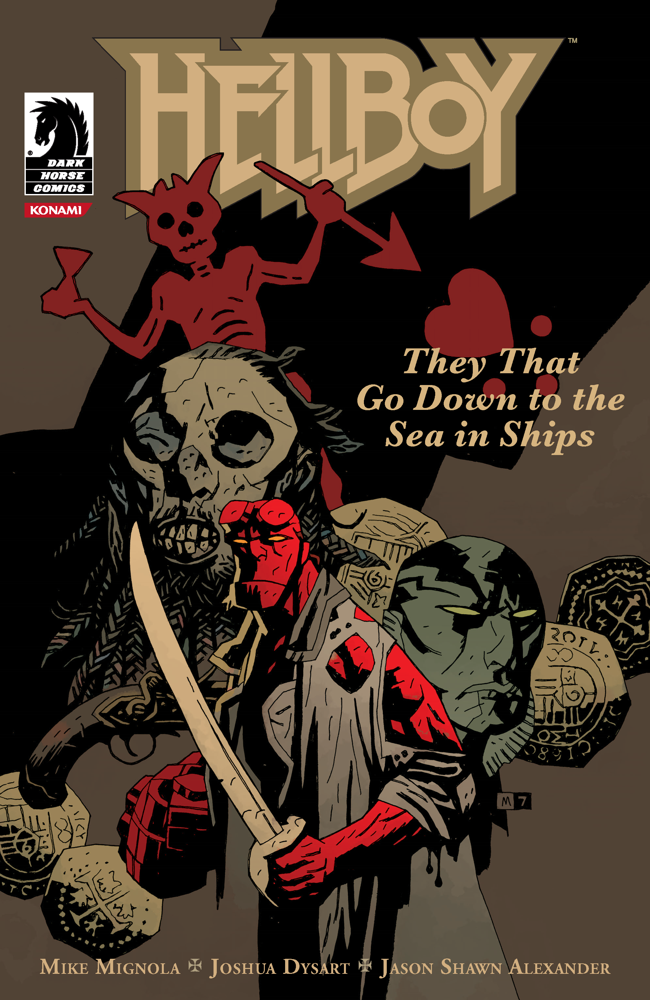

In 1986 [Hellboy](/entry/Hellboy) and [Abe Sapien](/entry/Abe%20Sapien) track down the head of the Pirate Blackbeard.

## Publication History

*They That Go Down to the Sea in Ships* was first published in August of 2007. The story was co-published by the game company Konami and released to as a free giveaway during the New York Comic-Con to promote [Hellboy: The Science of Evil](/entry/Hellboy__The_Science_of_Evil). The story is reprinted in [*Hellboy – Volume 10: The Crooked Man and Others*](/entry/TPB), first published in June 2010.

## Synopsis

In Massachusetts in 1986 a psychic enters an antique store to get out of the rain. Suddenly a bookcase full of objects falls to the floor. The psychic pickups a [skull chalice](/entry/Blackbeard%27s%20skull%20chalice) and feels a presence within it. He asks to buy it from the proprietor, but does not have enough money. The psychic brutally kills the man and takes the skull.

One month later [Abe Sapien](/entry/Abraham%20Sapien) and [Hellboy](/entry/Hellboy%20%28character%29) are on an island in North Carolina. Hellboy picks up a local historian, Earl Reeds, and asks him about the head.

Meanwhile the psychic and a second man row out to the island. The psychic mutters as though possessed leading the pair the the correct place. Arriving the psychic raises the skull over his head and calls out to the pirate Blackbeard.

Abe approaches a cloaked figure sitting on the beach. The figure tells him that Blackbeard was cruel to the people he knew. In the end Blackbeard was killed and beheaded. His body was thrown overboard and swam laps around the ship.

Reeds tells Hellboy that when he was a child he saw Blackbeard's body swimming in the area looking for its head. He explains that the head was passed around and over time it was lost. Hellboy responds that apparently it was found again.

The headless corpse of Blackbeard slowly approaches the two men. The second man tells the psychic that he wants to handle the exchange. The psychic refuses and his companion shoots him dead. The man points the gun at Blackbeard's and tells him he will trade for Blackbeard's treasure. Blackbeard kills the man and takes back his head. By now Hellboy and Reeds have arrived to confront Blackbeard. The two posture and Blackbeard shoots Hellboy in the arm.

Back on the beach Abe watches long dead sailors walk up to the shore. The cloaked figure tells Abe that they have unfinished business with Blackbeard. The man removes his cloak and reveals that he too is a dead sailor.

Hellboy and Blackbeard fight but suddenly the dead sailors arrive, grab the head, and drag it screaming out to sea.

## Trivia

The title of this story comes from the King James version of Psalms 107:23.

## Notes

<references/>
! colspan = 3 | [Vol. 10 The Crooked Man and Others](/entry/TPB)

**Category:Story** **Category:Hellboy story**