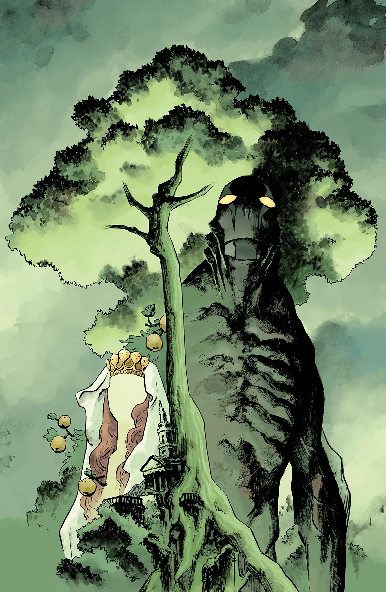

《**伊甸园（III）**》（The Garden (III)）是一个单期完结故事，由麦克斯·菲乌马拉（Max Fiumara）作画。

## 剧情简介

在《[黑暗与可怖](/entry/Dark_and_Terrible_%28story_cycle%29)》风暴来临前最后的平静中，[亚伯·塞皮恩](/entry/Abraham_Sapien)抵达英格兰，死灵法师[古斯塔夫·施特罗布尔](/entry/Gustav_Strobl)则在此展示他新获得的力量。

## 画廊

**Category:Story** **Category:Abe Sapien story** **Category:Abe Sapien: Dark and Terrible story**
