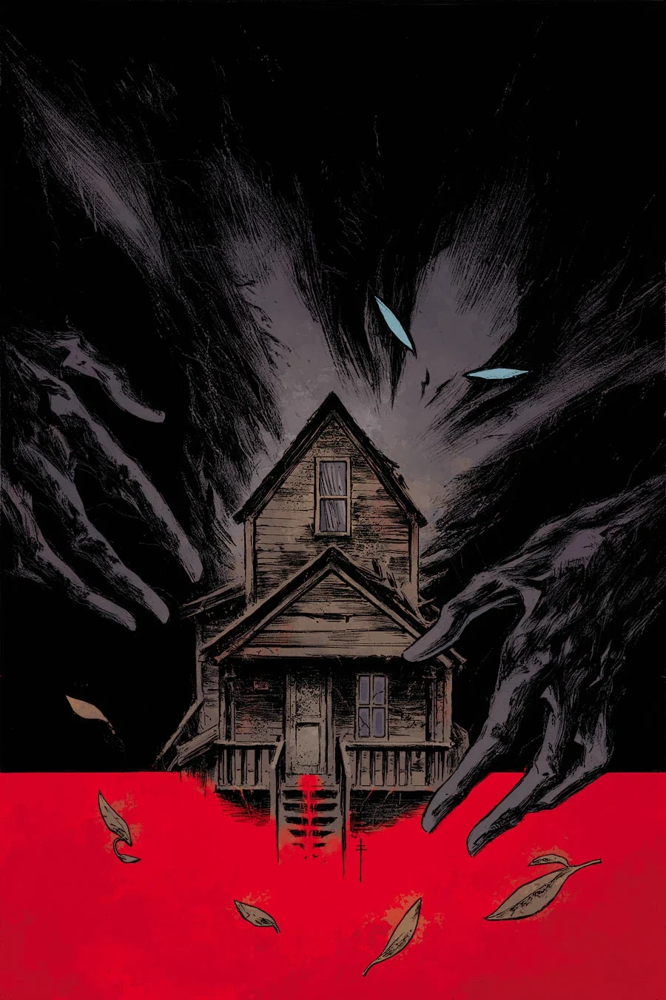

《**伊甸园（I）**》（The Garden (I)）是一个单期完结篇章，2014 年 5 月推出，由麦克斯·菲乌马拉（Max Fiumara）作画。

## 出版历史

这个故事最初以《伊甸园》（The Garden）之名刊载于《Abe Sapien》第 12 期；结集成平装合订本时，被重新命名为《伊甸园（I）》。后来揭示，它是一个主题三部曲的第一部。

## 剧情简介

亚伯的旅程迎来新的转折——在这个关于一段家庭关系彻底扭曲的乡野恐怖故事里，他遇到了一对变态的夫妇。

## 画廊

**Category:Story** **Category:Abe Sapien story** **Category:Abe Sapien: Dark and Terrible story**
