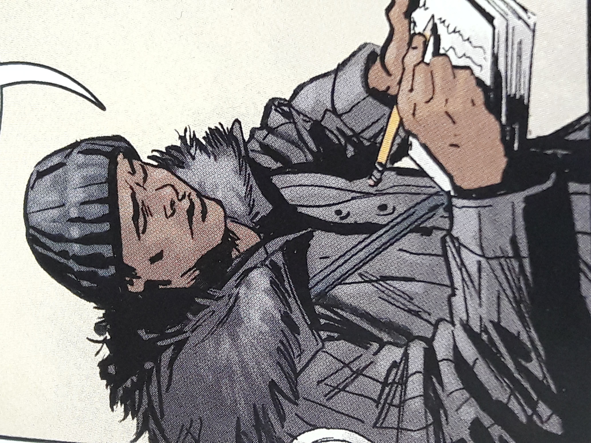

伍德罗·法瑞尔

**Woodrow Farrier** was a cryptozoologist and [B.P.R.D.](/entry/Bureau%20for%20Paranormal%20Research%20and%20Defense) affiliate.

## History

Woodrow was interested in science and cryptozoology; however, being a black man growing up in the 1940s he was not accepted in universities and research institutes. Woodrow was only able to gain a job teaching high school math in Chicago. But one day, he was tracked down by Professor [Trevor Bruttenholm](/entry/Trevor%20Bruttenholm), who gotten his hands on one of Woodrow's rejected research papers and recruited him to the B.P.R.D.

**Category:Characters** **Category:B.P.R.D. agent** **Category:Male Characters** **Category:Americans**