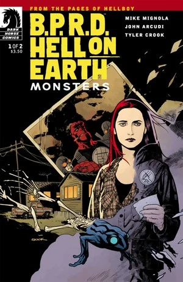
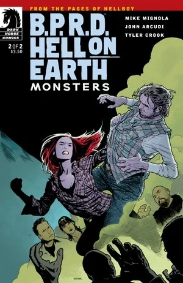

***《众兽》***（Monsters）是一部于 2011 年 7 月至 8 月出版的两期限定连载。

## 出版历史

本篇是[《人间炼狱》故事环](/entry/Hell_on_Earth_(story_cycle)))的第三个篇章，紧接《[诸神](/entry/Gods)》之后。各期封面由[瑞安·苏克](/entry/Ryan_Sook)绘制。这也是[泰勒·克鲁克](/entry/Tyler_Crook)（Tyler Crook）首次作为《B.P.R.D.》常驻画师参与的限定连载。

本篇与《[诸神](/entry/Gods)》一同收录于平装合订本《[B.P.R.D.：人间炼狱——诸神与众兽](/entry/Trade_Collections)》。

## 剧情简介

### 第一部

当[防御署](/entry/Bureau_for_Paranormal_Research_and_Defense)的人马在得克萨斯州与巨型蝙蝠耳怪兽鏖战时，[丽兹·舍曼](/entry/Liz_Sherman)正栖身于一处拖车停车场。

### 第二部

丽兹·舍曼被困在一个怪诞的拖车停车场里，四周尽是乡巴佬邪教狂徒；为了活命，她必须一路杀过那位“垃圾大祭司”的地盘。

## 画廊

\#1

\#1 变体封面（[弗朗切斯科·弗兰卡维拉](/entry/Francesco_Francavilla)（Francesco Francavilla）版，原图缺失）

\#2

**Category:B.P.R.D. story** **Category:B.P.R.D.: Hell on Earth story** **Category:Story**
