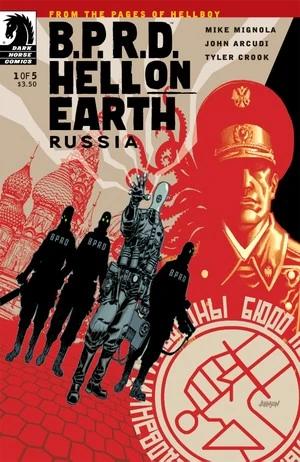
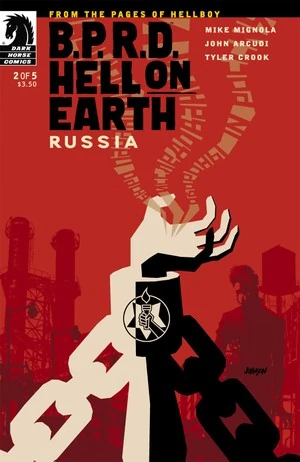
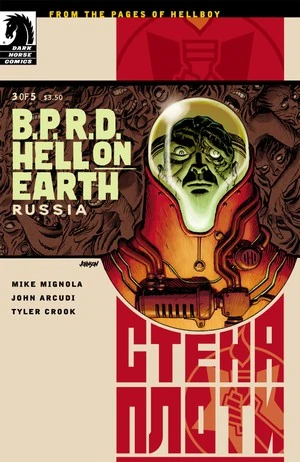

***《俄罗斯》***（Russia）是一部五期完结的迷你系列，于 2011 年 9 月至 2012 年 1 月间出版。

## 出版历史

这是[*人间炼狱*](/entry/Hell_on_Earth_(story_cycle)))系列的第四个故事篇章，接续《[众兽](/entry/Monsters)》。各期封面均由[戴夫·约翰逊](/entry/Dave_Johnson)（Dave Johnson）绘制。本篇章收录于《B.P.R.D.：人间炼狱——俄罗斯》（*[B.P.R.D.: Hell on Earth—Russia](/entry/Trade_Collections)*）合订本中。

## 剧情简介

### 第一部

俄罗斯一座矿井深处，人们挖出了一片变异怪物的坟场。此时丽兹仍然下落不明，亚伯·塞皮恩则躺在病榻上奄奄一息。刚刚走向国际化的超自然调查防御署（B.P.R.D.）派出凯特和约翰，去会见俄罗斯对口的超自然机构——读者最早在《[B.P.R.D.：1946](/entry/1946)》中见过它——并在克里姆林宫迎战一头会爆炸的真菌怪物，以及一场不断扩散的瘟疫。

### 第二部

在俄罗斯秘术局总部的保险库里，关押着一个被铁链锁住、受到严密监视的男人。凯特和约翰被请来协助调查，而俄罗斯局那位已是活死人的局长竟强迫他们与这个被附身的囚犯对决！

### 第三部

约翰被卷入一场灵体之战，与俄罗斯特殊科学局（Special Sciences Service）一名被附身囚犯体内的恶灵缠斗；与此同时，凯特得知了荒废小镇兰帕耶季克（Rampayedik）以及镇上神秘的丧尸劫掠者的事。

### 第四部

约翰直面奥格德鲁·赫姆的恶灵，凯特则与丧尸群作战。

### 第五部

在遭到无产者丧尸的凶残围攻之后，超自然调查防御署与俄罗斯机构不得不结成同盟，才能从一座致命的矿井中救出约翰。

## 画廊

\#1

\#2

\#3

\#4

\#5

**Category:Story** **Category:B.P.R.D. story** **Category:B.P.R.D.: Hell on Earth story**