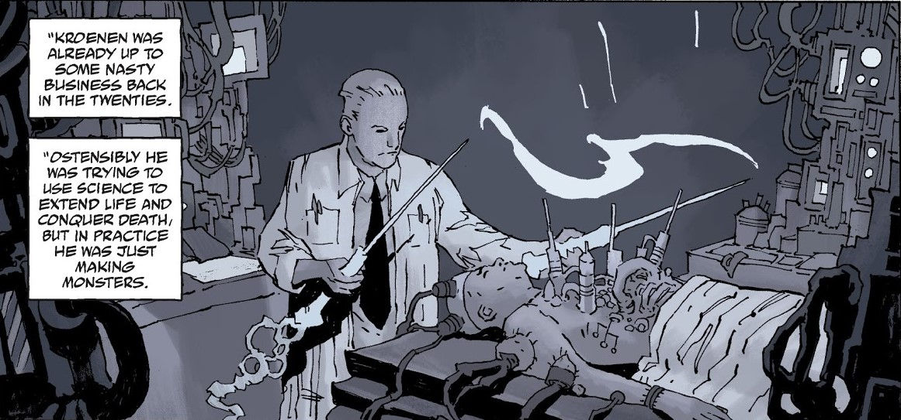
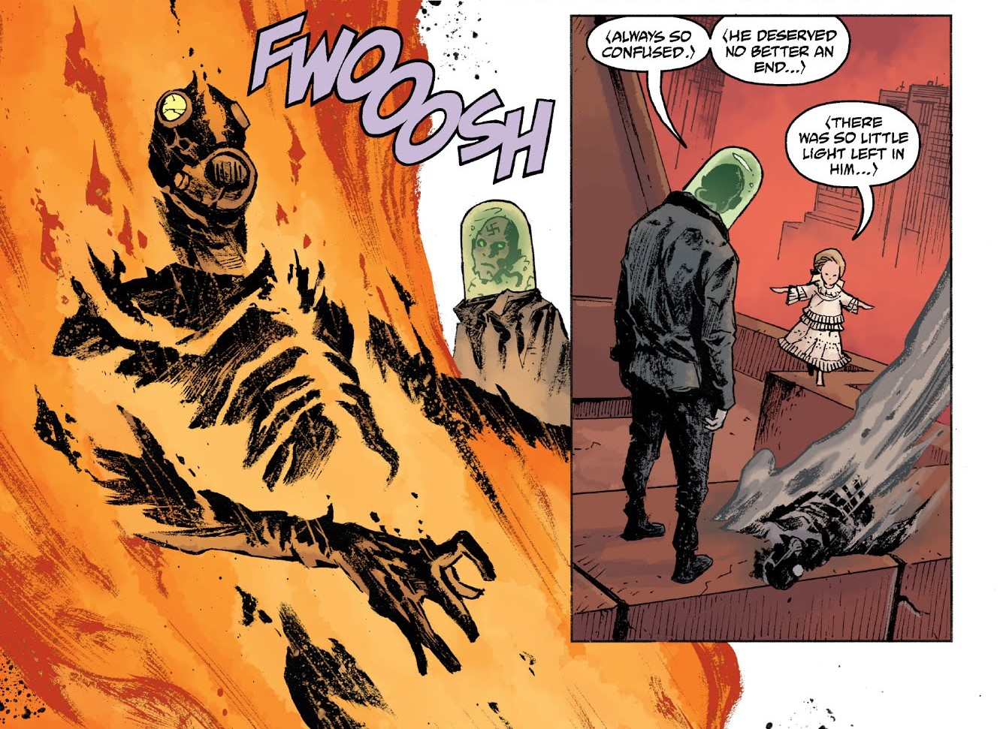
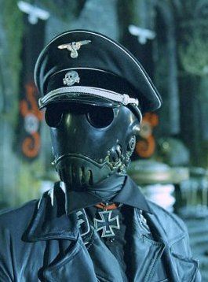
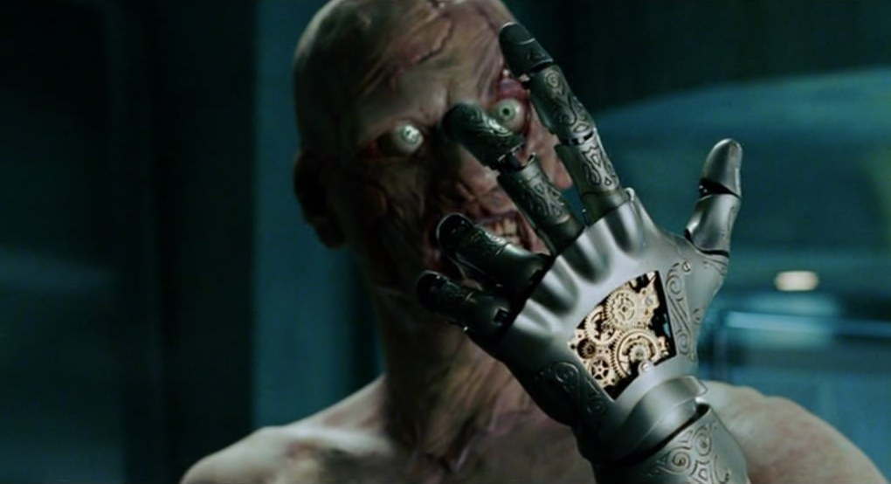
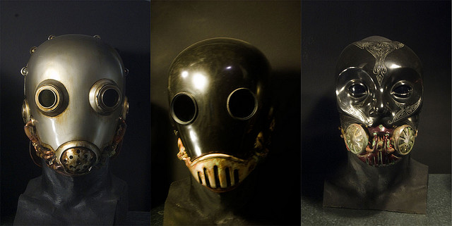

**Karl Ruprecht Kroenen** was a relatively unremarkable Nazi SS scientist, whose most distinguishing characteristic was that he always wore a gas mask and protective bodysuit, possibly due to severe obsessive-compulsive disorder and fear of bacteria.

He initially served Grigori Rasputin and his plans to bring about the end of the world. After failing to bring his master back from the dead, he allied with Varvara before being killled at her hands.

Director Guillermo del Toro created a significantly expanded biography for the character, to appear as a villain in the [2004 film adaptation](/entry/Hellboy%20%282004%20film%29).

## History

A German scientist trying to extend life and conquer death, Dr. Kroenen was already active in the 1920s. Working for the Nazis, and a member of the Thule Society, he was presumed to be involved in an attempt to harness the 'shakti' energy force in 1930. An accident during the attempt left Kroenen injured, and the operations that saved his life left him resembling his monstrous creations and bound to live in a protective bodysuit. His later work led him to run afoul of [A.N. Sandhu](/entry/A.N.%20Sandhu) a number of times.

Kroenen would eventually became one of the top scientists for [Project Ragna Rok](/entry/Project%20Ragna%20Rok), and a close disciple of [Grigori Rasputin](/entry/Grigori%20Rasputin), along with [Ilsa Haupstein](/entry/Ilsa%20Haupstein) and [Leopold Kurtz](/entry/Leopold%20Kurtz). While serving Rasputin became his main goal, Kroenen would be allowed to indulge in his own projects towards creating an unstoppable army for the Reich.

In 1941, under the auspices of 'Operation Geist', he and Kurtz summoned the spirit of Albert Mayhew and bound it to the body to a German soldier for Rasputin to find and gain access to the tomb of Eugene Remy. While in Paris to find the tomb, Kroenen set up a laboratory to continue his personal project, where he was discovered by Sandhu and a young [Trevor Bruttenholm](/entry/Trevor%20Bruttenholm). Kroenen initially had the upper hand until he was blinded and gunned down by Sandhu and left for dead. Recovering enough soon afterwards, Kroenen reached Rasputin in the catacombs and found that he had killed Sandhu himself. He witnessed Mayhew opening Remy's sarcophagus and Rasputin gaining the ancient tablet he sought in the wake or Remy's retribution. Kroenen was later present with Rasputin at the secret ritual in Scotland that brought [Hellboy](/entry/Hellboy) to the world.

Kroenen, Haupstein, and Kurtz were frozen inside a secret Nazi base sometime afterwards, until they were resuscitated in 1994 by industrialist [Roderick Zinco](/entry/Roderick%20Zinco), acting on Rasputin's orders. Kroenen resumed work on several of his former projects, including making an "Apocalypse Army" by combining corpses with robotics. He also convinced Zinco to retrieve the head of his colleague, [Herman von Klempt](/entry/Herman%20von%20Klempt), from South America. Kroenen retained an affection for his colleague, though Rasputin had rejected von Klempt as unsuitable for Ragna Rok. When von Klempt's head was re-animated, he tried to convince Kroenen to abandon Rasputin's plan - to awaken the Ogdru Jahad - and instead to use the Army to retrieve von Klempt's work in South America. Overhearing, Kurtz became furious and attacked von Klempt's head, screaming, "Rasputin is master!" In a panic, Kroenen seized a knife and stabbed Kurtz. When their plan failed, an enraged Rasputin struck Zinco blind. Wandering around, Zinco accidentally pressed a self-destruct button in the base, destroying it completely and seemingly taking Kroenen with it.

Kroenen survived the explosion and reappeared in a meeting room of the [Zinco Corporation](/entry/Zinco%20Corporation) with Leopold Kurtz many years later. Under the direction of Isiah Marsten, Kroenen began preparing a body to retrieve the soul of Rasputin, thinking it to be locked with the Ogdru Jahad. After acquiring a suitable body from the B.P.R.D., Kroenen and Kurtz succeeded before realizing that they had been duped by Marsten into bringing back the Black Flame instead.  As Marsten proceeded with his own plans and destroyed Zinco's collection Nazi relics, a disillusioned Kroenen saved von Klempt's head and escaped. Sometime later, he was found by [Varvara](/entry/Varvara), who reawakened von Klempt and invited the two men to join her cause to rebuild Pandemonium on Earth. Kroenen became increasingly skeptical of his choice and voiced his concern to von Klempt after Varvara seemed to intentionally lead Hellboy to them. While explaining that she was hiding something, Kroenen was set on fire by Varvara and his ashes scattered to the wind.

## Other media

### *Hellboy* (2004)

KarlKroenen.jpg

In the movie adaptation of Hellboy, Kroenen's character is altered to have him as an assassin and Thule Society member renowned for his swordsmanship and using signature swords of his design. Guillermo Del Toro provided an expanded biography which appeared in a series of comic panels in the book Hellboy: The Art of the Movie, as well as in the special features of the film's DVD).

Born in Munich Germany in 1897, Karl Ruprecht Kroenen was a musical prodigy with angelic features and blonde hair who toured the capitals of Europe singing opera until his voice deepened with the onset of puberty. From a very early age, Kroenen demonstrated symptoms of masochism, whipping himself with a fresh branch of oak each day. By his teenage years, feeling awkward, Kroenen's masochism developed into an extreme form of body dysmorphic disorder (termed "surgical addiction" in the film). In his obsession with physical perfection, Kronen conducted brutal experiments on his own body, including surgically removing his own eyelids, lips, and his toe- and finger nails. He also designed a tight-fitting gas mask to filter out germs, which he wore almost permanently. Kronen was quite adept with mechanical devices, believing that fusing mechanical constructs with living bodies would help create perfection. One of his early inventions was a clockwork nightingale that sang a Mozart aria perfectly.

In 1930, Kroenen met the resurrected Rasputin for the first time and quickly became his most loyal disciple. He subsequently joined the Nazi Party, and rose quickly through the ranks, joining the Schutzstaffel in 1933 and achieving the rank of Obersturmbannführer (Lieutenant Colonel). He was awarded the Iron Cross for services to the Third Reich, including a tour of duty as commandant of Auschwitz concentration camp, where he served with distinction. Kroenen became head of the Thule Society, a group of German aristocrats obsessed with the occult. He helped them to spearhead Project Ragna Rok, engineering the portal generator that would conjure the Scarlet Beast, Hellboy, in October 1944.

When Allied Forces stormed the island off the coast of Scotland where Project Ragna Rok took place, Kroenen killed several American soldiers attacking the base before a grenade is thrown under the portal device by a young Professor Trevor Bruttenholm. Kroenen tried to retrieve the grenade, but his left hand was ripped apart by the portal before being blown away and impaled through the chest by a length of rebar. Though this severed his spine, Kronen somehow managed to disappear in the aftermath of the battle. Twelve years later, an unmarked grave in Romania was found, and the body inside was confirmed through dental records to be Kroenen's.

 However, Kroenen reappeared in 2004. Thanks to the inexplicable powers of science and black magic, Kroenen "repaired" himself with a prosthetic mechanical hand, a steel rod replacing the broken part of his spine, and a clockwork heart operated by a wind-up key implanted in his chest. By cranking the key, he was able to increase his speed and reflexes. After long decades, the blood in his veins dried up completely, leaving only dust, and rendering him virtually invulnerable to gunshot wounds. He could also turn the key to "switch off" his body (literally), remaining in a dormant state and appearing dead, until he was reanimated. He used this deceptive technique to infiltrate the BPRD headquarters. After critically wounding BPRD Agent Clay, he faked his own death and lay beside Clay, and they were both taken into the headquarters. Once inside, Kroenen drew Rasputin there, and personally killed the now elderly Professor Bruttenholm, before disappearing with Rasputin.

The BPRD tracked Rasputin to his own mausoleum beneath Moscow. Hellboy seemingly avenged Bruttenholm's death by throwing Kroenen into a spiked pit hidden beneath a trapdoor. Skewered on the stakes, Kroenen then watched helplessly as Hellboy dropped a giant cog on top of him, his fate afterwards remains unknown.

### The Zinco Epilogue

He was set to reappear in the third installment, as an alternate ending meant to set up the start of the third movie was made. It had Zinco being led by Russian Mercenaries to his pit. After Zinco betrayed the mercenaries by having his men gun them down, he returns to Zinco Enterprises with his body in tow. However, his company is not willing to do the procedure as not only was it illegal, but borderline occultist. He then decides to go to the Arctic, where a remnant of the Project Ragna Rok base was located. After nearly being killed by a collapsing Ice Shelf, he then inserts Kroenen's head into a machine dome. Completely revived by the machine, Kronen laughs insidiously and tells his "master" that this was just what he promised. Zinco is initially confused as to why he called him Master, until he heard someone coming behind him. It turns out that Grigori Rasputin somehow returned from the grave and he tells Zinco and Kroenen that they have served them well and that he has one more task for them.

## Weapons and equipment

3579051548_62e79f734c_z.jpg

Karl wore the mask in the first picture when he is at the base, fixing himself. The second mask was shown when he needed to fight and readying for battle. The third mask made its appearance when Kroenen went to fake his death and kill Clay.

Kroenen's comics version is a fairly ordinary scientist, who seems to possess some surgical training.

In his initial appearance, while wearing a Schutzstaffel black uniform, Kroenen wields a Luger P08 pistol against the attacking U.S. soldiers, and then a pair of Katar (कटार)-like (shodo) daggers that extend from the sleeves of his trench coat.

In his later appearances, he wields a pair of tonfa blades, and also has several other daggers strapped to his suit.

Kroenen is also briefly seen in his workshop, which many disturbing gadgets and several different versions of his gas mask are seen.

## Trivia

- Kroenen's battered gas mask can be seen several times in *Hellboy II* in a display case along with a golden mask that resembles the head of [Sammael](/entry/Sammael).
- Kroenen has killed Allied troops, [BPRD](/entry/Bureau%20for%20Paranormal%20Research%20and%20Defense) agents, and [Trevor Bruttenholm](/entry/Trevor%20Bruttenholm), the man who threw the grenade which took his hand.
- This portrayal in the film is radically different from the comics. Kroenen, who originally played the part of a meek character, who Del Toro describes as someone who is likely to say "Aargh! Don't break the machine!" is here portrayed as a murderous soldier who is inhumanly loyal to Rasputin.
- In the original script for *Hellboy*, the young Professor Bruttenholm describes Kroenen as "one of the Reich's top scientists, and head of the Thule Occult Society." In the film release, the line was re-dubbed so that the first phrase was replaced by "Hitler's top assassin."
- The film incarnation of Kroenen bears many striking similarities to [Voldo](http://soulcalibur.wikia.com/wiki/Voldo) of the *[Soulcalibur](http://soulcalibur.wikia.com/wiki/Soulcalibur_Wiki)* series of fighting games.

## Gallery

文件:Kronen.jpg 文件:Hellboy-kroenen-011.jpg 文件:Dvd3.jpg 文件:Dvd1.jpg 文件:Dvd2.jpg 文件:Kroenenfilm.jpg 文件:Kroenen1.jpg 文件:Kroenenmuseum.png 文件:Kroenenmusic.jpg 文件:Kroenen story by kroenen4millennium.jpg

de:Karl Ruprecht Kroenen **分类:人物**

**Category:Nazi** **Category:Villains** **Category:Male Characters** **Category:Germans** **Category:Humans** **Category:Scientists** **Category:Zinco Corporation** **Category:Hellboy (2004 film) characters** **Category:Hellboy characters**