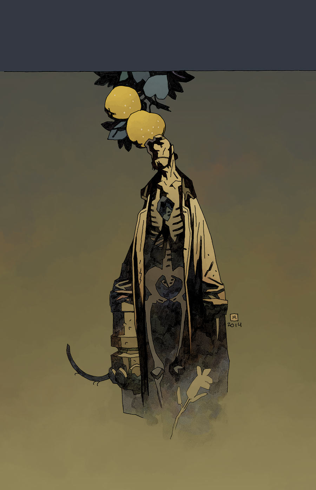
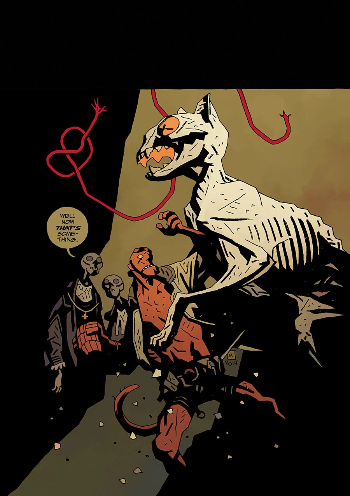

《**冥王之犬**》（The Hounds of Pluto）于 2015 年 8 月至 9 月推出。这个故事结集成书时，第一部被重新命名为《霍夫曼博士的审判》（The Trials of Dr. Hoffmann）。

## 剧情简介

### 第一部：《霍夫曼博士的审判》

一种疾病正一点点侵蚀着[地狱男爵](/entry/Hellboy_(character))。尽管他已经死了，却仍有可能迷失自我，沦为游荡在地狱中的空洞幻影之一。一队医生承诺能治好他，但他们先要从他身上取一样东西……

### 第二部：《冥王之犬》

一只木乃伊化的猫、一场地狱中的审判、一次可怖的家庭团聚——这一切都横亘在地狱男爵寻求治愈的道路上。

## 画廊

\#7：《冥王之犬（第一部）》

\#8：《冥王之犬（第二部）》

**Category:Story** **Category:Hellboy in Hell story** **Category:Hellboy story**
