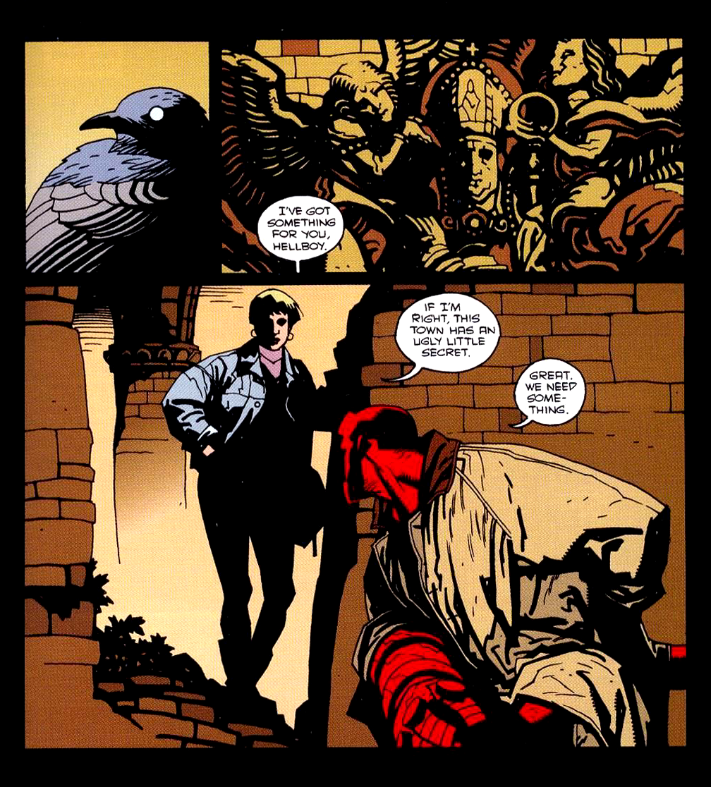
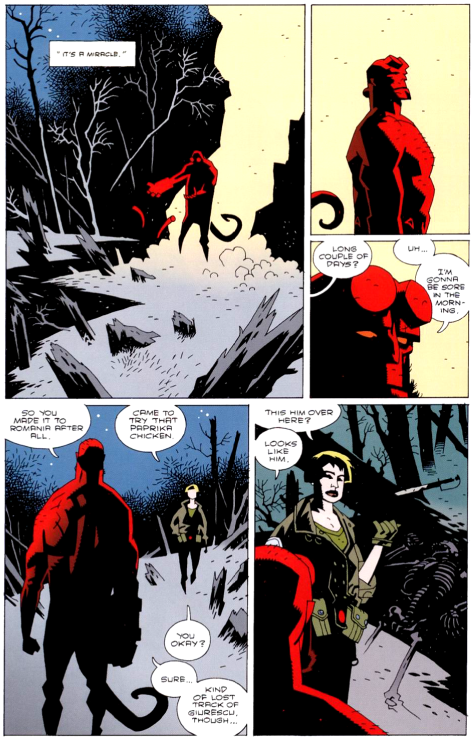
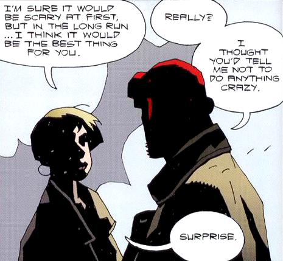
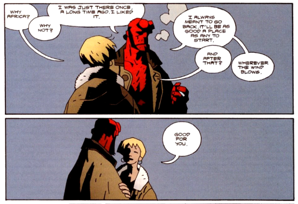
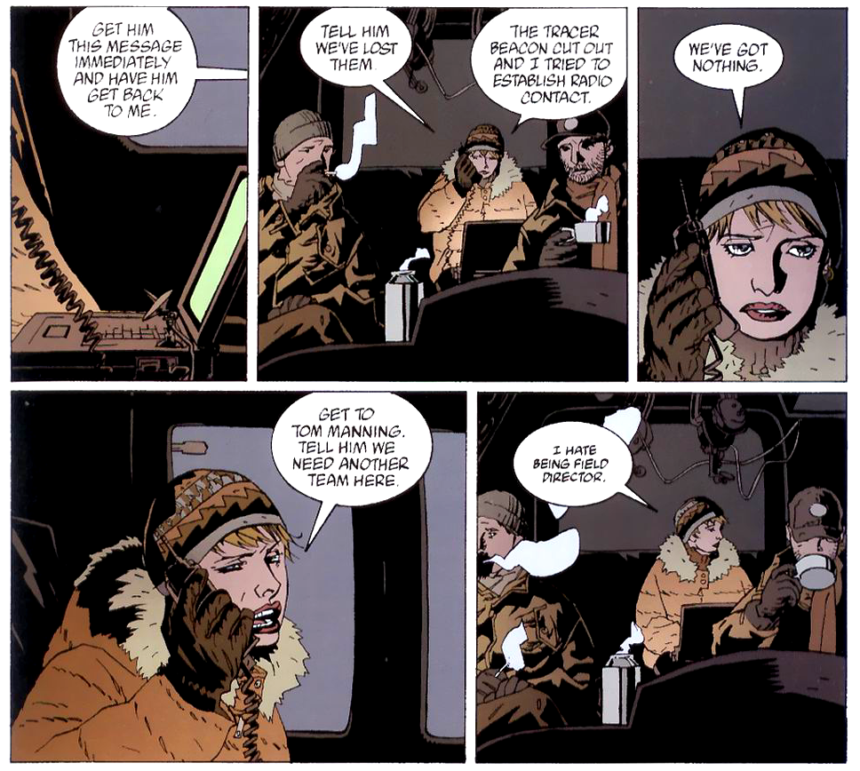
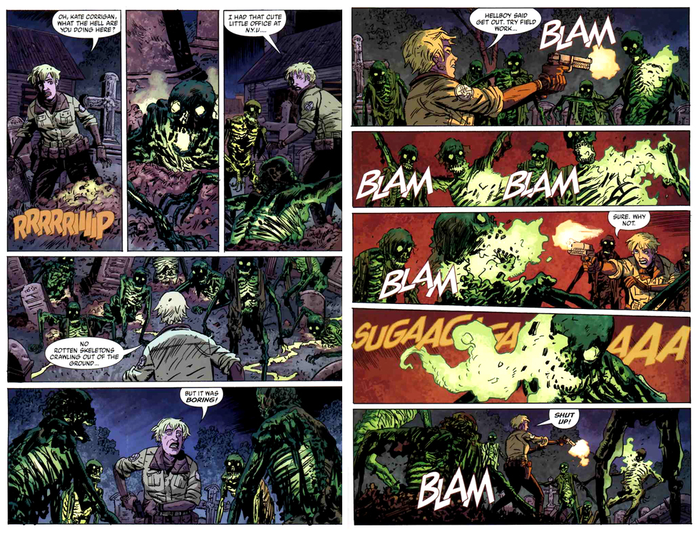
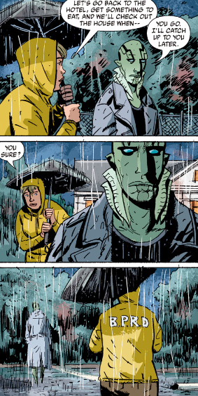
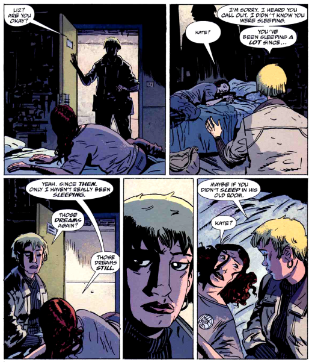
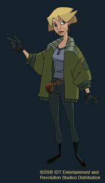

Doctor **Katherine "Kate" Corrigan** is the current liaison to the enhanced talent agents of the [Bureau for Paranormal Research and Defense](/entry/Bureau%20for%20Paranormal%20Research%20and%20Defense). Kate is a normal, human member of the B.P.R.D. who was initially hired on for her expertise in scholarly knowledge of folklore and the occult. Through her tenure in the series, she has gradually became almost exclusively involved in the practicalities of running the Bureau. First appearing in *[The Wolves of Saint August](/entry/The%20Wolves%20of%20Saint%20August)*, Kate was present in a number of the early [Hellboy (series)](/entry/Hellboy%20%28series%29) comics, and is featured as a main character in *[B.P.R.D.](/entry/B.P.R.D.%20%28series%29)*.

## History

### Life Before the B.P.R.D

Dr. Corrigan was born in Oakland, California in 1958. She completed her BA with honors at University of California Berkeley in 1980, and her PhD at the University of Bucharest. Working towards her PhD, she traveled throughout Europe, recording the oral traditions of the villages she visited, which she later compiled into one of the recognized primary texts of occult research. She began her tenure as a professor of history at New York University (specializing in Folklore) in 1983. She has since written sixteen academic books on highly specialized folklore and occult history, including the confessions of Isobel Gowdie.

In 1983, she also began her long career at the [Bureau for Paranormal Research and Defense](/entry/Bureau%20for%20Paranormal%20Research%20and%20Defense), initially as an independent consultant. Through her consult work, she met [Hellboy](/entry/Hellboy%20%28character%29) in 1984. With the intent of writing a book, they began a series of interviews in 1985. The book was never published, but instead they established a very close, long-lasting friendship, Over the years, Kate became the one person that Hellboy trusted enough to confide in his private concerns.

### Massacre of Griart

 After almost ten years of goading by Hellboy, Kate finally went on her first field mission in May 1994. She and Hellboy investigated the mass murders in the small Balkan village of Griart. After recognizing the village from an obscure medieval text, Kate deduced that the village must be the cursed village of St. August and thus the killings were being performed by Werewolves. Upon this discovery, the last remaining werewolf chases the two of them down. Hellboy took him out, and Kate for the first time saw her friend of 10 years in action. The whole experience was clearly a shock for the academic, but with Hellboy's sympathetic reassurances, she decided she was ready for more.

### The Homunculus of Romania

 [Hellboy (character)](/entry/Hellboy%20%28character%29), [Abe Sapien](/entry/Abe%20Sapien), [Elizabeth Sherman](/entry/Elizabeth%20Sherman), [Sidney Leach](/entry/Sidney%20Leach), [Bud Waller](/entry/Bud%20Waller), and Clark set off to Romania in search of [Vladimir Giurescu](/entry/Vladimir%20Giurescu). Kate briefed the entire team prior to departure and expressed a desire to go herself, though she was turned down, citing that "only *real* Bureau field agents this time," were to come, presumably referring to *[Wolves](/entry/The%20Wolves%20of%20Saint%20August)*. Hellboy himself tried to coax her into joining him, though she remained at headquarters while the team flew off to Romania.

As the mission deteriorated rapidly, with the incapacitation of Liz Sherman, the destruction of Castle Giurescu, the loss of contact with Hellboy, and the destruction of the BPRD transport planes, Kate left Fairfield to assist on the ground in Romania. She arrived in time to meet Hellboy as he recovered from his brush with his greater destiny.

At the same time as Hellboy's encounter with Giurescu, Liz Sherman had her first encounter with the homunculus that would be known as [Roger](/entry/Roger). Liz was drawn to the homunculus and, sensing a way to be rid of her fire, put her finger in a metal opening in the body's chest. Instantly, her fire was drained into the creature, bringing it to life. The homunculus escaped, leaving Liz listless and slowly dying without the fire that was somehow tied to her life-force. In hopes of catching the homunculus to restore Liz's life-force, Kate and Hellboy set out across the Romanian countryside.

They eventually arrived at the Monastery of Capatineni to discover the two homunculi and a gigantic tower of molten human fat. There, Kate was captured by the [elder homunculus](/entry/Roger%27s%20brother), who planned on using her body as the final ingredient for creating a giant body out of human fat. Fortunately, the homunculus (whom Hellboy had dubbed Roger) rescued her just in time. Hellboy joined them just as the Colossus homunculus rose and the three of them leapt from the tower. Roger won over his brother and the three of them returned to Liz to successfully restore her from death.

### The Bromhead/Guarino Business

 After the encounter with [Igor Bromhead](/entry/Igor%20Bromhead) and [Ualac](/entry/Ualac), Hellboy wandered off on his own to the Avebury stone circles in Wiltshire, England. There, Kate found him and he confided in her his fears for the grand destiny he was trying to ignore and avoid. She encouraged him to face whatever was coming, rather than try to dodge it. All the same, he decides to "bury his head one more time" and returns to the Buruea for two more years.

Also in 1999, Kate was promoted to Assistant Director of Field Operations at the BPRD. It is unclear whether it was before or after this mission.

### Conqueror Worm

 After the events of *[Almost Colossus](/entry/Almost%20Colossus)*, Roger was later revived by BPRD scientists. However, as part of a fail safe, Field Director [Thomas Manning](/entry/Thomas%20Manning) implanted a small bomb in Roger's chest. As a result of this betrayal of trust, Hellboy quit the BPRD. He told Manning flat out that he quit and nothing more. However, before leaving, he confided in Kate one last time. He admitted that, more than just what happened with Roger, it was time for him to follow the advice she gave him back in 1999. She promised him she will take care of things at the Bureau for him and begs him to take care of himself. With that, he leaves for further adventures, likely never to see her again.

### Director of Field Operations

A year after Hellboy's departure in [*Conqueror Worm*](/entry/Conqueror%20Worm%20%28story%29), Kate was promoted to Director of Field Operations in 2002, in which she was in charge of organizing missions, which often involved accompanying agents to mission locations via helicopter or plane, or from the office at home base.

### Hollow Earth

Kate welcomed new agent [Johann Kraus](/entry/Johann%20Kraus), while there was a quiet dis-ease with her other remaining agents, [Roger](/entry/Roger) and [Abe Sapien](/entry/Abe%20Sapien) ([Liz Sherman](/entry/Liz%20Sherman) having already left some time off-page). With Hellboy gone, Abe and Roger seriously considered leaving, a desire Abe expressed directly to Kate. This reflected a reoccurring conflict throughout Kate's time as Field Coordinator, wherein Kate's position within the bureaucracy of the B.P.R.D. limited the trust her agents could place in her.

 However, before Abe was able to leave, Elizabeth Sherman appeared before him and begged him to help her. This led to the mission to Agartha Temple to rescue Liz, on which Kate acted as Field Coordinator, briefing Roger and Abe on the trip over and awaiting their eventual return. As it is the first time the reader is shown Kate's perspective on the mission, it is of note that she worried extensively for her agents, doing everything she could, though it appears she spends most of the time nervously waiting for bad news. She eventually recovered the team in Scotland.

### Plague of Frogs

 Kate acted as Field Coordinator for both the mission to New Jersey, to inspect the theft of the fungal growth collected from Cavendish Hall and the follow-up pursuit mission to Crab Point, Michigan. Upon the approach, the B.P.R.D. helicopter was forcefully crashed and Kate was thrown from the craft. Recovering quickly, she was the only agent to return to the wreckage and attempted to make contact with B.P.R.D. headquarters. Meanwhile, Abe Sapien, Elizabeth Sherman, Johann Kraus and the other remaining agents were captured and held within a church. There, Humbert T Jones aka the West Virginia Miracle Boy, presented the result of the Cavendish fungus, a gigantic, mushroom/humanoid [Sadu-Hem](/entry/Sadu-Hem), and revealed his own power to turn humans into frog creatures. Kate remained trapped outside the church, where she was attacked by the bodies of the dead, risen by Jones' actions. Kate held them off with her handgun, prompting a reevaluation of her life to this point, until Liz rejoined her and fended them off with fire. Together with Johann, they recovered Abe and airlifted him out to medical attention. They all escaped largely intact, though many frog creatures survive to continue to infect humanity.

### The Dead and The Black Flame

 While the rest of the team moved the B.P.R.D headquarters to Colorado, Kate and Abe took a side trip to Littleport, Rhode Island. There, they researched Langdon Everett Caul, the man Abe once was. Together, they went over what could be found in the town archives. After they finished, Abe set off on his own to confront the ghost of his wife, Edith Caul, without Kate. Kate was left to wait out the rising storm, presumably caused by this encounter, unable to reach Abe.

Abe, now distracted and despondent after his encounter with his dead wife, joined Kate as a Field Coordinator. Worried, she urged him to return to the field and to seek help with a counselor, but he still refused. Roger, now more active in the field after imprinting on the militaristic [Ben Daimio](/entry/Ben%20Daimio), was tragically blown up while on mission. Kate tried to comfort Liz, who was incredibly distraught at the loss.

 After Liz expressed concern for Abe, Kate returns to the mission room to discover a sudden frog invasion headed right for Abe and his team. However, the warning was too late and contact was lost as the frog army marched and Kathu-Hem rose. Abe and crew were left to fight for their lives, while Kate and Liz could only worry, powerless to help. However, once again, Kate's professional obligations, in this case, to protect the general populace, were made a priority over rescuing Abe. The two women clash over this, but Johann offered a solution.

At Johann's urging, Kate sat in while he tried to trigger Liz's connection to the mysterious [Memnan Saa](/entry/Memnan%20Saa) in hope of answers. The connection triggered an epiphany in Liz, reminding her of an item Roger kept. While Kate remains at the Bureau, Liz and the other agents on the scene manage to destroy Kathu-Hem.

After they returned, Johann led Kate to the remains of Roger. There, they discovered the remains being sawn apart by B.P.R.D., which Johann forcibly stopped, blaming Kate, though she was just as outraged and kept out of the loop as he was.

### The Universal Machine

In Kate's most dangerous mission to date, she was captured by an ageless marquis, Adoet de Fabre, who wished to trade her for the corpse of Roger. She was able to escape by slicing off the marquis' fingers with a knife and destroying one of his rings. The ring, belonging to King Solomon, held the Demon Marchosias in thrall, so the monster allowed Kate to live while he razed the marquis' treasures and carried him off to Hell.

## Other media

Kate Corrigan in the Hellboy Animated series.

- Kate appears as one of the main characters in the straight-to-DVD animated film *[Hellboy: Sword of Storms](/entry/Hellboy__Sword_of_Storms)*, and a supporting character in *[Hellboy: Blood and Iron](/entry/Hellboy__Blood_and_Iron)*. In both appearances, she is voiced by Peri Gilpin.

## External Links

- Kate Corrigan at Wikipedia

**Category:Characters** **Category:B.P.R.D. agent** **Category:Living Characters** **Category:Americans** **Category:Female Characters** **Category:Humans** **Category:Hellboy Animated Characters**