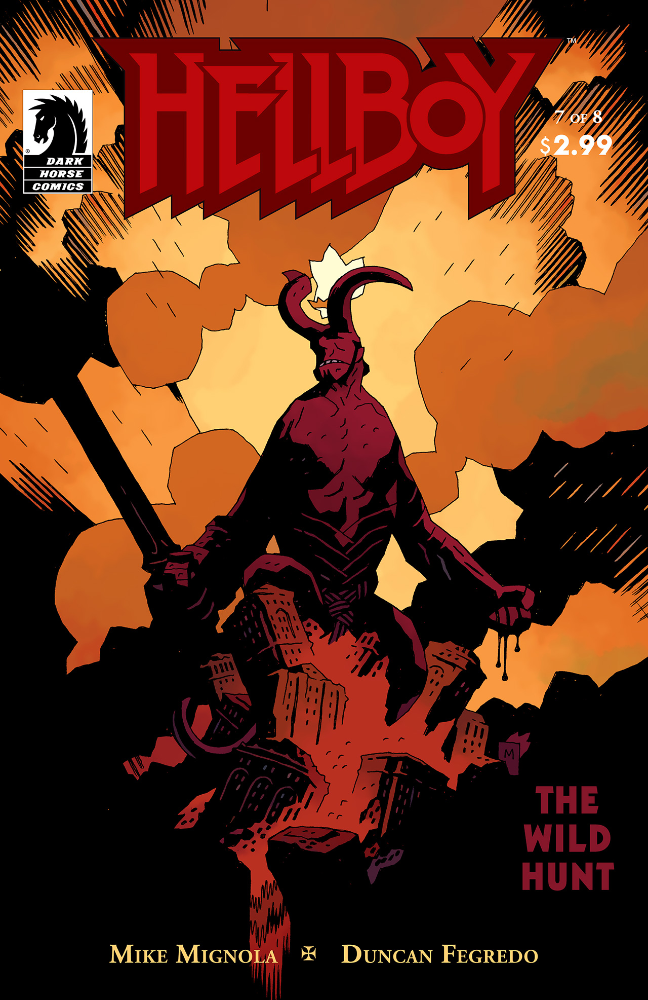

A short tale of the witchfinder, [Henry Hood](/entry/Henry%20Hood).

## Publication History

*The Burial of Katharine Baker* was published in October of 2009 as the backup story to *[The Wild Hunt](/entry/The%20Wild%20Hunt)* \#7. The story was collected in April 2010 in [*Witchfinder – Volume 1: In the Service of Angels*](/entry/TPB).

## Synopsis

R.S. Forsythe sits at his desk writing a letter to the Archbishop in 1667. He tells of his work under [Henry Hood](/entry/Henry%20Hood) and the good he did.

In 1646 a young woman, Katharine Baker, was accused of being a witch. She was found guilty and hanged. The girl's family stopped Hood from leaving. The family asked that the girl be buried with her kin and not in a shallow hole. He took the family to her current resting place, but a bearded man was already there pulling her from the ground. The man said he was her father come to take her home, but the girl's father protested that she would come back with him. The stranger said he was more of a father to the girl than the other man, and that he would not abandon her now. Hood began to recite from the bible, but the figure slapped the book from his hands. Hood stabbed the figure, and he erupted into flames revealing himself as a demon. The demon told her family that she had done far worse things than they know. He warned Hood that he was making powerful enemies and disappeared.

Forsythe and Hood left the town, never knowing where the family decided to ultimately bury the girl.

**Burial of Katharine Baker, The** **Burial of Katharine Baker, The**