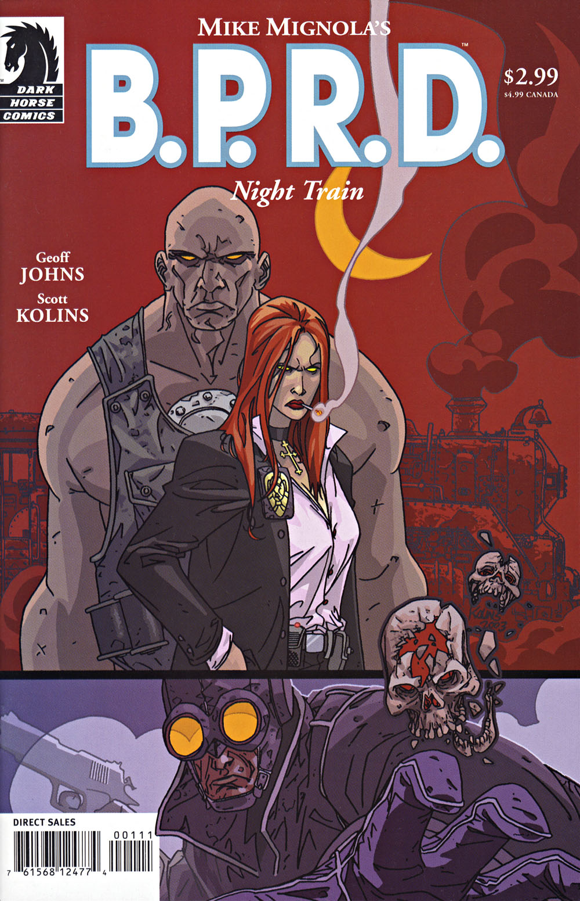

在***《午夜列车》***（Night Train）中，[丽兹·舍曼](/entry/Elizabeth_Sherman)与[罗杰](/entry/Roger)前往科罗拉多州，调查一列与[大螯虾强生](/entry/The_Lobster)有关的幽灵列车。

## 出版历史

《[空心地球](/entry/Hollow_Earth)》之后，B.P.R.D. 漫画将走向何方一度并不明朗。2003 年 5 月至 11 月间，每隔一个月推出一篇单篇故事，共四篇：《[威尼斯之魂](/entry/The_Soul_of_Venice)》、《[黑水之域](/entry/Dark_Waters)》、《午夜列车》和《[床下有鬼](/entry/There%27s_Something_Under_My_Bed)》。与此同时，在"休刊"月份，黑马漫画出版了[脱离正传时间线](/entry/Hellboy_Comics)的选集《地狱男爵：怪谈》（*Hellboy: Weird Tales*）。

《午夜列车》于 2003 年 9 月出版，后于 2004 年 8 月被收录进合订本《B.P.R.D.：威尼斯之魂及其他故事》（*[B.P.R.D.: The Soul of Venice & Other Stories](/entry/Trade_Collections)*）。

## 剧情简介

1939 年，在科罗拉多州，[大螯虾强生](/entry/Lobster_Johnson)正在一列行驶中的火车车顶追击一名纳粹破坏分子，车上载着运往"曼哈顿计划"的科学家和设备。火车驶上一座大桥时，强生追上了纳粹，但纳粹跳车并跳伞逃生。大桥随即爆炸——强生侥幸生还，科学家们和他的助手却全部遇难。

[丽兹·舍曼](/entry/Elizabeth_Sherman)和[罗杰](/entry/Roger)被派往阿拉巴马州科顿维尔（Cottonville）调查一列幽灵列车现身的事件。他们扎营守候，当晚幽灵列车抵达。列车停下，一群军人跑下车，四处搜寻什么。幽灵们包围了一栋房子，丽兹和罗杰闯入查看屋内情况。他们在屋里发现了一个老人——正是 1939 年炸毁那列火车的人。老人向他们求助，却突然把一个装置安到丽兹身上，让幽灵们转而去追她。幽灵把丽兹拖回了列车。

大螯虾强生的幽灵现身，让罗杰去追丽兹。罗杰登上幽灵列车并摧毁了装置。幽灵士兵们带走那个老德国人、让他迎来应有的下场时，罗杰抱着丽兹离开了列车。

## 内容

### 角色

- [大螯虾强生的小队](/entry/%3ACategory%3ALobster%27s%20crew)
  - [大螯虾强生](/entry/The_Lobster)（回忆与幽灵形态）
  - 龙虾的助手（回忆出场）
- [纳粹](/entry/%3ACategory%3ANazi)特工
- [超自然调查防御署](/entry/Bureau_for_Paranormal_Research_and_Defense)（B.P.R.D.）
  - [丽兹·舍曼](/entry/Elizabeth_Sherman)
  - [罗杰](/entry/Roger)
  - [汤姆·曼宁](/entry/Thomas_Manning)
  - [地狱男爵](/entry/Hellboy_%28character%29)（罗杰的想象）
  - [亚伯拉罕·塞皮恩](/entry/Abraham_Sapien)（罗杰的想象）
  - [凯瑟琳·考瑞根](/entry/Kate_Corrigan)（罗杰的想象）
  - [约翰·克劳斯](/entry/Johann_Kraus)（罗杰的想象）
  - 其他职员
- 美军士兵幽灵

### 地点

- 美国
  - 科罗拉多州铁路沿线
  - [B.P.R.D.](/entry/Bureau_for_Paranormal_Research_and_Defense) 总部（康涅狄格州费尔菲尔德）
  - 阿拉巴马州科顿维尔（Cottonville）
