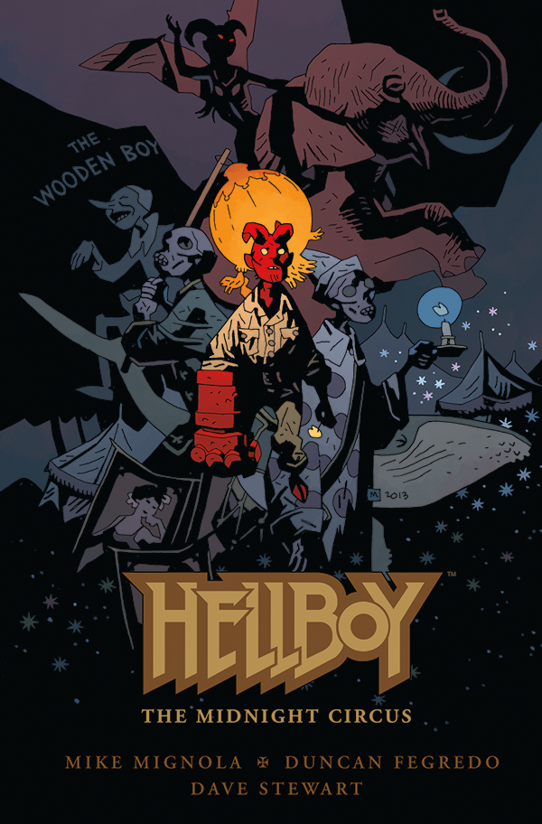

## Publication History

*The Midnight Circus* is the second Hellboy original graphic novel. It was formally announced at C2E2 2013.

## Original Press Release

Following up on a collaboration which spanned multiple series, leading up to Mike Mignola’s return to both writing and drawing his beloved demon, artist Duncan Fegredo returns to tell a story about a young Hellboy’s first brush with Hell. In this beautifully drawn fifty-six-page graphic novel, a young Hellboy runs away from the B.P.R.D., only to stumble upon a weird and fantastical circus and the few demons from hell who inhabit it.

“This one owes a lot to Ray Bradbury’s *Something Wicked This Way Comes* (pretty much my favorite circus story of all time), but even more to *Pinocchio*—especially all the spooky, disturbing bits Disney left out. And the work Duncan is doing here is just flat-out amazing,” said Mike Mignola.

“Growing up is tough enough, even when you don’t know the weight of the world rests on the future of your yet-diminutive shoulders. Mike has woven a tale of coming of age for the young Hellboy made all the more poignant for knowing his future. Wonderful, magical, terrifying, this is epic *Hellboy* on a smaller stage,” Duncan Fegredo added.

*Hellboy: The Midnight Circus* arrives in a beautiful hardcover format similar to the previously released *[Hellboy: House of the Living Dead](/entry/House%20of%20the%20Living%20Dead)* (created in collaboration with legendary artist Richard Corben in 2011). This new tale arrives on shelves on October 23, carrying a retail price of $14.99.

**Midnight Circus, The** **Midnight Circus, The**