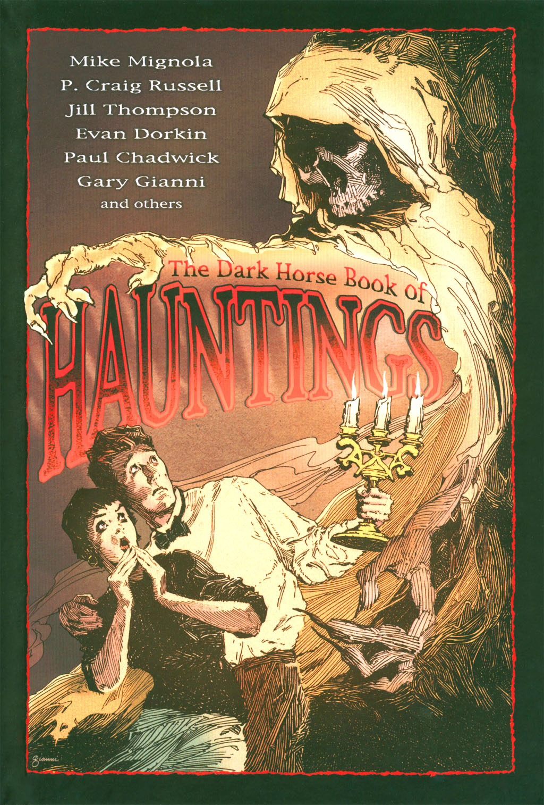

[Hellboy](/entry/Hellboy) explores a haunted house in Long Island. This story introduced the [Heliopic Brotherhood of Ra](/entry/Heliopic%20Brotherhood%20of%20Ra).

## Publication History

*Dr. Carp's Experiment* was published as part of the anthology *The Dark Horse Book of Hauntings* in August 2003. The volume is part of \[<https://en.wikipedia.org/wiki/The_Dark_Horse_Book_of>... *Dark Horse Book of...*\] series of horror anthologies.

## Synopsis

In 1991, [Hellboy](/entry/Hellboy) is sent to assist [Pauline Raskin](/entry/Pauline%20Raskin) and her team in the search of a haunted house. The house was owned by Dr. Carp, “the Grand Master of the Golden Lodge, the [Heliopic Brotherhood of Ra](/entry/Heliopic%20Brotherhood%20of%20Ra).” Dr. Carp disappeared in 1902, and the house passed to his sister until her death in 1911. The [Bureau](/entry/B.P.R.D.) sent psychics the investigate over the years, but nothing too bad was ever reported.

A new blueprint of the house surfaced and revealed a hidden basement room. In light of what happened in Castle Glamis (as seen in [Wake the Devil](/entry/Wake%20the%20Devil)), the room remained sealed for Hellboy to investigate. As Hellboy enters the room, two men attack him with electrified spears. While subdued, Dr. Carp extracts some of Hellboy's blood, and injects it into a chimpanzee strapped to a table. The chimp breaks is bonds and quickly changes into a demonic creature. The Demon attacks the men, and one is able to shoot the creature, but not before the men are all badly wounded.

Hellboy hits the floor and wakes up in the room covered in cobwebs. Confused he asks Raskin how long he was in the room. She tells him is had only been two seconds. In the room are the long dead bodies of the men and the dead demon. The team decides that Dr. Carp must have died there and that his sister had the room bricked up. Hellboy looks down and picks up a syringe, still containing traces of his blood.

## Story Chronology

The story takes place in 1991.

Dr. Carp was born in 1836, the same year as Martin Gilfryd.[1]

## Trivia

- The story had many unreleased prior versions, including one where the scene with Dr. Carp takes place in [*Conqueror Worm* \#3](/entry/Conqueror%20Worm%20%28story%29), replacing the scene with the heads.

## Notes

<references/>
! colspan = 3 | [*Hellboy – Volume 7: The Troll Witch and Others*](/entry/TPB)

sv:Dr. Carp's Experiment

**Dr. Carp's Experiment** **Dr. Carp's Experiment**

[1] According to *[The Black Goddess](/entry/The%20Black%20Goddess)* \#1, Gilfryd was 101 in 1937.