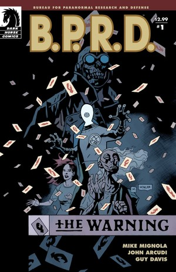
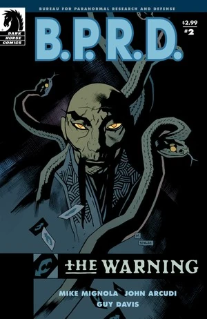
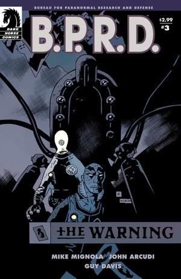
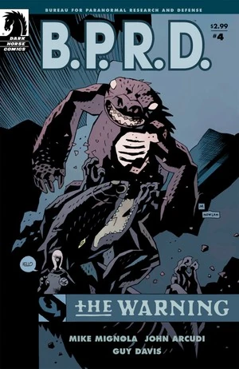
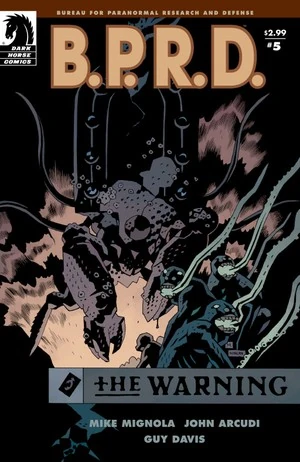

***《厄运之兆》***（The Warning）是一部五期限定连载，也是《[焦土三部曲](/entry/Scorched_Earth_Trilogy)》的第一部。故事围绕[亚伯·塞皮恩](/entry/Abraham_Sapien)、[丽兹·舍曼](/entry/Liz_Sherman)、[凯特·考瑞根](/entry/Kate_Corrigan)博士、[约翰·克劳斯](/entry/Johann_Kraus)和[潘雅](/entry/Panya_%28character%29)展开——他们试图查明不断出现在丽兹梦中的神秘男子究竟是何身份。

## 出版历史

这部五期限定连载于 2008 年 7 月至 11 月出版。2009 年 4 月，它与《[遥不可及](/entry/Out_of_Reach)》一并收录进平装合订本《B.P.R.D.：厄运之兆》（*[B.P.R.D.: The Warning](/entry/Trade_Collections)*）。

## 剧情简介

### 第一部

首期开篇承接《[杀戮地带](/entry/Killing_Ground)》的余波，随后潘雅、约翰·克劳斯、凯特·考瑞根和丽兹·舍曼参加了一场由约翰·克劳斯主持的通灵会，试图与[大螯虾强生](/entry/Lobster_Johnson)取得联系。通灵为他们留下了一条线索：墙上用大螯虾强生的卡片拼出了"GILFRYD"（吉尔弗瑞德）的字样。

随后潘雅运用她的心灵感应能力进入那名神秘男子的意识，确认他就是[马丁·吉尔弗瑞德](/entry/Martin_Gilfryd)，并揭示自己已经找到了他巢穴的位置。

### 第二部

丽兹梦中那位神秘绅士的实力远超 B.P.R.D. 的预料，而他们也一步步落进他的圈套；亚伯被迫放弃了对戴米奥的搜寻。

### 第三部

队伍受困、又失去了一名队友，亚伯、凯特和约翰发现局势远比他们想象的更糟——又一个宿敌重新浮出水面。

### 第四部

丽兹依然下落不明，防御署的其余成员则在慕尼黑街头与巨型机器人正面交锋。

### 第五部

亚伯、约翰和凯特发现，他们的宿敌们已经联手，威胁着要撼动世界的根基。

## 内容

注：平装合订本与精选合订本（Omnibus）所收录序幕的内容，见《[遥不可及](/entry/Out_of_Reach)》。

### 角色

#### [超自然调查防御署](/entry/Bureau_for_Paranormal_Research_and_Defense)（B.P.R.D.）

- [亚伯拉罕·塞皮恩](/entry/Abraham_Sapien)
- [丽兹·舍曼](/entry/Elizabeth_Sherman)
- [凯瑟琳·考瑞根](/entry/Kate_Corrigan)
- [安德鲁·德文](/entry/Andrew_Devon)
- [约翰·克劳斯](/entry/Johann_Kraus)
- [潘雅](/entry/Panya_%28character%29)
  - 奥利（Olly）
  - 变异动物
- 多丽丝（Doris，潘雅的看护人）
- [本雅明·戴米奥](/entry/Benjamin_Daimio)（仅被提及）
- 其他探员与职员

#### 其他

- 德国老妇
- [左手之仆](/entry/Servants_of_the_Left_Hand)
- [梅姆南·萨 / 马丁·吉尔弗瑞德](/entry/Martin_Gilfryd)
- [太阳神拉的赫利奥皮克兄弟会](/entry/Heliopic_Brotherhood_of_Ra)成员（回忆）
- [布鲁诺·卡尔胡](/entry/Bruno_Karhu)
- [蛙怪](/entry/Frog_monster)
- [兰迪斯·波普](/entry/Landis_Pope)（[黑焰](/entry/The_Black_Flame_%28character%29)）（壁画）
- [大螯虾强生](/entry/The_Lobster)（仅被提及）
- [恐惧之王](/entry/King_of_Fear_%28character%29)（梦境/幻象）
- 伊迪丝·霍华德（照片）
- [地狱男爵](/entry/Hellboy_%28character%29)（照片）

### 地点

- 美国
  - 科罗拉多荒野
  - [B.P.R.D.](/entry/Bureau_for_Paranormal_Research_and_Defense) 总部（科罗拉多州）
  - 考尔宅邸（罗德岛州利特尔波特）（梦境/幻象）
- 英国（回忆）
  - 英国历史学会（回忆）
  - 伦敦街头（回忆）
- [梅姆南·萨](/entry/Memnan_Saa)的神殿
- 德国
  - 慕尼黑街头
  - 慕尼黑地铁 / 空心地球

### 重要物品

- [大螯虾强生](/entry/The_Lobster)的名片
- [极北族人](/entry/Hyperboreans)的战争机器

## 画廊

 \#1

 \#2

 \#3

 \#4

 \#5

**Category:Story** **Category:B.P.R.D. story** **Category:B.P.R.D.: Plague of Frogs story**
