The Hellboy series and its spin-off comics have been collected in over seventy trade paperbacks. They usually include extensive special features, such as additional story material, galleries, and sketchbooks.

## *[Hellboy](/entry/Hellboy%20%28series%29)*

*Hellboy* trade paperbacks occasionally contain additional story material not previously published; sometimes this is the presence of a new short story, a new epilogue, or a few new pages in a story. Trades always contain additional art, either in the form of a gallery or a sketchbook. Usually, each story is collected with a short text introduction containing background information on its creation.

These stories have also been collected in omnibus editions in which the stories were placed in chronological order. For a full breakdown, please see the [Omnibus Editions](/entry/Omnibus%20Editions) page.

<table>
<thead>
<tr class="header">
<th>
#
</th>
<th>
Title
</th>
<th>
Date Published
</th>
<th>
Material collected
</th>
<th>
Additional Material
</th>
<th>
Cover
</th>
<th>
Library Edition
</th>
</tr>
</thead>
<tbody>
<tr class="odd">
<td>
1
</td>
<td>
<em>Seed of Destruction</em>
</td>
<td>
October 1, 1994
</td>
<td style="text-align: left;"><ul>
<li><em><a href="Seed_of_Destruction" title="wikilink">Seed of Destruction</a></em> #1–4</li>
<li><a href="World&#39;s_Greatest_Paranormal_Investigator_(SDCC)" title="wikilink">World's Greatest Paranormal Investigator (SDCC)</a></li>
<li><a href="World&#39;s_Greatest_Paranormal_Investigator_(CBG)" title="wikilink">World's Greatest Paranormal Investigator (CBG)</a></li>
</ul></td>
<td style="text-align: left;"><ul>
<li>Introduction by Robert Bloch</li>
<li>Early Hellboy sketches</li>
<li>Gallery featuring art by Simon Bisley, Mike Allred, Art Adams, Frank Miller, Fred Blanchard and Gary Gianni (7 pages)</li>
</ul></td>
<td>
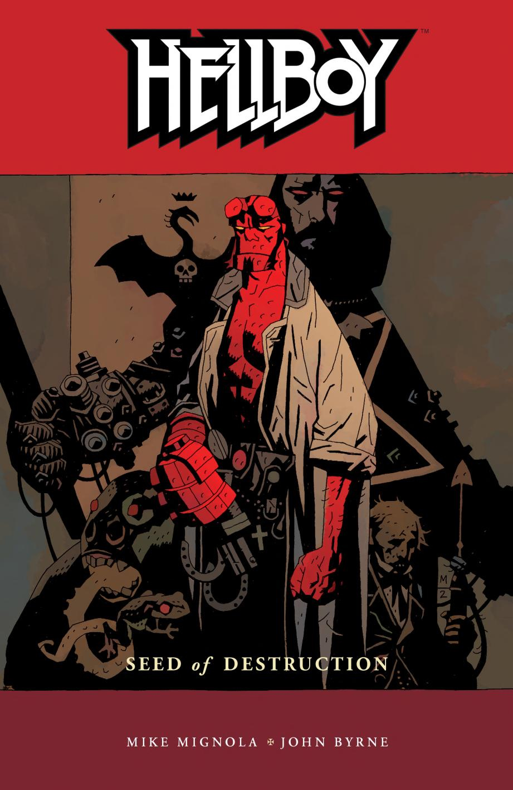MIKE MIGNOLA
</td>
<td rowspan="2">
<a href="Hellboy_Library_Editions#HB_LE_1" title="wikilink">Volume 1</a>
</td>
</tr>
<tr class="even">
<td>
2
</td>
<td>
<em>Wake the Devil</em>
</td>
<td>
June 11, 1997
</td>
<td style="text-align: left;"><ul>
<li><em><a href="Wake_the_Devil" title="wikilink">Wake the Devil</a></em> #1–5 w/ epilogue</li>
</ul></td>
<td style="text-align: left;"><ul>
<li>Introduction by Alan Moore</li>
<li>Gallery featuring art by Bruce Timm, P. Craig Russell, Derek Thompson, Dave Cooper, Jay Stephens and Oliver Vatine (7 pages)</li>
</ul></td>
<td>
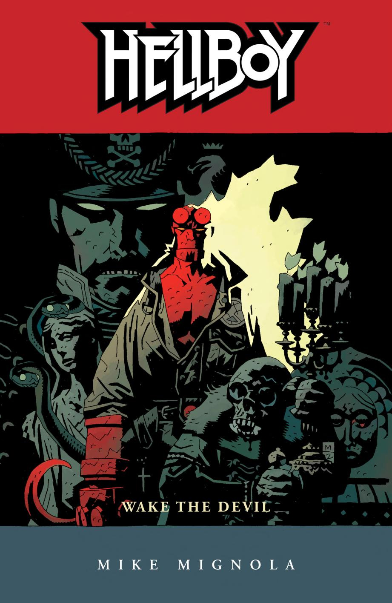MIKE MIGNOLA
</td>
</tr>
<tr class="odd">
<td>
3
</td>
<td>
<em>The Chained Coffin and Others</em>
</td>
<td>
August 5, 1998
</td>
<td style="text-align: left;"><ul>
<li><em><a href="The_Corpse" title="wikilink">The Corpse</a></em></li>
<li><em><a href="The_Iron_Shoes" title="wikilink">The Iron Shoes</a></em></li>
<li><em><a href="The_Baba_Yaga" title="wikilink">The Baba Yaga</a></em></li>
<li><em><a href="A_Christmas_Underground" title="wikilink">A Christmas Underground</a></em></li>
<li><em><a href="The_Chained_Coffin" title="wikilink">The Chained Coffin</a></em></li>
<li><em><a href="The_Wolves_of_Saint_August" title="wikilink">The Wolves of Saint August</a></em></li>
<li><em><a href="Almost_Colossus" title="wikilink">Almost Colossus</a></em> #1–2</li>
</ul></td>
<td style="text-align: left;"><ul>
<li>Introduction by P. Craig Russell</li>
<li>Gallery featuring art by <a href="Kevin_Nowlan" title="wikilink">Kevin Nowlan</a>, <a href="Matt_Smith" title="wikilink">Matt Smith</a>, <a href="Duncan_Fegredo" title="wikilink">Duncan Fegredo</a>, Dave Johnson, Thierry Robin and B.C. Boyer (7 pages)</li>
</ul></td>
<td>
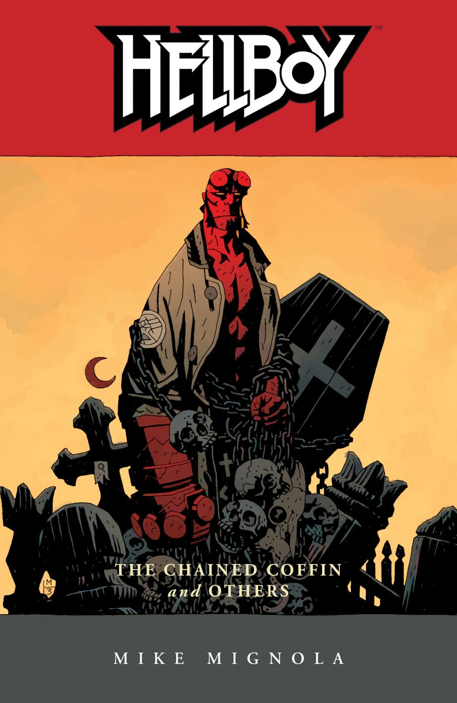MIKE MIGNOLA
</td>
<td rowspan="2">
<a href="Hellboy_Library_Editions#HB_LE_2" title="wikilink">Volume 2</a>
</td>
</tr>
<tr class="even">
<td>
4
</td>
<td>
<em>The Right Hand of Doom</em>
</td>
<td>
April 26, 2000
</td>
<td style="text-align: left;"><ul>
<li><em><a href="Pancakes" title="wikilink">Pancakes</a></em></li>
<li><em><a href="The_Nature_of_the_Beast" title="wikilink">The Nature of the Beast</a></em></li>
<li><em><a href="King_Vold" title="wikilink">King Vold</a></em></li>
<li><em><a href="Heads" title="wikilink">Heads</a></em></li>
<li><em><a href="Goodbye_Mister_Tod" title="wikilink">Goodbye Mister Tod</a></em></li>
<li><em><a href="The_Vârcolac" title="wikilink">The Vârcolac</a></em></li>
<li><em><a href="The_Right_Hand_of_Doom" title="wikilink">The Right Hand of Doom</a></em></li>
<li><em><a href="Box_Full_of_Evil" title="wikilink">Box Full of Evil</a></em> #1–2 w/ epilogue</li>
</ul></td>
<td style="text-align: left;"><ul>
<li>Sketchbook (19 pages)</li>
</ul></td>
<td>
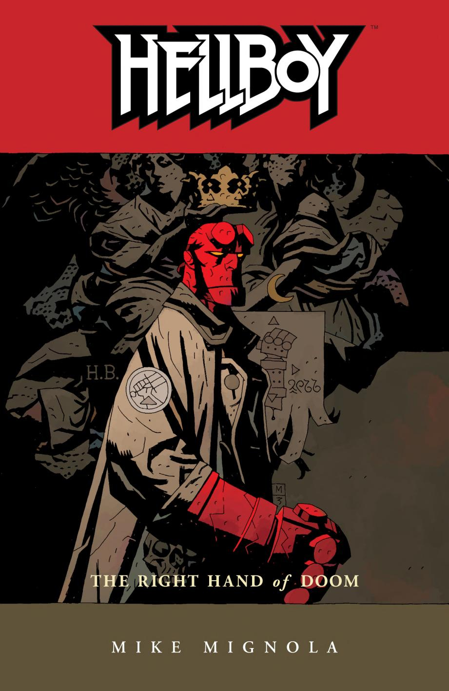MIKE MIGNOLA
</td>
</tr>
<tr class="odd">
<td>
5
</td>
<td>
<em>Conqueror Worm</em>
</td>
<td>
February 27, 2002
</td>
<td style="text-align: left;"><ul>
<li><em><a href="Conqueror_Worm_(story)" title="wikilink">Conqueror Worm</a></em> #1–4 w/ epilogue</li>
</ul></td>
<td style="text-align: left;"><ul>
<li>Introduction by <a href="Guillermo_del_Toro" title="wikilink">Guillermo del Toro</a></li>
<li>Sketchbook (5 pages)</li>
</ul></td>
<td>
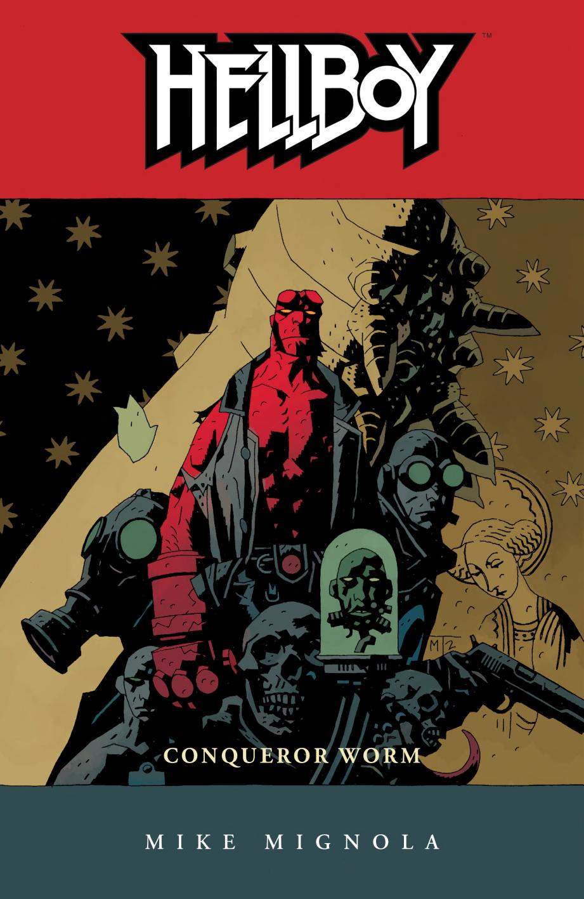MIKE MIGNOLA
</td>
<td rowspan="2">
<a href="Hellboy_Library_Editions#HB_LE_3" title="wikilink">Volume 3</a>
</td>
</tr>
<tr class="even">
<td>
6
</td>
<td>
<em>Strange Places</em>
</td>
<td>
April 26, 2006
</td>
<td style="text-align: left;"><ul>
<li><em><a href="The_Third_Wish" title="wikilink">The Third Wish</a></em> #1–2</li>
<li><em><a href="The_Island" title="wikilink">The Island</a></em> #1–2 w/ epilogue</li>
</ul></td>
<td style="text-align: left;"><ul>
<li>Introduction by Gary Gianni</li>
<li>Unused opening for <em>The Island</em> (8 pages)</li>
<li>Unused alternative version of <em>The Island</em> pages 13-19</li>
<li>Sketchbook (4 pages)</li>
</ul></td>
<td>
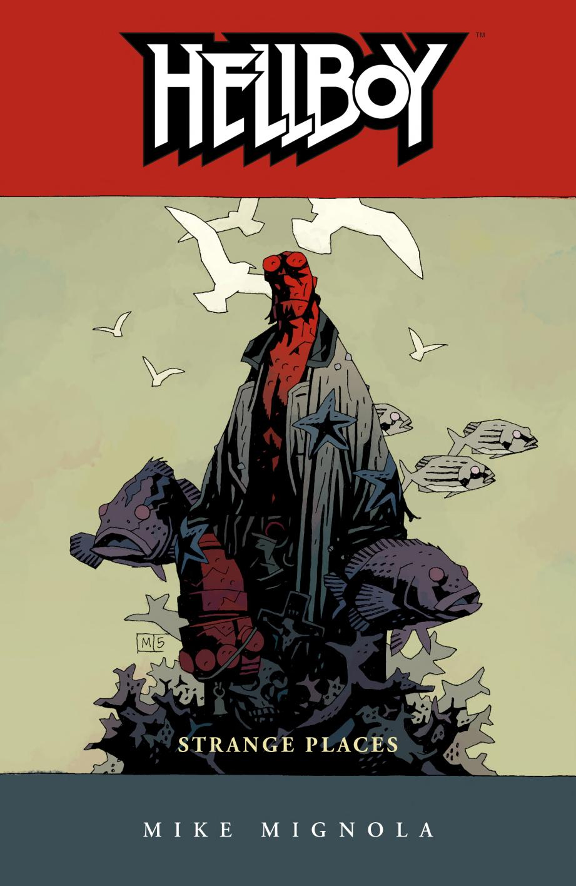MIKE MIGNOLA
</td>
</tr>
<tr class="odd">
<td>
7
</td>
<td>
<em>The Troll Witch and Others</em>
</td>
<td>
October 3, 2007
</td>
<td style="text-align: left;"><ul>
<li><em><a href="The_Penanggalan" title="wikilink">The Penanggalan</a></em></li>
<li><em><a href="The_Hydra_and_the_Lion" title="wikilink">The Hydra and the Lion</a></em></li>
<li><em><a href="The_Troll_Witch" title="wikilink">The Troll-Witch</a></em></li>
<li><em><a href="The_Vampire_of_Prague" title="wikilink">The Vampire of Prague</a></em></li>
<li><em><a href="Dr._Carp&#39;s_Experiment" title="wikilink">Dr. Carp's Experiment</a></em></li>
<li><em><a href="The_Ghoul" title="wikilink">The Ghoul</a></em></li>
<li><em><a href="Makoma" title="wikilink">Makoma</a></em> #1–2</li>
</ul></td>
<td style="text-align: left;"><ul>
<li>Introduction by Walter Simonson</li>
<li>Sketchbook (13 pages)</li>
</ul></td>
<td>
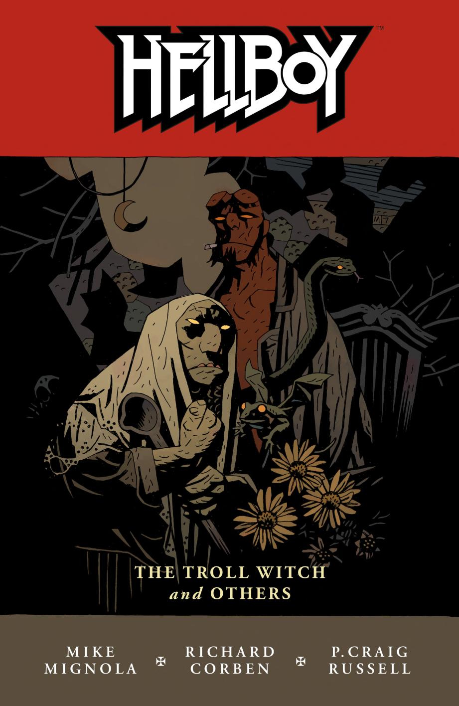MIKE MIGNOLA
</td>
<td>
<a href="Hellboy_Library_Editions#HB_LE_4" title="wikilink">Volume 4</a>
</td>
</tr>
<tr class="even">
<td>
8
</td>
<td>
<em>Darkness Calls</em>
</td>
<td>
May 16, 2008
</td>
<td style="text-align: left;"><ul>
<li><em><a href="Darkness_Calls" title="wikilink">Darkness Calls</a></em> #1–6 w/ two epilogues</li>
</ul></td>
<td style="text-align: left;"><ul>
<li>Introduction by Jane Yolen</li>
<li>Sketchbook (18 pages)</li>
</ul></td>
<td>
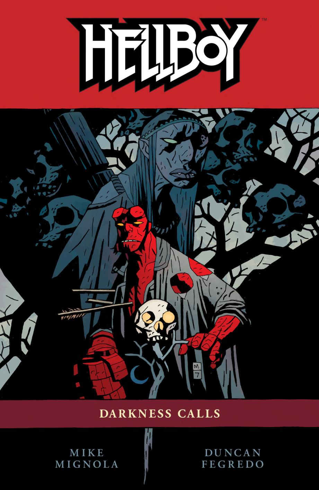MIKE MIGNOLA
</td>
<td rowspan="2">
<a href="Hellboy_Library_Editions#HB_LE_5" title="wikilink">Volume 5</a>
</td>
</tr>
<tr class="odd">
<td>
9
</td>
<td>
<em>The Wild Hunt</em>
</td>
<td>
March 10, 2010
</td>
<td style="text-align: left;"><ul>
<li><em><a href="The_Wild_Hunt" title="wikilink">The Wild Hunt</a></em> #1–8</li>
</ul></td>
<td style="text-align: left;"><ul>
<li>Introduction by Mark Chadbourn</li>
<li>Sketchbook (13 pages)</li>
</ul></td>
<td>
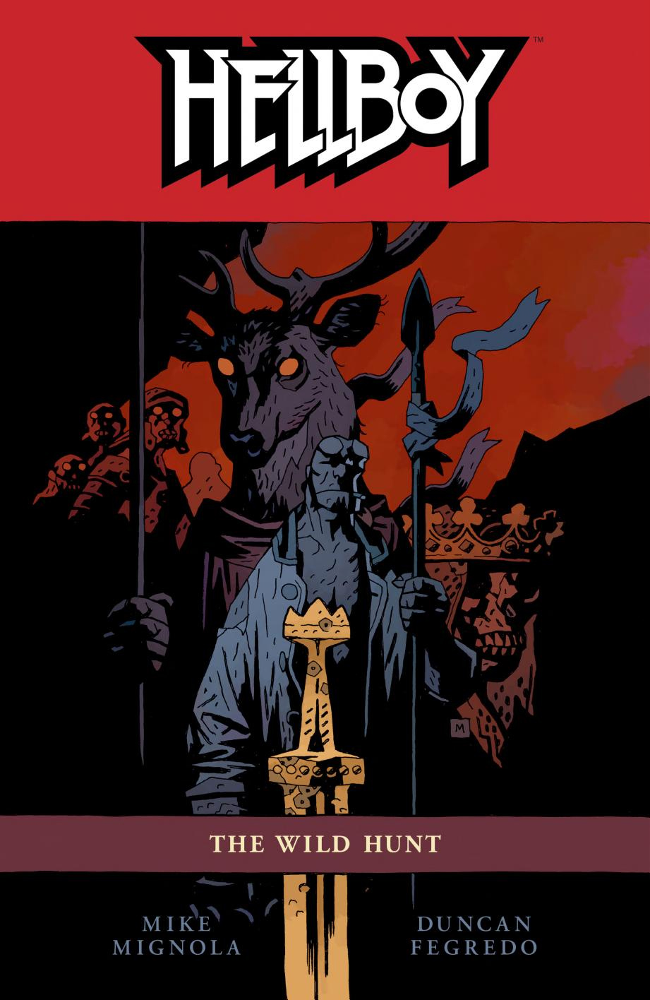MIKE MIGNOLA
</td>
</tr>
<tr class="even">
<td>
10
</td>
<td>
<em>The Crooked Man and Others</em>
</td>
<td>
June 9, 2010
</td>
<td style="text-align: left;"><ul>
<li><em><a href="The_Crooked_Man" title="wikilink">The Crooked Man</a></em> #1–3</li>
<li><em><a href="They_That_Go_Down_to_the_Sea_in_Ships" title="wikilink">They That Go Down to the Sea in Ships</a></em></li>
<li><em><a href="In_the_Chapel_of_Moloch" title="wikilink">In the Chapel of Moloch</a></em></li>
<li><em><a href="The_Mole" title="wikilink">The Mole</a></em></li>
</ul></td>
<td style="text-align: left;"><ul>
<li>Introduction by Gahan Wilson</li>
<li>Sketchbook (13 pages)</li>
<li>"Manly Wade Wellman: American Mythmaker" by John Pelan, a four-page text article</li>
</ul></td>
<td>
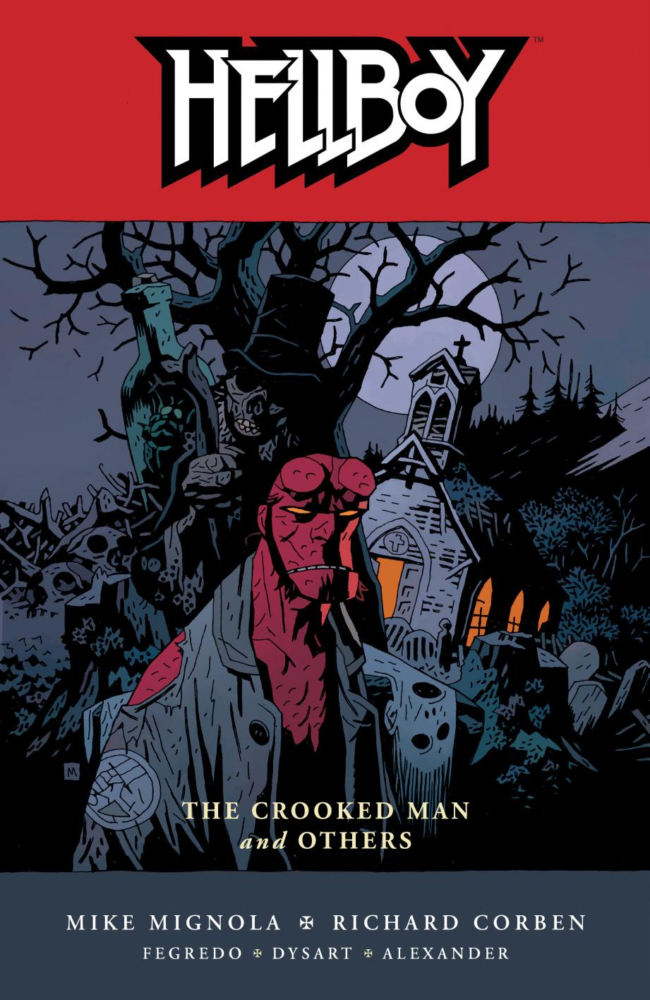MIKE MIGNOLA
</td>
<td>
<a href="Hellboy_Library_Editions#HB_LE_4" title="wikilink">Volume 4</a> 
(except <em>The Mole</em>, collected in <a href="Hellboy_Library_Editions#HB_LE_5" title="wikilink">Volume 5</a>)
</td>
</tr>
<tr class="odd">
<td>
11
</td>
<td>
<em>The Bride of Hell and Others</em>
</td>
<td>
October 5, 2011
</td>
<td style="text-align: left;"><ul>
<li><em><a href="Hellboy_in_Mexico_(story)" title="wikilink">Hellboy in Mexico</a></em></li>
<li><em><a href="Double_Feature_of_Evil" title="wikilink">Double Feature of Evil</a></em></li>
<li><em><a href="The_Sleeping_and_the_Dead" title="wikilink">The Sleeping and the Dead</a></em> #1–2</li>
<li><em><a href="The_Bride_of_Hell" title="wikilink">The Bride of Hell</a></em></li>
<li><em><a href="The_Whittier_Legacy" title="wikilink">The Whittier Legacy</a></em></li>
<li><em><a href="Buster_Oakley_Gets_His_Wish" title="wikilink">Buster Oakley Gets His Wish</a></em></li>
</ul></td>
<td style="text-align: left;"><ul>
<li>Sketchbook (21 pages)</li>
</ul></td>
<td>
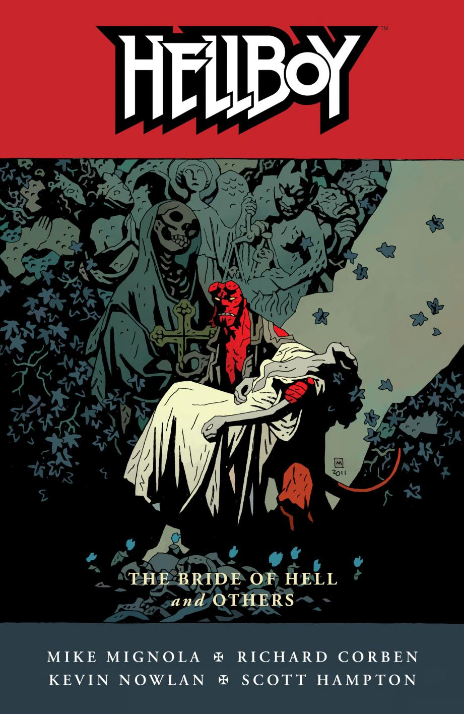MIKE MIGNOLA
</td>
<td rowspan="2">
<a href="Hellboy_Library_Editions#HB_LE_6" title="wikilink">Volume 6</a>
</td>
</tr>
<tr class="even">
<td>
12
</td>
<td>
<em>The Storm and the Fury</em>
</td>
<td>
March 7, 2012
</td>
<td style="text-align: left;"><ul>
<li><em><a href="The_Storm" title="wikilink">The Storm</a></em> #1–3</li>
<li><em><a href="The_Fury" title="wikilink">The Fury</a></em> #1–3 w/ Epilogue</li>
</ul></td>
<td style="text-align: left;"><ul>
<li>Introduction by Glen David Gold</li>
<li>Sketchbook (7 pages)</li>
<li>Two pages from <em>The Fury</em> #1, which recapped <em>The Storm</em>, were removed for the trade collection. They did not contain any new art.</li>
</ul></td>
<td>
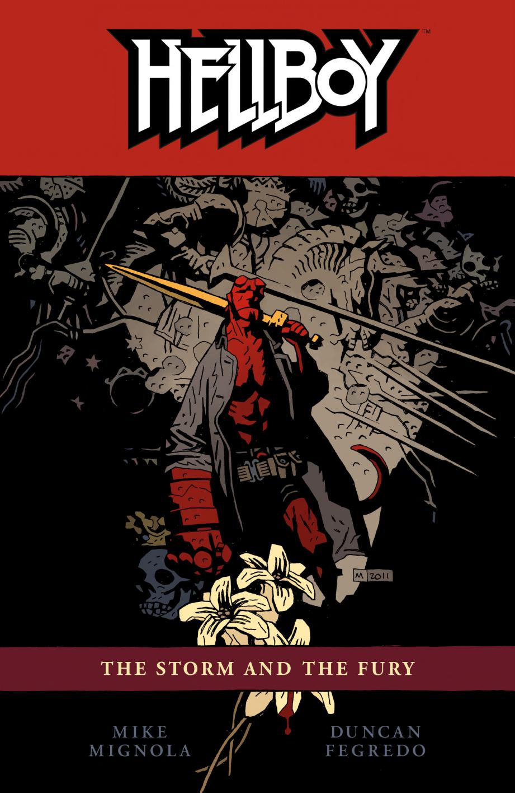MIKE MIGNOLA
</td>
</tr>
<tr class="odd">
<td>
NA
</td>
<td>
<em>Hellboy in Mexico</em>
</td>
<td>
April 13, 2016
</td>
<td style="text-align: left;"><ul>
<li><a href="Hellboy_in_Mexico_(story)" title="wikilink"><em>Hellboy in Mexico</em> (or <em>A Drunken Blur</em>)</a></li>
<li><em><a href="House_of_the_Living_Dead" title="wikilink">House of the Living Dead</a></em></li>
<li><em><a href="Hellboy_versus_the_Aztec_Mummy" title="wikilink">Hellboy versus the Aztec Mummy</a></em></li>
<li><em><a href="Hellboy_Gets_Married" title="wikilink">Hellboy Gets Married</a></em></li>
<li><em><a href="The_Coffin_Man" title="wikilink">The Coffin Man</a></em></li>
<li><em><a href="The_Coffin_Man_2:_The_Rematch" title="wikilink">The Coffin Man 2: The Rematch</a></em></li>
</ul></td>
<td style="text-align: left;"><ul>
<li>Sketchbook (17 pages)</li>
</ul></td>
<td>
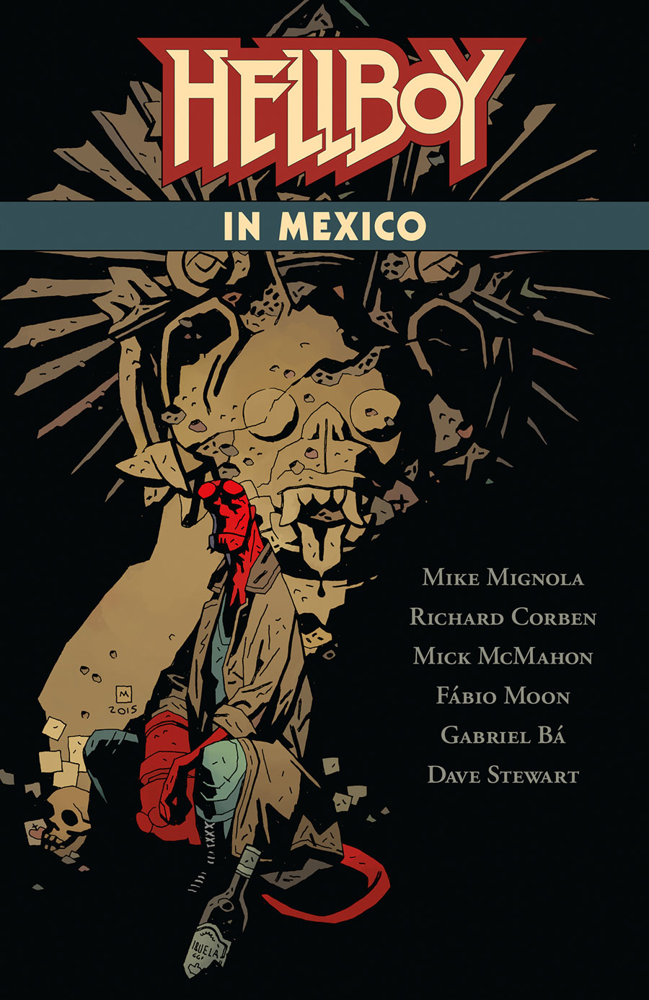MIKE MIGNOLA
</td>
<td>
NA
</td>
</tr>
</tbody>
</table>

### *Hellboy* Original Graphic Novels

These original stories are released in hardcover trades. These trades contain none of the special features usually associated with Hellboy trades (no author's notes, no sketchbook/gallery).

<table>
<thead>
<tr class="header">
<th>
Title
</th>
<th>
Date Published
</th>
<th>
Author
</th>
<th>
Artist
</th>
<th>
Cover
</th>
<th>
Collected in
</th>
</tr>
</thead>
<tbody>
<tr class="odd">
<td>
<em><a href="House_of_the_Living_Dead" title="wikilink">House of the Living Dead</a></em>
</td>
<td>
November 2, 2011
</td>
<td>
<a href="Mike_Mignola" title="wikilink">Mike Mignola</a>
</td>
<td>
<a href="Richard_Corben" title="wikilink">Richard Corben</a>
</td>
<td>
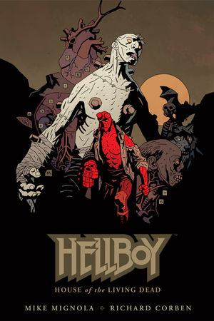MIKE MIGNOLA
</td>
<td>
<a href="TPB#HellboyInMexico" title="wikilink"><em>Hellboy in Mexico</em></a> 
— 
<a href="Omnibus_Editions#Hellboy_Shorts_Omni1" title="wikilink"><em>Hellboy Omnibus: The Complete Short Stories – Volume 1</em></a>
</td>
</tr>
<tr class="even">
<td>
<em><a href="The_Midnight_Circus" title="wikilink">The Midnight Circus</a></em>
</td>
<td>
October 23, 2013
</td>
<td>
<a href="Mike_Mignola" title="wikilink">Mike Mignola</a>
</td>
<td>
<a href="Duncan_Fegredo" title="wikilink">Duncan Fegredo</a>
</td>
<td>
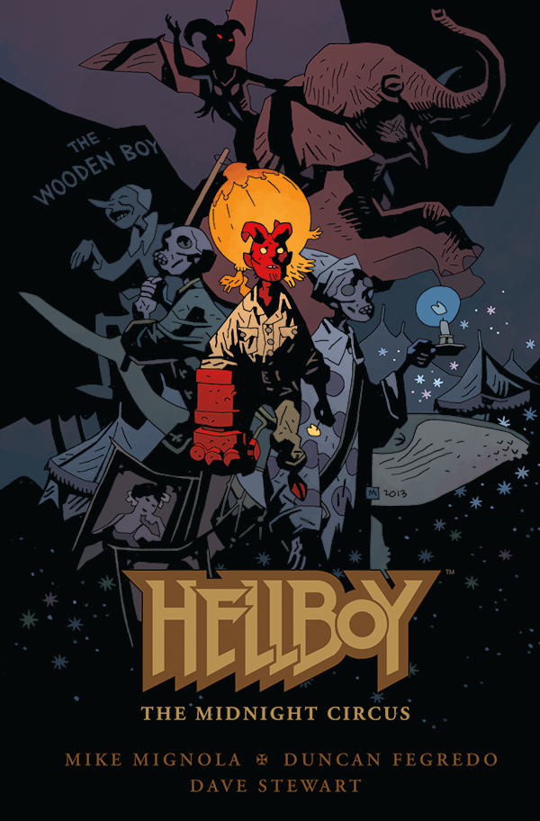MIKE MIGNOLA
</td>
<td>
<a href="Omnibus_Editions#Hellboy_Shorts_Omni1" title="wikilink"><em>Hellboy Omnibus: The Complete Short Stories – Volume 1</em></a>
</td>
</tr>
<tr class="odd">
<td>
<em><a href="Into_the_Silent_Sea" title="wikilink">Into the Silent Sea</a></em>
</td>
<td>
April 19, 2017
</td>
<td>
<a href="Mike_Mignola" title="wikilink">Mike Mignola</a> 
<a href="Gary_Gianni" title="wikilink">Gary Gianni</a>
</td>
<td>
<a href="Gary_Gianni" title="wikilink">Gary Gianni</a>
</td>
<td>
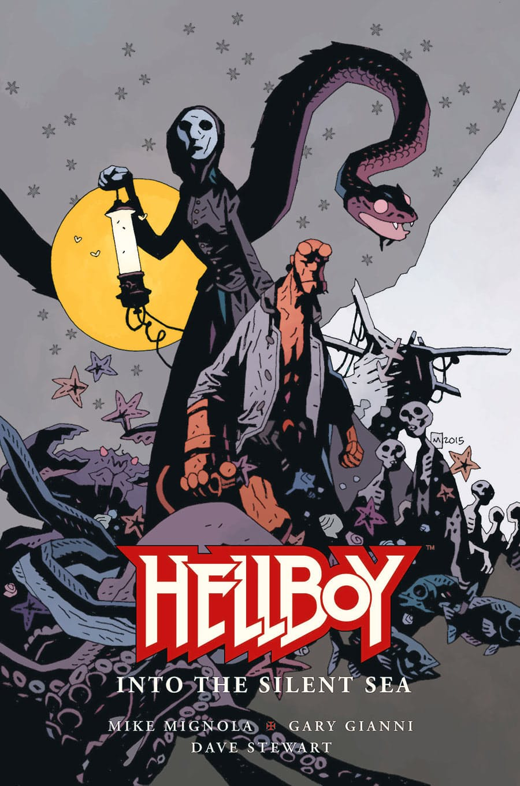MIKE MIGNOLA
</td>
<td>
<a href="Omnibus_Editions#Hellboy_Omni2" title="wikilink"><em>Hellboy Omnibus – Volume 2: Strange Places</em></a>
</td>
</tr>
</tbody>
</table>

### Uncollected *Hellboy*

The following *Hellboy* stories are not currently collected:

- *[Krampusnacht](/entry/Krampusnacht)*
- *[Return of the Lambton Worm](/entry/Return%20of%20the%20Lambton%20Worm)*

### Other *Hellboy* Collections

<table>
<thead>
<tr class="header">
<th>
Title
</th>
<th>
Date Published
</th>
<th>
ISBN
</th>
<th>
Cover
</th>
</tr>
</thead>
<tbody>
<tr class="odd">
<td>
<a href="http://www.darkhorse.com/Books/12-283/Art-of-Hellboy-HC">The Art of Hellboy</a>
</td>
<td>
March 26, 2003 (Hardcover) March 31, 2004 (Paperback)
</td>
<td>
978-1569719107 (HC) 978-1593070892 (PB)
</td>
<td>
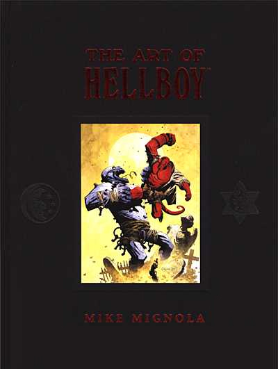MIKE MIGNOLA
</td>
</tr>
<tr class="even">
<td>
<em><a href="Hellboy:_Weird_Tales#WeirdTalesVol1" title="wikilink">Hellboy: Weird Tales Volume 1</a></em>
</td>
<td>
December 17, 2003
</td>
<td>
978-1569716229
</td>
<td>
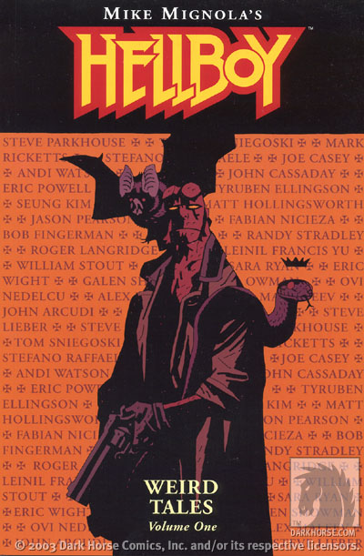MIKE MIGNOLA
</td>
</tr>
<tr class="odd">
<td>
<a href="http://www.darkhorse.com/Books/12-569/Hellboy-Junior-TPB">Hellboy Junior</a>
</td>
<td>
January 21, 2004
</td>
<td>
978-1569719886
</td>
<td>
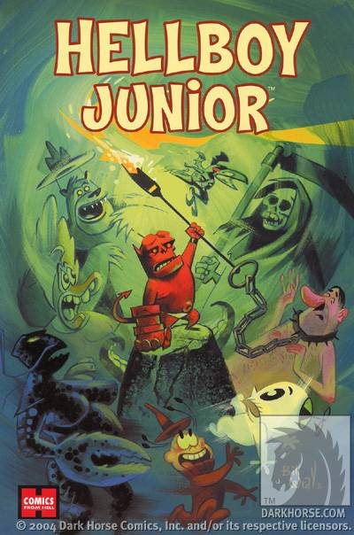BILL WRAY
</td>
</tr>
<tr class="even">
<td>
<em><a href="Hellboy:_Weird_Tales#WeirdTalesVol2" title="wikilink">Hellboy: Weird Tales Volume 2</a></em>
</td>
<td>
October 27, 2004
</td>
<td>
978-1569719534
</td>
<td>
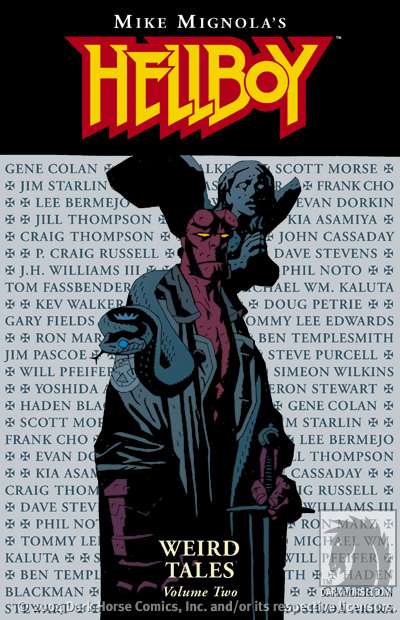MIKE MIGNOLA
</td>
</tr>
<tr class="odd">
<td>
<a href="Masks_and_Monsters" title="wikilink">Masks and Monsters</a>
</td>
<td>
October 13, 2010
</td>
<td>
978-1595825674
</td>
<td>
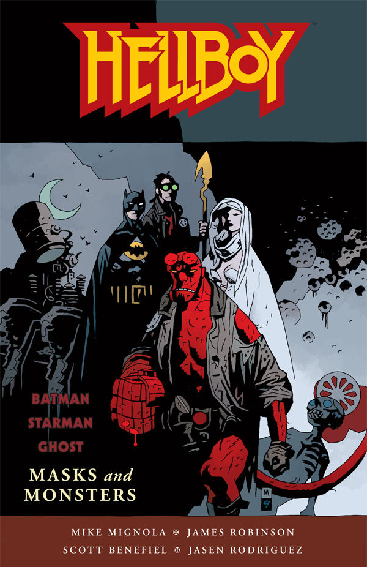MIKE MIGNOLA
</td>
</tr>
<tr class="even">
<td>
<a href="http://www.darkhorse.com/Books/24-471/Hellboy-The-First-20-Years-HC">Hellboy: 
The First 20 Years</a>
</td>
<td>
March 19, 2014
</td>
<td>
978-1616553531
</td>
<td>
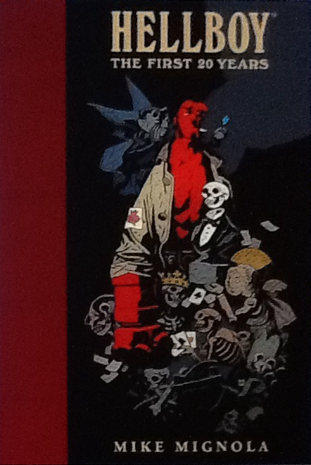MIKE MIGNOLA
</td>
</tr>
<tr class="odd">
<td>
<a href="http://www.darkhorse.com/Books/23-942/Itty-Bitty-Hellboy-TPB">Itty Bitty Hellboy</a>
</td>
<td>
April 16, 2014
</td>
<td>
978-1616554149
</td>
<td>
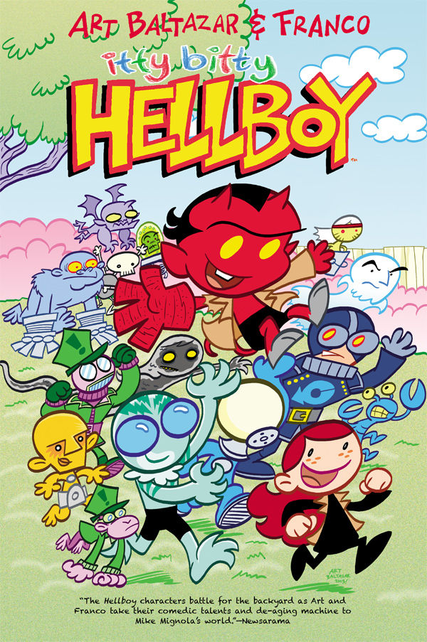ART BALTAZAR
</td>
</tr>
<tr class="even">
<td>
<a href="Mike_Mignola&#39;s_Hellboy_Artist&#39;s_Edition" title="wikilink">Hellboy Artist's Edition: Hellboy in Hell and Other Stories</a>
</td>
<td>
July 9, 2014
</td>
<td>
978-1631400032
</td>
<td>
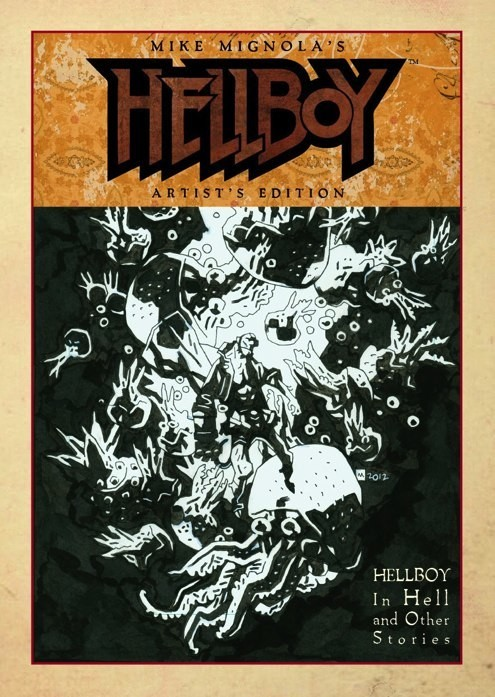MIKE MIGNOLA
</td>
</tr>
<tr class="odd">
<td>
<em><a href="Hellboy:_Weird_Tales#WeirdTalesHC" title="wikilink">Hellboy: Weird Tales</a></em> 
ALSO INCLUDES: <em><a href="How_Koshchei_Became_Deathless" title="wikilink">How Koshchei Became Deathless</a></em> 
<em><a href="Baba_Yaga&#39;s_Feast" title="wikilink">Baba Yaga's Feast</a></em>
</td>
<td>
November 26, 2014
</td>
<td>
978-1616555108
</td>
<td>
MIKE MIGNOLA
</td>
</tr>
<tr class="even">
<td>
The Hellboy 100 Project 
(<a href="http://www.darkhorse.com/Books/26-604/The-Hellboy-100-Project-HC">Hardcover</a> and <a href="http://www.darkhorse.com/Books/26-619/The-Hellboy-100-Project-TPB">Paperback</a> Art Book)
</td>
<td>
September 23, 2015
</td>
<td>
978-1616559335 (HC) 
978-1616559328 (PB)
</td>
<td>
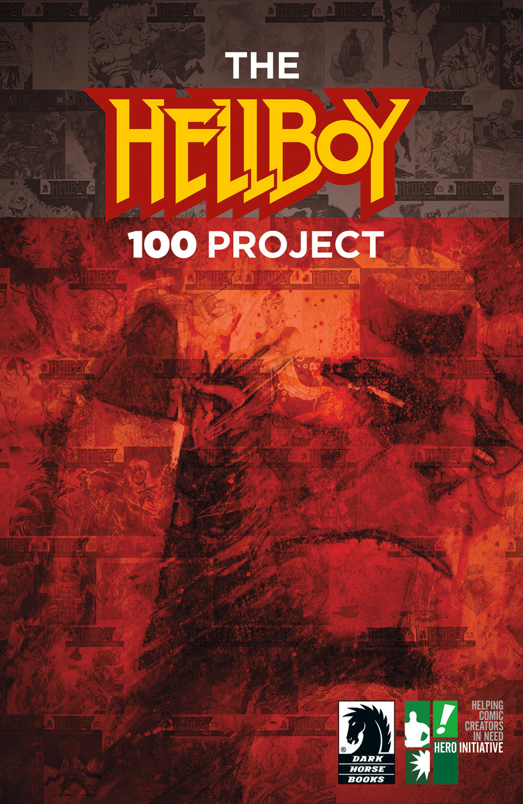VARIOUS
</td>
</tr>
</tbody>
</table>

## *[Hellboy in Hell](/entry/Hellboy%20in%20Hell%20%28series%29)*

<table>
<thead>
<tr class="header">
<th>
#
</th>
<th>
Title
</th>
<th>
Date Published
</th>
<th>
Material collected
</th>
<th>
Additional Material
</th>
<th>
Cover
</th>
<th>
Library Edition
</th>
<th>
Omnibus
</th>
</tr>
</thead>
<tbody>
<tr class="odd">
<td>
1
</td>
<td>
<em>The Descent</em>
</td>
<td>
May 21, 2014
</td>
<td style="text-align: left;"><ul>
<li><em><a href="Hellboy_in_Hell_(first_story_arc)" title="wikilink">Hellboy in Hell</a></em> #1–4</li>
<li><em><a href="The_Three_Gold_Whips" title="wikilink">The Three Gold Whips</a></em></li>
</ul></td>
<td style="text-align: left;"><ul>
<li>Sketchbook (24 pages)</li>
</ul></td>
<td>
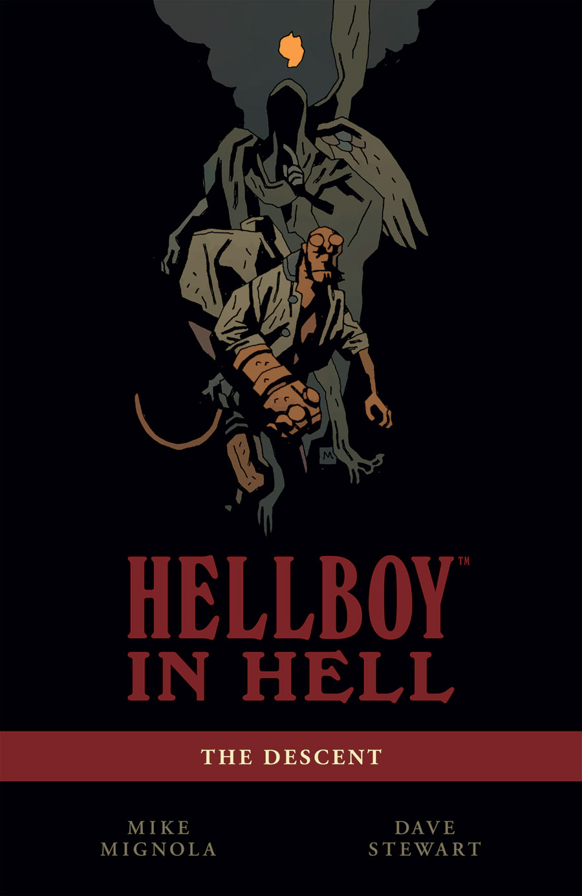MIKE MIGNOLA
</td>
<td rowspan="2">
<a href="Hellboy_Library_Editions#HBinH_LE" title="wikilink"><em>Hellboy in Hell</em></a>
</td>
<td rowspan="2">
<a href="Omnibus_Editions#Hellboy_Omni4" title="wikilink"><em>Hellboy Omnibus – Volume 4: Hellboy in Hell</em></a>
</td>
</tr>
<tr class="even">
<td>
2
</td>
<td>
<em>The Death Card</em>
</td>
<td>
October 5, 2016
</td>
<td style="text-align: left;"><ul>
<li><em><a href="The_Death_Card" title="wikilink">The Death Card</a></em> w/ prologue</li>
<li><em><a href="The_Hounds_of_Pluto" title="wikilink">The Hounds of Pluto</a></em></li>
<li><em><a href="The_Spanish_Bride" title="wikilink">The Spanish Bride</a></em></li>
<li><em><a href="For_Whom_the_Bell_Tolls" title="wikilink">For Whom the Bell Tolls</a></em></li>
<li><em><a href="The_Exorcist_of_Vorsk" title="wikilink">The Exorcist of Vorsk</a></em></li>
</ul></td>
<td style="text-align: left;"><ul>
<li>Afterword by <a href="Mike_Mignola" title="wikilink">Mike Mignola</a></li>
<li>Sketchbook (12 pages)</li>
</ul></td>
<td>
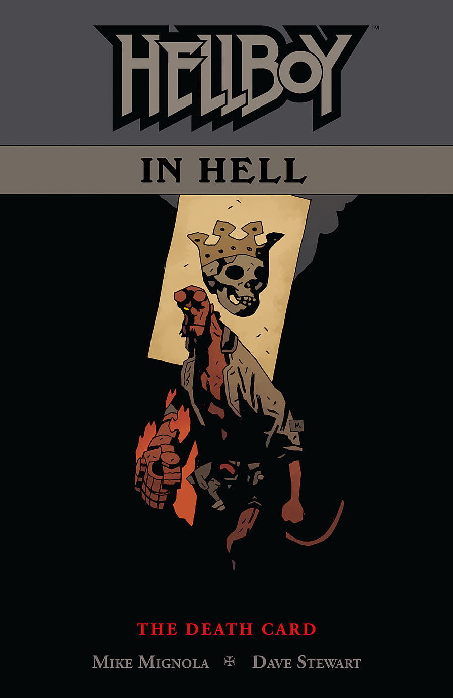MIKE MIGNOLA
</td>
</tr>
</tbody>
</table>

## *[B.P.R.D.](/entry/B.P.R.D.%20%28series%29)*

<table>
<thead>
<tr class="header">
<th>
#
</th>
<th>
Title
</th>
<th>
Date Published
</th>
<th>
Material collected
</th>
<th>
Additional Material
</th>
<th>
Cover
</th>
<th>
Omnibus
</th>
</tr>
</thead>
<tbody>
<tr class="odd">
<td>
1
</td>
<td>
<em>Hollow Earth &amp; Other Stories</em>
</td>
<td>
January 29, 2003
</td>
<td style="text-align: left;"><ul>
<li><em><a href="Hollow_Earth" title="wikilink">Hollow Earth</a></em> #1–3</li>
<li><em><a href="B.P.R.D._(teaser)" title="wikilink">B.P.R.D.</a></em></li>
<li><em><a href="The_Killer_in_My_Skull" title="wikilink">Lobster Johnson: The Killer in My Skull</a></em></li>
<li><em><a href="Abe_Sapien_versus_Science" title="wikilink">Abe Sapien versus Science</a></em></li>
<li><em><a href="Drums_of_the_Dead" title="wikilink">Abe Sapien: Drums of the Dead</a></em></li>
</ul></td>
<td style="text-align: left;"><ul>
<li>Sketchbook (9 pages)</li>
</ul></td>
<td>
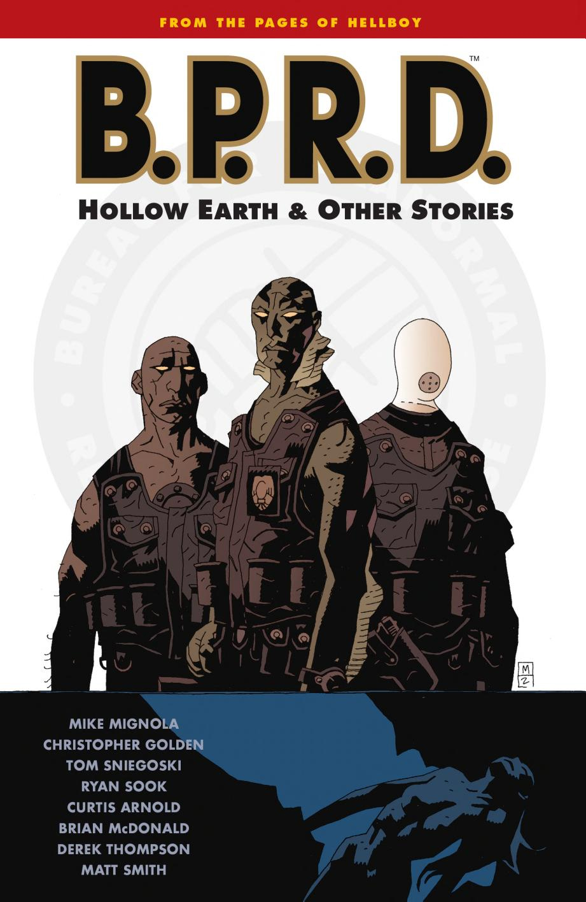MIKE MIGNOLA
</td>
<td rowspan="3">
<a href="Omnibus_Editions#BPRD_Omni_PoF1" title="wikilink"><em>B.P.R.D. 
Plague of Frogs</em> 
Volume 1</a>
</td>
</tr>
<tr class="even">
<td>
2
</td>
<td>
<em>The Soul of Venice &amp; Other Stories</em>
</td>
<td>
August 25, 2004
</td>
<td style="text-align: left;"><ul>
<li><em><a href="The_Soul_of_Venice" title="wikilink">The Soul of Venice</a></em></li>
<li><em><a href="Dark_Waters" title="wikilink">Dark Waters</a></em></li>
<li><em><a href="Night_Train" title="wikilink">Night Train</a></em></li>
<li><em><a href="There&#39;s_Something_Under_My_Bed" title="wikilink">There's Something Under My Bed</a></em></li>
<li><em><a href="Another_Day_at_the_Office" title="wikilink">Another Day at the Office</a></em></li>
</ul></td>
<td style="text-align: left;"><ul>
<li>Sketchbook (13 pages)</li>
</ul></td>
<td>
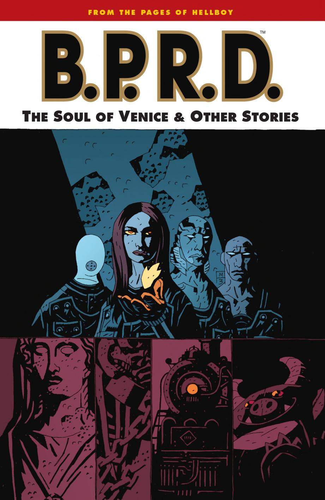MIKE MIGNOLA
</td>
</tr>
<tr class="odd">
<td>
3
</td>
<td>
<em>Plague of Frogs</em>
</td>
<td>
February 23, 2005
</td>
<td style="text-align: left;"><ul>
<li><em><a href="Plague_of_Frogs_(story)" title="wikilink">Plague of Frogs</a></em> #1–5</li>
</ul></td>
<td style="text-align: left;"><ul>
<li>Afterword by <a href="Mike_Mignola" title="wikilink">Mike Mignola</a></li>
<li>Sketchbook (8 pages)</li>
</ul></td>
<td>
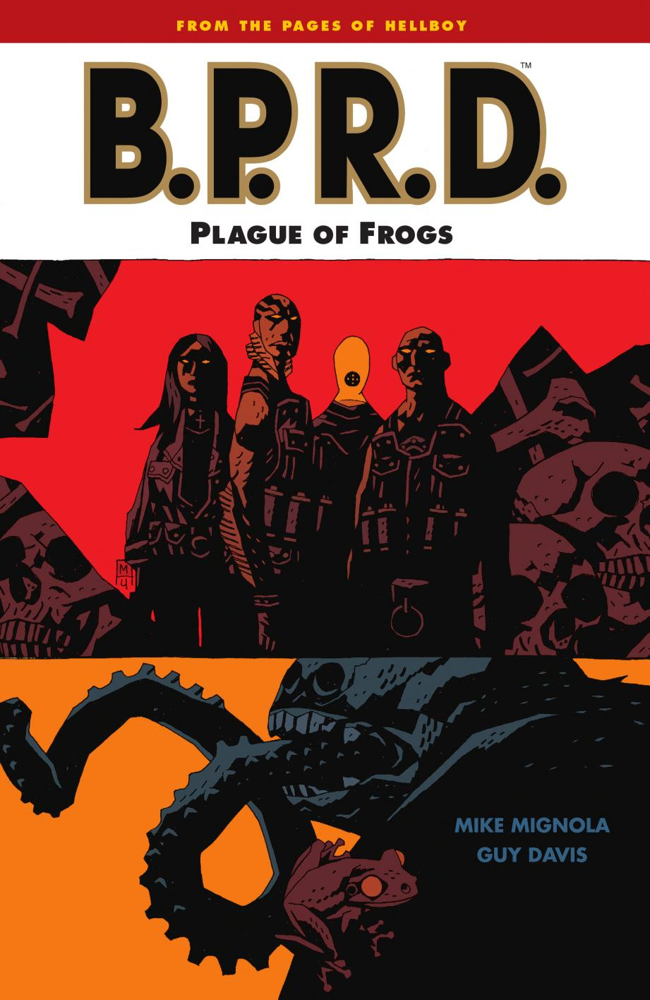MIKE MIGNOLA
</td>
</tr>
<tr class="even">
<td>
4
</td>
<td>
<em>The Dead</em>
</td>
<td>
September 28, 2005
</td>
<td style="text-align: left;"><ul>
<li><em><a href="Born_Again" title="wikilink">Born Again</a></em></li>
<li><em><a href="The_Dead" title="wikilink">The Dead</a></em> #1–5</li>
</ul></td>
<td style="text-align: left;"><ul>
<li>Introduction by <a href="John_Arcudi" title="wikilink">John Arcudi</a></li>
<li>Afterword by <a href="Mike_Mignola" title="wikilink">Mike Mignola</a></li>
<li>Sketchbook (11 pages)</li>
</ul></td>
<td>
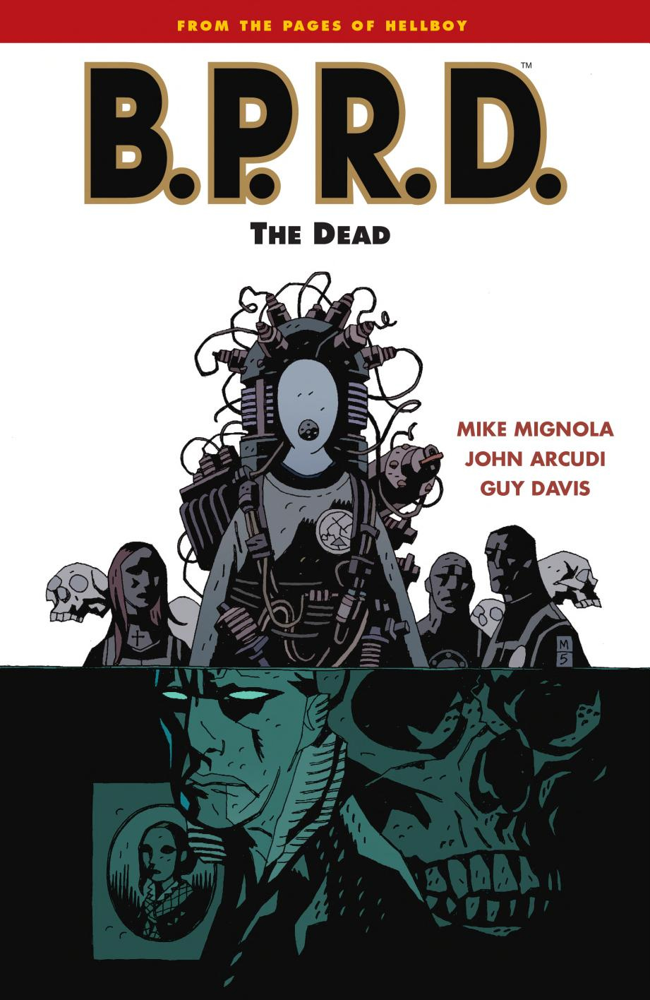MIKE MIGNOLA
</td>
<td rowspan="2">
<a href="Omnibus_Editions#BPRD_Omni_PoF2" title="wikilink"><em>B.P.R.D. 
Plague of Frogs</em> 
Volume 2</a>
</td>
</tr>
<tr class="odd">
<td>
5
</td>
<td>
<em>The Black Flame</em>
</td>
<td>
July 12, 2006
</td>
<td style="text-align: left;"><ul>
<li><em><a href="The_Black_Flame_(story)" title="wikilink">The Black Flame</a></em> #1–6</li>
</ul></td>
<td style="text-align: left;"><ul>
<li>Afterword by <a href="Mike_Mignola" title="wikilink">Mike Mignola</a></li>
<li>Sketchbook (6 pages)</li>
</ul></td>
<td>
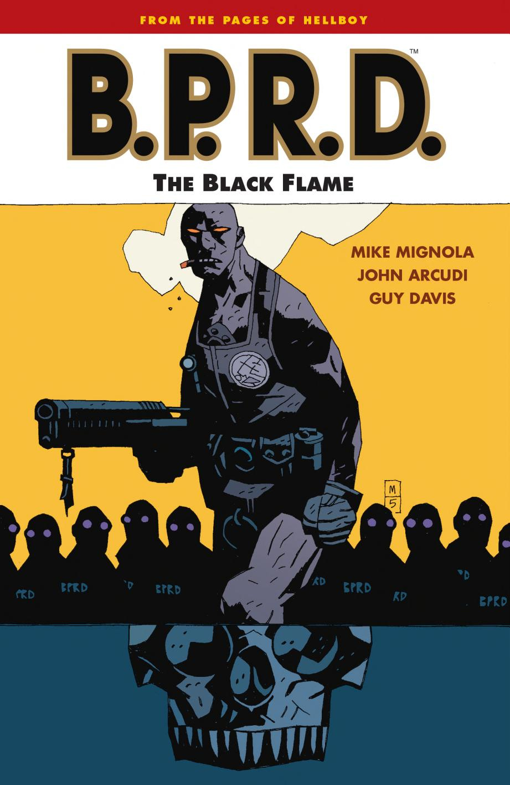MIKE MIGNOLA
</td>
</tr>
<tr class="even">
<td>
6
</td>
<td>
<em>The Universal Machine</em>
</td>
<td>
January 17, 2007
</td>
<td style="text-align: left;"><ul>
<li><em><a href="The_Universal_Machine" title="wikilink">The Universal Machine</a></em> #1–5</li>
</ul></td>
<td style="text-align: left;"><ul>
<li>Afterword by <a href="Mike_Mignola" title="wikilink">Mike Mignola</a></li>
<li>Sketchbook (7 pages)</li>
</ul></td>
<td>
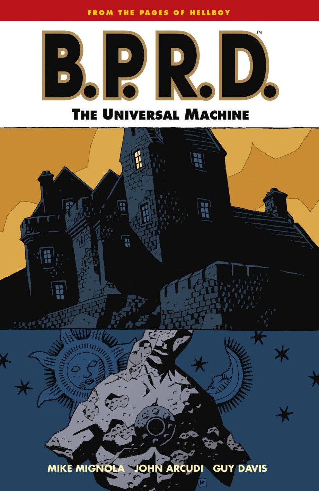MIKE MIGNOLA
</td>
<td rowspan="3">
<a href="Omnibus_Editions#BPRD_Omni_PoF3" title="wikilink"><em>B.P.R.D. 
Plague of Frogs</em> 
Volume 3</a>
</td>
</tr>
<tr class="odd">
<td>
7
</td>
<td>
<em>Garden of Souls</em>
</td>
<td>
January 30, 2008
</td>
<td style="text-align: left;"><ul>
<li><em><a href="Garden_of_Souls" title="wikilink">Garden of Souls</a></em> #1–5</li>
</ul></td>
<td style="text-align: left;"><ul>
<li>Afterword by <a href="John_Arcudi" title="wikilink">John Arcudi</a></li>
<li>Sketchbook (13 pages)</li>
</ul></td>
<td>
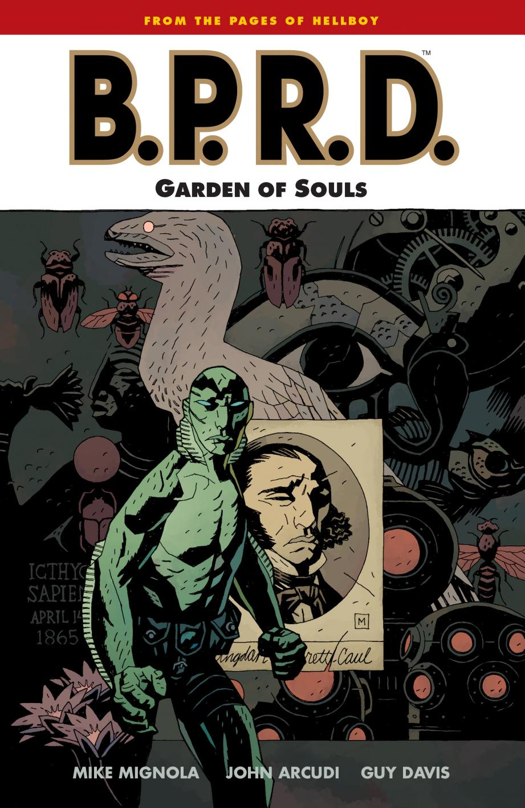MIKE MIGNOLA
</td>
</tr>
<tr class="even">
<td>
8
</td>
<td>
<em>Killing Ground</em>
</td>
<td>
May 21, 2008
</td>
<td style="text-align: left;"><ul>
<li><em><a href="Killing_Ground" title="wikilink">Killing Ground</a></em> #1–5</li>
</ul></td>
<td style="text-align: left;"><ul>
<li>Afterword by <a href="John_Arcudi" title="wikilink">John Arcudi</a></li>
<li>Sketchbook (8 pages)</li>
</ul></td>
<td>
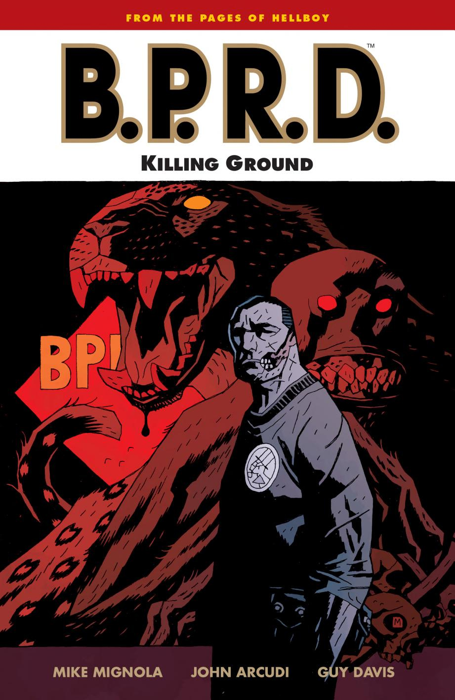MIKE MIGNOLA
</td>
</tr>
<tr class="odd">
<td>
9
</td>
<td>
<em>1946</em>
</td>
<td>
November 5, 2008
</td>
<td style="text-align: left;"><ul>
<li><em><a href="1946" title="wikilink">1946</a></em> #1–5</li>
<li><em><a href="Bishop_Olek&#39;s_Devil" title="wikilink">Bishop Olek's Devil</a></em></li>
</ul></td>
<td style="text-align: left;"><ul>
<li>Afterword by <a href="Joshua_Dysart" title="wikilink">Joshua Dysart</a></li>
<li>Sketchbook (8 pages)</li>
</ul></td>
<td>
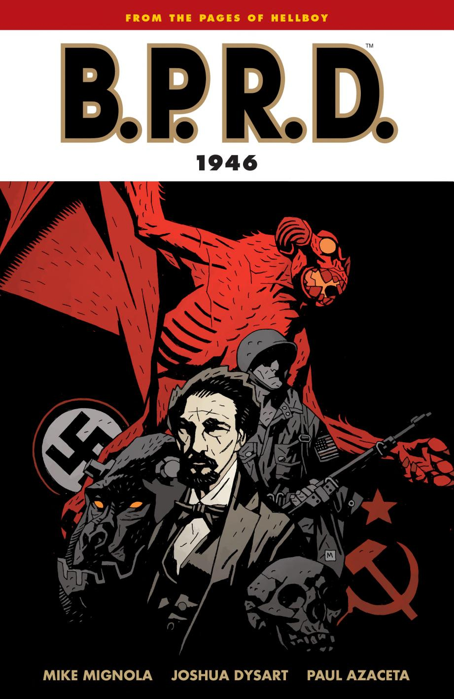MIKE MIGNOLA
</td>
<td>
<a href="Omnibus_Editions#B.P.R.D._1946_.E2.80.93_1948" title="wikilink">B.P.R.D. 
1946 – 1948</a>
</td>
</tr>
<tr class="even">
<td>
10
</td>
<td>
<em>The Warning</em>
</td>
<td>
April 15, 2009
</td>
<td style="text-align: left;"><ul>
<li><em><a href="Out_of_Reach" title="wikilink">Out of Reach</a></em></li>
<li><em><a href="The_Warning" title="wikilink">The Warning</a></em> #1–5</li>
</ul></td>
<td style="text-align: left;"><ul>
<li>Afterword by <a href="John_Arcudi" title="wikilink">John Arcudi</a></li>
<li>Sketchbook (6 pages)</li>
</ul></td>
<td>
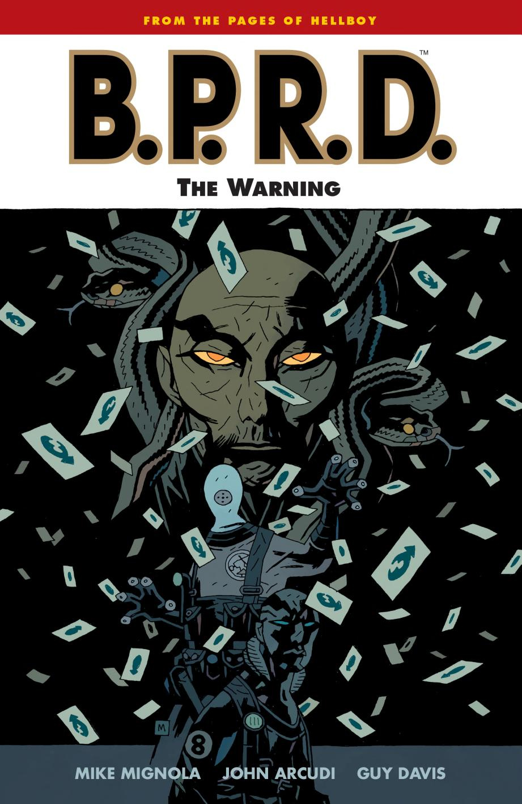MIKE MIGNOLA
</td>
<td rowspan="2">
<a href="Omnibus_Editions#BPRD_Omni_PoF4" title="wikilink"><em>B.P.R.D. 
Plague of Frogs</em> 
Volume 4</a>
</td>
</tr>
<tr class="odd">
<td>
11
</td>
<td>
<em>The Black Goddess</em>
</td>
<td>
October 21, 2009
</td>
<td style="text-align: left;"><ul>
<li><em><a href="The_Black_Goddess" title="wikilink">The Black Goddess</a></em> #1–5</li>
</ul></td>
<td style="text-align: left;"><ul>
<li>Sketchbook (13 pages)</li>
<li>"Latchkey Memories from Crab Point" by <a href="Guy_Davis" title="wikilink">Guy Davis</a></li>
</ul></td>
<td>
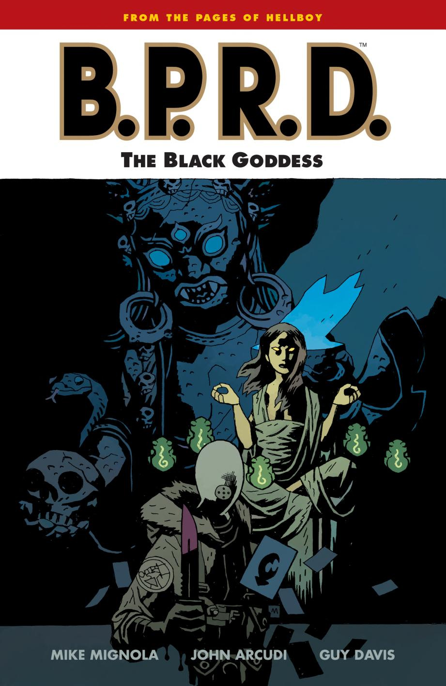MIKE MIGNOLA
</td>
</tr>
<tr class="even">
<td>
12
</td>
<td>
<em>War on Frogs</em>
</td>
<td>
April 28, 2010
</td>
<td style="text-align: left;"><ul>
<li><em><a href="War_on_Frogs" title="wikilink">War on Frogs</a></em> #1–4</li>
<li><em><a href="Revival" title="wikilink">Revival</a></em></li>
</ul></td>
<td style="text-align: left;"><ul>
<li>Sketchbook (8 pages)</li>
</ul></td>
<td>
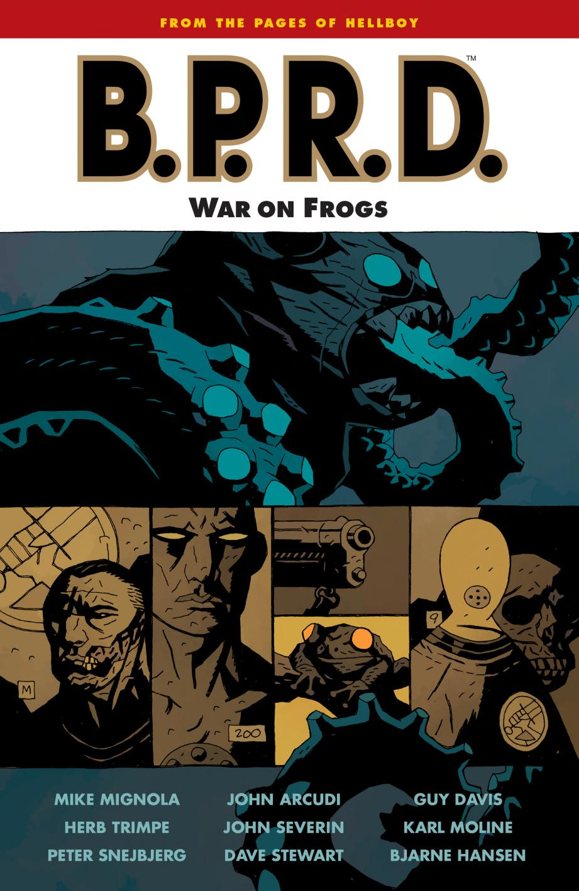MIKE MIGNOLA
</td>
<td>
<a href="Omnibus_Editions#BPRD_Omni_PoF2" title="wikilink"><em>B.P.R.D. 
Plague of Frogs</em> 
Volume 2</a>
</td>
</tr>
<tr class="odd">
<td>
13
</td>
<td>
<em>1947</em>
</td>
<td>
July 7, 2010
</td>
<td style="text-align: left;"><ul>
<li><em><a href="1947" title="wikilink">1947</a></em> #1–5</li>
<li><em><a href="And_What_Shall_I_Find_There?" title="wikilink">And What Shall I Find There?</a></em></li>
</ul></td>
<td style="text-align: left;"><ul>
<li>Afterword by <a href="Mike_Mignola" title="wikilink">Mike Mignola</a></li>
<li>Sketchbook (15 pages)</li>
</ul></td>
<td>
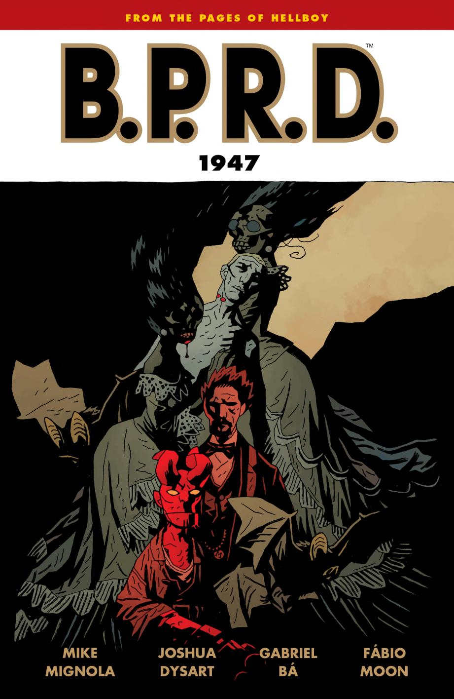MIKE MIGNOLA
</td>
<td>
<a href="Omnibus_Editions#B.P.R.D._1946_.E2.80.93_1948" title="wikilink">B.P.R.D. 
1946 – 1948</a>
</td>
</tr>
<tr class="even">
<td>
14
</td>
<td>
<em>King of Fear</em>
</td>
<td>
November 3, 2010
</td>
<td style="text-align: left;"><ul>
<li><em><a href="King_of_Fear_(story)" title="wikilink">King of Fear</a></em> #1–5</li>
</ul></td>
<td style="text-align: left;"><ul>
<li>Afterword by <a href="Mike_Mignola" title="wikilink">Mike Mignola</a></li>
<li>Sketchbook (18 pages)</li>
</ul></td>
<td>
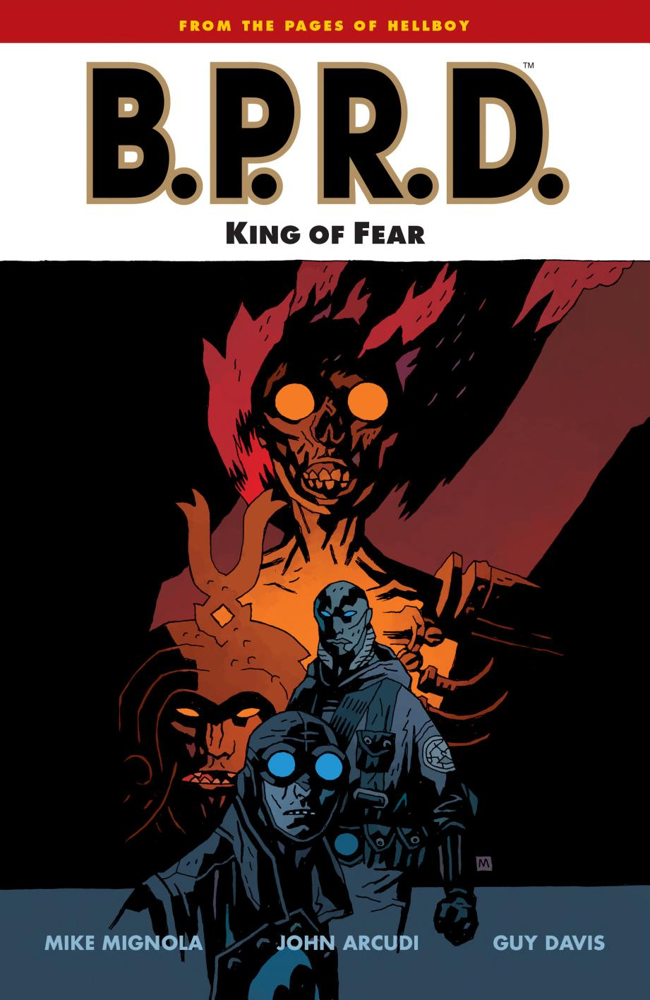MIKE MIGNOLA
</td>
<td>
<a href="Omnibus_Editions#BPRD_Omni_PoF4" title="wikilink"><em>B.P.R.D. 
Plague of Frogs</em> 
Volume 4</a>
</td>
</tr>
<tr class="odd">
<td>
NA
</td>
<td>
<em>Being Human</em>
</td>
<td>
November 30, 2011
</td>
<td style="text-align: left;"><ul>
<li><em><a href="The_Dead_Remembered" title="wikilink">The Dead Remembered</a></em> #1–3</li>
<li><em><a href="Casualties" title="wikilink">Casualties</a></em></li>
<li><em><a href="Being_Human" title="wikilink">Being Human</a></em></li>
<li><em><a href="The_Ectoplasmic_Man" title="wikilink">The Ectoplasmic Man</a></em></li>
</ul></td>
<td style="text-align: left;"><ul>
<li>Sketchbook (12 pages)</li>
</ul></td>
<td>
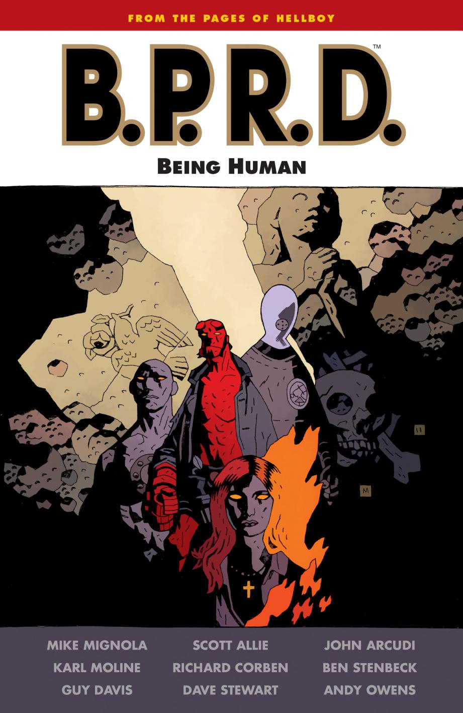MIKE MIGNOLA
</td>
<td>
See notes below
</td>
</tr>
<tr class="even">
<td>
NA
</td>
<td>
<em>1948</em>
</td>
<td>
September 11, 2013
</td>
<td style="text-align: left;"><ul>
<li><em><a href="1948" title="wikilink">1948</a></em> #1–5</li>
</ul></td>
<td style="text-align: left;"><ul>
<li>Sketchbook (18 pages)</li>
</ul></td>
<td>
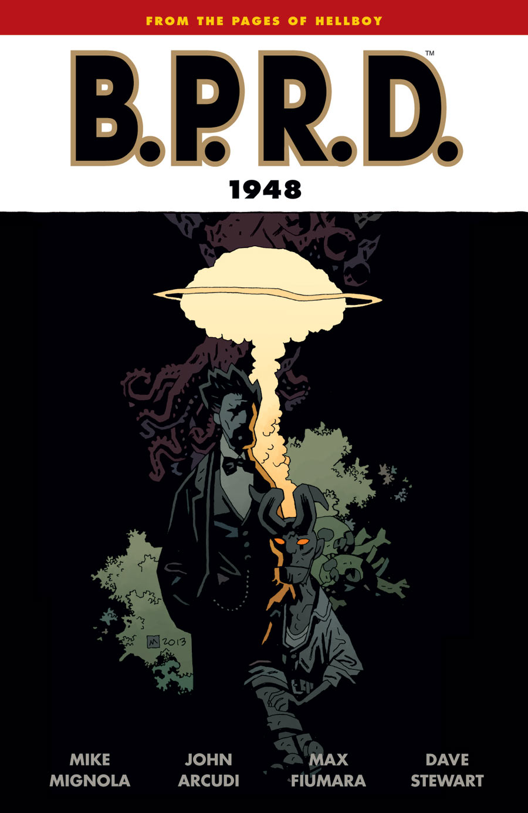MIKE MIGNOLA
</td>
<td>
<a href="Omnibus_Editions#B.P.R.D._1946_.E2.80.93_1948" title="wikilink">B.P.R.D. 
1946 – 1948</a>
</td>
</tr>
</tbody>
</table>

***B.P.R.D.: Being Human*** notes on omnibuses:

- *Casualties* is collected in [*Abe Sapien: The Drowning and Other Stories*](/entry/Omnibus%20Editions)
- *Being Human* is collected in [*Hellboy: The Complete Short Stories – Volume 2*](/entry/Omnibus%20Editions)

### *B.P.R.D.: Vampire*

<table>
<thead>
<tr class="header">
<th>
#
</th>
<th>
Title
</th>
<th>
Date Published
</th>
<th>
Material collected
</th>
<th>
Additional Material
</th>
<th>
Cover
</th>
</tr>
</thead>
<tbody>
<tr class="odd">
<td rowspan="4">
1
</td>
<td rowspan="4">
<em>Vampire</em>
</td>
<td colspan="2">
<strong>1st EDITION</strong>
</td>
<td rowspan="4" style="text-align: left;"><ul>
<li>Sketchbook (17 pages)</li>
</ul></td>
<td rowspan="4">
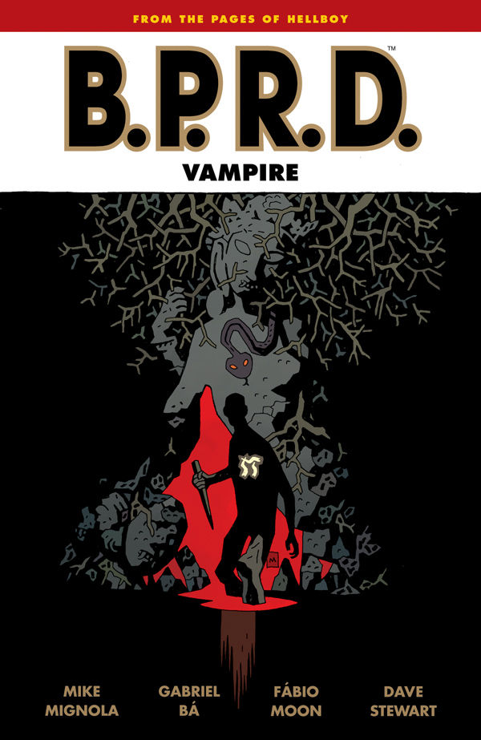MIKE MIGNOLA
</td>
</tr>
<tr class="even">
<td>
November 27, 2013
</td>
<td style="text-align: left;"><ul>
<li><em><a href="Vampire_(story)" title="wikilink">Vampire</a></em> #1–5</li>
</ul></td>
</tr>
<tr class="odd">
<td colspan="2">
<strong>2nd EDITION</strong>
</td>
</tr>
<tr class="even">
<td>
February 27, 2019
</td>
<td style="text-align: left;"><ul>
<li><em><a href="Vampire_(story)" title="wikilink">Vampire</a></em> #1–5</li>
<li>Short story from <em><a href="Hellboy_Winter_Special_(2018)" title="wikilink">Hellboy Winter Special (2018)</a></em></li>
</ul></td>
</tr>
</tbody>
</table>

## *[B.P.R.D.: Hell on Earth](/entry/B.P.R.D.%20%28series%29)*

<table>
<thead>
<tr class="header">
<th>
#
</th>
<th>
Title
</th>
<th>
Date Published
</th>
<th>
Material collected
</th>
<th>
Additional Material
</th>
<th>
Cover
</th>
<th>
Omnibus
</th>
</tr>
</thead>
<tbody>
<tr class="odd">
<td>
1
</td>
<td>
<em>New World</em>
</td>
<td>
August 17, 2011
</td>
<td style="text-align: left;"><ul>
<li><em><a href="New_World" title="wikilink">New World</a></em> #1–5</li>
<li><em><a href="Seattle" title="wikilink">Seattle</a></em></li>
</ul></td>
<td style="text-align: left;"><ul>
<li>Afterword by <a href="Mike_Mignola" title="wikilink">Mike Mignola</a></li>
<li>Sketchbook (8 pages)</li>
</ul></td>
<td>
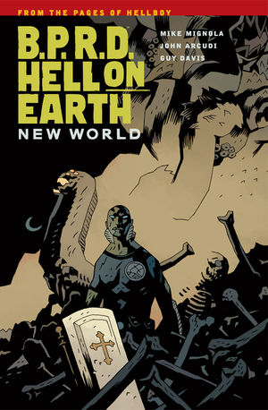MIKE MIGNOLA
</td>
<td rowspan="3">
<a href="Omnibus_Editions#BPRD_Omni_HoE1" title="wikilink"><em>B.P.R.D. 
Hell on Earth</em> 
Volume 1</a>
</td>
</tr>
<tr class="even">
<td>
2
</td>
<td>
<em>Gods and Monsters</em>
</td>
<td>
January 11, 2012
</td>
<td style="text-align: left;"><ul>
<li><em><a href="Gods" title="wikilink">Gods</a></em> #1–3</li>
<li><em><a href="Monsters" title="wikilink">Monsters</a></em> #1–2</li>
</ul></td>
<td style="text-align: left;"><ul>
<li>Sketchbook (19 pages)</li>
</ul></td>
<td>
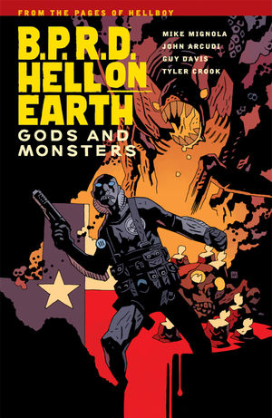MIKE MIGNOLA
</td>
</tr>
<tr class="odd">
<td>
3
</td>
<td>
<em>Russia</em>
</td>
<td>
August 15, 2012
</td>
<td style="text-align: left;"><ul>
<li><em><a href="Russia" title="wikilink">Russia</a></em> #1–5</li>
<li><em><a href="An_Unmarked_Grave" title="wikilink">An Unmarked Grave</a></em></li>
</ul></td>
<td style="text-align: left;"><ul>
<li>Sketchbook (24 pages)</li>
</ul></td>
<td>
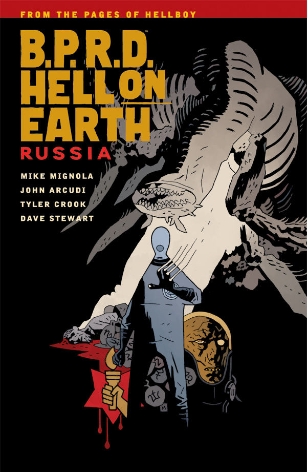MIKE MIGNOLA
</td>
</tr>
<tr class="even">
<td>
4
</td>
<td>
<em>The Devil's Engine &amp; The Long Death</em>
</td>
<td>
December 5, 2012
</td>
<td style="text-align: left;"><ul>
<li><em><a href="The_Devil&#39;s_Engine" title="wikilink">The Devil's Engine</a></em> #1–3</li>
<li><em><a href="The_Long_Death" title="wikilink">The Long Death</a></em> #1–3</li>
</ul></td>
<td style="text-align: left;"><ul>
<li>Sketchbook (27 pages)</li>
</ul></td>
<td>
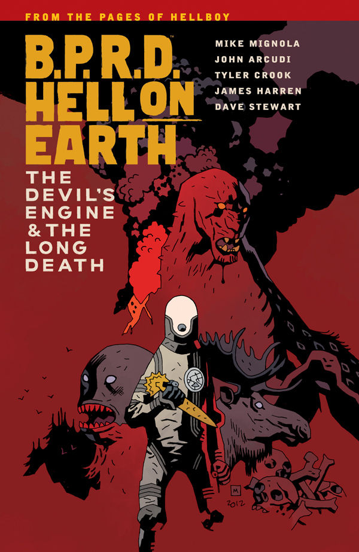MIKE MIGNOLA
</td>
<td rowspan="3">
<a href="Omnibus_Editions#BPRD_Omni_HoE2" title="wikilink"><em>B.P.R.D. 
Hell on Earth</em> 
Volume 2</a>
</td>
</tr>
<tr class="odd">
<td>
5
</td>
<td>
<em>The Pickens County Horror and Others</em>
</td>
<td>
July 17, 2013
</td>
<td style="text-align: left;"><ul>
<li><em><a href="The_Pickens_County_Horror" title="wikilink">The Pickens County Horror</a></em> #1–2</li>
<li><em><a href="The_Transformation_of_J.H._O&#39;Donnell" title="wikilink">The Transformation of J.H. O'Donnell</a></em></li>
<li><em><a href="The_Abyss_of_Time" title="wikilink">The Abyss of Time</a></em> #1–2</li>
</ul></td>
<td style="text-align: left;"><ul>
<li>Sketchbook (30 pages)</li>
</ul></td>
<td>
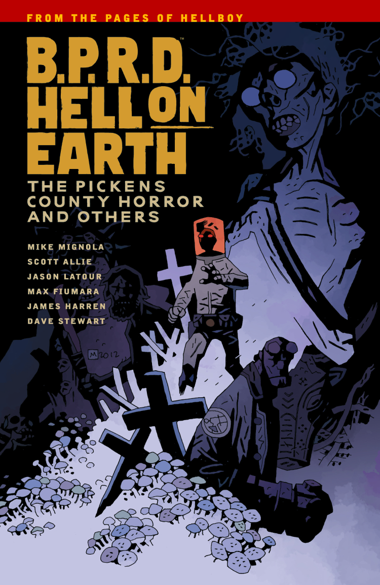MIKE MIGNOLA
</td>
</tr>
<tr class="even">
<td>
6
</td>
<td>
<em>The Return of the Master</em>
</td>
<td>
August 7, 2013
</td>
<td style="text-align: left;"><ul>
<li><em><a href="The_Return_of_the_Master" title="wikilink">The Return of the Master</a></em> #1–5</li>
</ul></td>
<td style="text-align: left;"><ul>
<li>Sketchbook (34 pages)</li>
</ul></td>
<td>
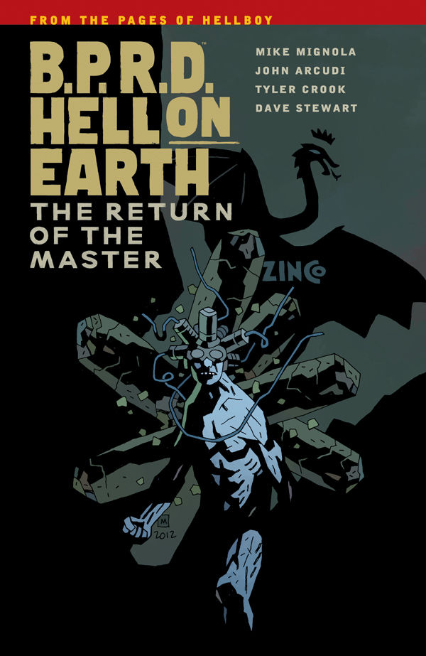MIKE MIGNOLA
</td>
</tr>
<tr class="odd">
<td>
7
</td>
<td>
<em>A Cold Day in Hell</em>
</td>
<td>
January 22, 2014
</td>
<td style="text-align: left;"><ul>
<li><em><a href="Wasteland" title="wikilink">Wasteland</a></em> #1–3</li>
<li><em><a href="A_Cold_Day_in_Hell" title="wikilink">A Cold Day in Hell</a></em> #1–2</li>
</ul></td>
<td style="text-align: left;"><ul>
<li>Sketchbook (18 pages)</li>
</ul></td>
<td>
MIKE MIGNOLA
</td>
<td rowspan="3">
<a href="Omnibus_Editions#BPRD_Omni_HoE3" title="wikilink"><em>B.P.R.D. 
Hell on Earth</em> 
Volume 3</a>
</td>
</tr>
<tr class="even">
<td>
8
</td>
<td>
<em>Lake of Fire</em>
</td>
<td>
April 9, 2014
</td>
<td style="text-align: left;"><ul>
<li><em><a href="Lake_of_Fire" title="wikilink">Lake of Fire</a></em> #1–5</li>
</ul></td>
<td style="text-align: left;"><ul>
<li>Sketchbook (18 pages)</li>
</ul></td>
<td>
MIKE MIGNOLA
</td>
</tr>
<tr class="odd">
<td>
9
</td>
<td>
<em>The Reign of the Black Flame</em>
</td>
<td>
September 10, 2014
</td>
<td style="text-align: left;"><ul>
<li><em><a href="The_Reign_of_the_Black_Flame" title="wikilink">The Reign of the Black Flame</a></em> #1–5</li>
</ul></td>
<td style="text-align: left;"><ul>
<li>Sketchbook (18 pages)</li>
</ul></td>
<td>
MIKE MIGNOLA
</td>
</tr>
<tr class="even">
<td>
10
</td>
<td>
<em>The Devil's Wings</em>
</td>
<td>
March 18, 2015
</td>
<td style="text-align: left;"><ul>
<li><em><a href="The_Devil&#39;s_Wings" title="wikilink">The Devil's Wings</a></em> #1–2</li>
<li><em><a href="The_Broken_Equation" title="wikilink">The Broken Equation</a></em> #1–2</li>
<li><em><a href="Grind" title="wikilink">Grind</a></em></li>
</ul></td>
<td style="text-align: left;"><ul>
<li>Sketchbook (22 pages)</li>
</ul></td>
<td>
RYAN SOOK
</td>
<td rowspan="2">
<a href="Omnibus_Editions#BPRD_Omni_HoE4" title="wikilink"><em>B.P.R.D. 
Hell on Earth</em> 
Volume 4</a>
</td>
</tr>
<tr class="odd">
<td>
11
</td>
<td>
<em>Flesh and Stone</em>
</td>
<td>
September 23, 2015
</td>
<td style="text-align: left;"><ul>
<li><em><a href="Flesh_and_Stone" title="wikilink">Flesh and Stone</a></em> #1–5</li>
</ul></td>
<td style="text-align: left;"><ul>
<li>Sketchbook (18 pages)</li>
</ul></td>
<td>
LAURENCE CAMPBELL
</td>
</tr>
<tr class="even">
<td>
12
</td>
<td>
<em>Metamorphosis</em>
</td>
<td>
December 23, 2015
</td>
<td style="text-align: left;"><ul>
<li><em><a href="Nowhere,_Nothing,_Never" title="wikilink">Nowhere, Nothing, Never</a></em> #1–3</li>
<li><em><a href="Modern_Prometheus" title="wikilink">Modern Prometheus</a></em> #1–2</li>
</ul></td>
<td style="text-align: left;"><ul>
<li>Sketchbook (18 pages)</li>
</ul></td>
<td>
<!-- missing image: BPRD_Hell_on_Earth_Trade12.jpg -->LAURENCE CAMPBELL
</td>
<td rowspan="2">
<a href="Omnibus_Editions#BPRD_Omni_HoE5" title="wikilink"><em>B.P.R.D. 
Hell on Earth</em> 
Volume 5</a>
</td>
</tr>
<tr class="odd">
<td>
13
</td>
<td>
<em>End of Days</em>
</td>
<td>
May 18, 2016
</td>
<td style="text-align: left;"><ul>
<li><em><a href="End_of_Days" title="wikilink">End of Days</a></em> #1–5</li>
</ul></td>
<td style="text-align: left;"><ul>
<li>Sketchbook (10 pages)</li>
</ul></td>
<td>
LAURENCE CAMPBELL
</td>
</tr>
<tr class="even">
<td>
14
</td>
<td>
<em>The Exorcist</em>
</td>
<td>
September 21, 2016
</td>
<td style="text-align: left;"><ul>
<li><em><a href="Exorcism" title="wikilink">Exorcism</a></em> #1–2</li>
<li><em><a href="The_Exorcist" title="wikilink">The Exorcist</a></em> #1–3</li>
</ul></td>
<td style="text-align: left;"><ul>
<li>Sketchbook (8 pages)</li>
</ul></td>
<td>
LAURENCE CAMPBELL
</td>
<td>
<a href="Omnibus_Editions#BPRD_Omni_HoE4" title="wikilink"><em>B.P.R.D. 
Hell on Earth</em> 
Volume 4</a>
</td>
</tr>
<tr class="odd">
<td>
15
</td>
<td>
<em>Cometh the Hour</em>
</td>
<td>
March 29, 2017
</td>
<td style="text-align: left;"><ul>
<li><em><a href="Cometh_the_Hour" title="wikilink">Cometh the Hour</a></em> #1–5</li>
</ul></td>
<td style="text-align: left;"><ul>
<li>Sketchbook (13 pages)</li>
</ul></td>
<td>
LAURENCE CAMPBELL
</td>
<td>
<a href="Omnibus_Editions#BPRD_Omni_HoE5" title="wikilink"><em>B.P.R.D. 
Hell on Earth</em> 
Volume 5</a>
</td>
</tr>
</tbody>
</table>

## *[B.P.R.D.: The Devil You Know](/entry/B.P.R.D.%20%28series%29)*

<table>
<thead>
<tr class="header">
<th>
#
</th>
<th>
Title
</th>
<th>
Date Published
</th>
<th>
Material collected
</th>
<th>
Additional Material
</th>
<th>
Cover
</th>
</tr>
</thead>
<tbody>
<tr class="odd">
<td>
1
</td>
<td>
<em>Messiah</em>
</td>
<td>
April 11, 2018
</td>
<td style="text-align: left;"><ul>
<li><em><a href="Messiah" title="wikilink">Messiah</a></em> #1–5</li>
<li><em><a href="Broken_Vessels" title="wikilink">Broken Vessels</a></em></li>
</ul></td>
<td style="text-align: left;"><ul>
<li>Sketchbook (9 pages)</li>
</ul></td>
<td>
LAURENCE CAMPBELL
</td>
</tr>
<tr class="even">
<td>
2
</td>
<td>
<em>Pandemonium</em>
</td>
<td>
2019
</td>
<td style="text-align: left;"><ul>
<li><a href="Pandemonium_(story_arc)" title="wikilink"><em>Pandemonium</em></a> #1–5</li>
</ul></td>
<td style="text-align: left;"></td>
<td></td>
</tr>
<tr class="odd">
<td>
3
</td>
<td></td>
<td>
2019
</td>
<td style="text-align: left;"></td>
<td style="text-align: left;"></td>
<td></td>
</tr>
</tbody>
</table>

## *[Lobster Johnson](/entry/Lobster%20Johnson%20%28series%29)*

<table>
<thead>
<tr class="header">
<th>
#
</th>
<th>
Title
</th>
<th>
Date Published
</th>
<th>
Material collected
</th>
<th>
Additional Material
</th>
<th>
Cover
</th>
</tr>
</thead>
<tbody>
<tr class="odd">
<td>
1
</td>
<td>
<em>The Iron Prometheus</em>
</td>
<td>
June 18, 2008
</td>
<td style="text-align: left;"><ul>
<li><em><a href="The_Iron_Prometheus" title="wikilink">The Iron Prometheus</a></em> #1–5</li>
</ul></td>
<td style="text-align: left;"><ul>
<li><em>The True History of Lobster Johnson</em></li>
<li>Sketchbook (17 pages)</li>
</ul></td>
<td>
MIKE MIGNOLA
</td>
</tr>
<tr class="even">
<td>
2
</td>
<td>
<em>The Burning Hand</em>
</td>
<td>
November 14, 2012
</td>
<td style="text-align: left;"><ul>
<li><em><a href="The_Burning_Hand" title="wikilink">The Burning Hand</a></em> #1–5</li>
</ul></td>
<td style="text-align: left;"><ul>
<li>Sketchbook (18 pages)</li>
</ul></td>
<td>
MIKE MIGNOLA
</td>
</tr>
<tr class="odd">
<td>
3
</td>
<td>
<em>Satan Smells a Rat</em>
</td>
<td>
February 12, 2014
</td>
<td style="text-align: left;"><ul>
<li><em><a href="Caput_Mortuum" title="wikilink">Caput Mortuum</a></em></li>
<li><em><a href="Satan_Smells_a_Rat" title="wikilink">Satan Smells a Rat</a></em></li>
<li><em><a href="Tony_Masso&#39;s_Finest_Hour" title="wikilink">Tony Masso's Finest Hour</a></em></li>
<li><em><a href="A_Scent_of_Lotus" title="wikilink">A Scent of Lotus</a></em> #1–2</li>
<li><em><a href="The_Prayer_of_Neferu" title="wikilink">The Prayer of Neferu</a></em></li>
</ul></td>
<td style="text-align: left;"><ul>
<li>Sketchbook (18 pages)</li>
</ul></td>
<td>
MIKE MIGNOLA
</td>
</tr>
<tr class="even">
<td>
4
</td>
<td>
<em>Get the Lobster!</em>
</td>
<td>
December 10, 2014
</td>
<td style="text-align: left;"><ul>
<li><em><a href="Get_the_Lobster" title="wikilink">Get the Lobster</a></em> #1–5</li>
</ul></td>
<td style="text-align: left;"><ul>
<li>Sketchbook (18 pages)</li>
</ul></td>
<td>
TONCI ZONJIC
</td>
</tr>
<tr class="odd">
<td>
5
</td>
<td>
<em>The Pirate’s Ghost and Metal Monsters of Midtown</em>
</td>
<td>
December 13, 2017
</td>
<td style="text-align: left;"><ul>
<li><em><a href="Metal_Monsters_of_Midtown" title="wikilink">Metal Monsters of Midtown</a></em> #1–3</li>
<li><em><a href="The_Pirate&#39;s_Ghost" title="wikilink">The Pirate's Ghost</a></em> #1–3</li>
</ul></td>
<td style="text-align: left;"><ul>
<li>Afterword by <a href="Clem_Robins" title="wikilink">Clem Robins</a></li>
<li>Sketchbook (16 pages)</li>
</ul></td>
<td>
TONCI ZONJIC
</td>
</tr>
<tr class="even">
<td>
6
</td>
<td>
<em>A Chain Forged in Life</em>
</td>
<td>
March 7, 2018
</td>
<td style="text-align: left;"><ul>
<li><em><a href="A_Chain_Forged_in_Life" title="wikilink">A Chain Forged in Life</a></em></li>
<li><em><a href="The_Forgotten_Man" title="wikilink">The Forgotten Man</a></em></li>
<li><em><a href="The_Glass_Mantis" title="wikilink">The Glass Mantis</a></em></li>
<li><em><a href="Garden_of_Bones" title="wikilink">Garden of Bones</a></em></li>
<li><em><a href="Mangekyō" title="wikilink">Mangekyō</a></em></li>
</ul></td>
<td style="text-align: left;"><ul>
<li>Sketchbook (18 pages)</li>
</ul></td>
<td>
TONCI ZONJIC
</td>
</tr>
</tbody>
</table>

## *[Abe Sapien](/entry/Abe%20Sapien%20%28series%29)*

<table>
<thead>
<tr class="header">
<th>
#
</th>
<th>
Title
</th>
<th>
Date Published
</th>
<th>
Material collected
</th>
<th>
Additional Material
</th>
<th>
Cover
</th>
<th>
Omnibus
</th>
</tr>
</thead>
<tbody>
<tr class="odd">
<td>
1
</td>
<td>
<em>The Drowning</em>
</td>
<td>
September 17, 2008
</td>
<td style="text-align: left;"><ul>
<li><em><a href="The_Drowning" title="wikilink">The Drowning</a></em> #1–5</li>
</ul></td>
<td style="text-align: left;"><ul>
<li>Sketchbook (8 pages)</li>
</ul></td>
<td>
MIKE MIGNOLA
</td>
<td rowspan="2">
<em><a href="Omnibus_Editions#Abe_Omni_Drowning" title="wikilink">Abe Sapien: 
The Drowning and Other Stories</a></em>
</td>
</tr>
<tr class="even">
<td>
2
</td>
<td>
<em>The Devil Does Not Jest 
and Other Stories</em>
</td>
<td>
May 9, 2012
</td>
<td style="text-align: left;"><ul>
<li><em><a href="The_Haunted_Boy" title="wikilink">The Haunted Boy</a></em></li>
<li><em><a href="The_Abyssal_Plain" title="wikilink">The Abyssal Plain</a></em> #1–2</li>
<li><em><a href="The_Devil_Does_Not_Jest" title="wikilink">The Devil Does Not Jest</a></em> #1–2</li>
</ul></td>
<td style="text-align: left;"><ul>
<li>Sketchbook (20 pages)</li>
</ul></td>
<td>
MIKE MIGNOLA
</td>
</tr>
<tr class="odd">
<td>
3
</td>
<td>
<em>Dark and Terrible 
and The New Race of Man</em>
</td>
<td>
December 11, 2013
</td>
<td style="text-align: left;"><ul>
<li><em><a href="Dark_and_Terrible_(story)" title="wikilink">Dark and Terrible</a></em> #1–3</li>
<li><em><a href="The_New_Race_of_Man" title="wikilink">The New Race of Man</a></em> #1–2</li>
</ul></td>
<td style="text-align: left;"><ul>
<li>Sketchbook (24 pages)</li>
</ul></td>
<td>
MIKE MIGNOLA
</td>
<td rowspan="3">
<a href="Omnibus_Editions#Abe_Omni_DaT1" title="wikilink"><em>Abe Sapien: 
Dark and Terrible</em> 
Volume 1</a>
</td>
</tr>
<tr class="even">
<td>
4
</td>
<td>
<em>The Shape of 
Things to Come</em>
</td>
<td>
July 9, 2014
</td>
<td style="text-align: left;"><ul>
<li><em><a href="The_Shape_of_Things_to_Come" title="wikilink">The Shape of Things to Come</a></em> #1–2</li>
<li><em><a href="To_the_Last_Man" title="wikilink">To the Last Man</a></em> #1–3</li>
</ul></td>
<td style="text-align: left;"><ul>
<li>Sketchbook (18 pages)</li>
</ul></td>
<td>
MIKE MIGNOLA
</td>
</tr>
<tr class="odd">
<td>
5
</td>
<td>
<em>Sacred Places</em>
</td>
<td>
January 21, 2015
</td>
<td style="text-align: left;"><ul>
<li><em><a href="The_Garden_(I)" title="wikilink">The Garden (I)</a></em></li>
<li><em><a href="The_Healer" title="wikilink">The Healer</a></em></li>
<li><em><a href="Visions,_Dreams,_and_Fishin&#39;" title="wikilink">Visions, Dreams, and Fishin'</a></em></li>
<li><em><a href="Sacred_Places" title="wikilink">Sacred Places</a></em> #1–2</li>
</ul></td>
<td style="text-align: left;"><ul>
<li>Sketchbook (20 pages)</li>
</ul></td>
<td>
MAX FIUMARA &amp; SEBASTIÁN FIUMARA
</td>
</tr>
<tr class="even">
<td>
6
</td>
<td>
<em>A Darkness 
So Great</em>
</td>
<td>
July 15, 2015
</td>
<td style="text-align: left;"><ul>
<li><em><a href="A_Darkness_so_Great" title="wikilink">A Darkness so Great</a></em> #1–5</li>
</ul></td>
<td style="text-align: left;"><ul>
<li>Sketchbook (18 pages)</li>
</ul></td>
<td>
MAX FIUMARA &amp; SEBASTIÁN FIUMARA
</td>
<td rowspan="3">
<a href="Omnibus_Editions#Abe_Omni_DaT2" title="wikilink"><em>Abe Sapien: 
Dark and Terrible</em> 
Volume 2</a>
</td>
</tr>
<tr class="odd">
<td>
7
</td>
<td>
<em>The Secret Fire</em>
</td>
<td>
June 15, 2016
</td>
<td style="text-align: left;"><ul>
<li><em><a href="The_Shadow_Over_Suwanee" title="wikilink">The Shadow Over Suwanee</a></em> #1–3</li>
<li><em><a href="The_Garden_(II)" title="wikilink">The Garden (II)</a></em> #1–2</li>
<li><em><a href="The_Black_School" title="wikilink">The Black School</a></em></li>
</ul></td>
<td style="text-align: left;"><ul>
<li>Sketchbook (18 pages)</li>
</ul></td>
<td>
MAX FIUMARA &amp; SEBASTIÁN FIUMARA
</td>
</tr>
<tr class="even">
<td>
8
</td>
<td>
<em>The Desolate Shore</em>
</td>
<td>
January 18, 2017
</td>
<td style="text-align: left;"><ul>
<li><em><a href="Regressions" title="wikilink">Regressions</a></em> #1–2</li>
<li><em><a href="Dark_and_Terrible_Deep" title="wikilink">Dark and Terrible Deep</a></em></li>
<li><em><a href="The_Garden_(III)" title="wikilink">The Garden (III)</a></em></li>
<li><em><a href="The_Desolate_Shore" title="wikilink">The Desolate Shore</a></em></li>
</ul></td>
<td style="text-align: left;"><ul>
<li>Sketchbook (19 pages)</li>
<li>Afterword by <a href="Scott_Allie" title="wikilink">Scott Allie</a></li>
</ul></td>
<td>
MAX FIUMARA &amp; SEBASTIÁN FIUMARA
</td>
</tr>
<tr class="odd">
<td>
9
</td>
<td>
<em>Lost Lives 
and Other Stories</em>
</td>
<td>
June 7, 2017
</td>
<td style="text-align: left;"><ul>
<li><em><a href="The_Land_of_the_Dead" title="wikilink">The Land of the Dead</a></em></li>
<li><em><a href="Witchcraft_&amp;_Demonology" title="wikilink">Witchcraft &amp; Demonology</a></em></li>
<li><em><a href="The_Ogopogo" title="wikilink">The Ogopogo</a></em></li>
<li><em><a href="Subconscious" title="wikilink">Subconscious</a></em></li>
<li><em><a href="Lost_Lives" title="wikilink">Lost Lives</a></em></li>
<li><em><a href="Icthyo_Sapien" title="wikilink">Icthyo Sapien</a></em></li>
</ul></td>
<td style="text-align: left;"><ul>
<li>Sketchbook (14 pages)</li>
</ul></td>
<td>
SEBASTIÁN FIUMARA
</td>
<td>
<em><a href="Omnibus_Editions#Abe_Omni_Drowning" title="wikilink">Abe Sapien: 
The Drowning and Other Stories</a></em>
</td>
</tr>
</tbody>
</table>

## *[Sir Edward Grey, Witchfinder](/entry/Witchfinder)*

<table>
<thead>
<tr class="header">
<th>
#
</th>
<th>
Title
</th>
<th>
Date Published
</th>
<th>
Material collected
</th>
<th>
Additional Material
</th>
<th>
Cover
</th>
</tr>
</thead>
<tbody>
<tr class="odd">
<td>
1
</td>
<td>
<em>In the Service of Angels</em>
</td>
<td>
April 7, 2010
</td>
<td style="text-align: left;"><ul>
<li><em><a href="In_the_Service_of_Angels" title="wikilink">In the Service of Angels</a></em> #1–5</li>
<li><em><a href="Murderous_Intent" title="wikilink">Murderous Intent</a></em></li>
<li>Henry Hood in <em><a href="The_Burial_of_Katharine_Baker" title="wikilink">The Burial of Katharine Baker</a></em></li>
</ul></td>
<td style="text-align: left;"><ul>
<li>Afterword by <a href="Mike_Mignola" title="wikilink">Mike Mignola</a></li>
<li>Sketchbook (10 pages)</li>
</ul></td>
<td>
MIKE MIGNOLA
</td>
</tr>
<tr class="even">
<td>
2
</td>
<td>
<em>Lost and Gone Forever</em>
</td>
<td>
January 11, 2012
</td>
<td style="text-align: left;"><ul>
<li><em><a href="Lost_and_Gone_Forever" title="wikilink">Lost and Gone Forever</a></em> #1–5</li>
</ul></td>
<td style="text-align: left;"><ul>
<li>Afterword by <a href="John_Arcudi" title="wikilink">John Arcudi</a></li>
<li>Sketchbook (9 pages)</li>
</ul></td>
<td>
MIKE MIGNOLA
</td>
</tr>
<tr class="odd">
<td>
3
</td>
<td>
<em>The Mysteries of Unland</em>
</td>
<td>
April 22, 2015
</td>
<td style="text-align: left;"><ul>
<li><em><a href="The_Mysteries_of_Unland" title="wikilink">The Mysteries of Unland</a></em> #1–5</li>
<li><em><a href="Beware_the_Ape" title="wikilink">Beware the Ape</a></em></li>
</ul></td>
<td style="text-align: left;"><ul>
<li>Sketchbook (18 pages)</li>
</ul></td>
<td>
MIKE MIGNOLA
</td>
</tr>
<tr class="even">
<td>
4
</td>
<td>
<em>City of the Dead</em>
</td>
<td>
April 19, 2017
</td>
<td style="text-align: left;"><ul>
<li><em><a href="City_of_the_Dead" title="wikilink">City of the Dead</a></em> #1–5</li>
</ul></td>
<td style="text-align: left;"><ul>
<li>Sketchbook (10 pages)</li>
</ul></td>
<td>
JULIÁN TOTINO TEDESCO
</td>
</tr>
<tr class="odd">
<td>
5
</td>
<td>
<em>The Gates of Heaven</em>
</td>
<td>
January 2, 2019
</td>
<td style="text-align: left;"><ul>
<li><em><a href="The_Gates_of_Heaven" title="wikilink">The Gates of Heaven</a></em> #1–5</li>
</ul></td>
<td style="text-align: left;"></td>
<td>
JULIÁN TOTINO TEDESCO
</td>
</tr>
</tbody>
</table>

### Uncollected *Witchfinder*

The following *Witchfinder* story is not currently collected:

- *[The Great Blizzard](/entry/The%20Great%20Blizzard)*

## *[Sledgehammer 44](/entry/Sledgehammer%2044%20%28series%29)*

<table>
<thead>
<tr class="header">
<th>
#
</th>
<th>
Title
</th>
<th>
Date Published
</th>
<th>
Material collected
</th>
<th>
Additional Material
</th>
<th>
Cover
</th>
</tr>
</thead>
<tbody>
<tr class="odd">
<td>
1
</td>
<td>
<em>Sledgehammer 44</em>
</td>
<td>
May 28, 2014
</td>
<td style="text-align: left;"><ul>
<li><em><a href="Sledgehammer_44_(story)" title="wikilink">Sledgehammer 44</a></em> #1–2</li>
<li><em><a href="Lightning_War" title="wikilink">Lightning War</a></em> #1–3</li>
</ul></td>
<td style="text-align: left;"><ul>
<li>Afterword by <a href="Scott_Allie" title="wikilink">Scott Allie</a></li>
<li>Sketchbook (17 pages)</li>
</ul></td>
<td>
MIKE MIGNOLA
</td>
</tr>
</tbody>
</table>

## *[Hellboy and the B.P.R.D.](/entry/Hellboy%20and%20the%20B.P.R.D.)*

<table>
<thead>
<tr class="header">
<th>
Title
</th>
<th>
Date Published
</th>
<th>
Material collected
</th>
<th>
Additional Material
</th>
<th>
Cover
</th>
</tr>
</thead>
<tbody>
<tr class="odd">
<td>
<em>1952</em>
</td>
<td>
August 12, 2015
</td>
<td style="text-align: left;"><ul>
<li><em><a href="1952" title="wikilink">1952</a></em> #1–5</li>
</ul></td>
<td style="text-align: left;"><ul>
<li>Sketchbook (18 pages)</li>
</ul></td>
<td>
MIKE MIGNOLA
</td>
</tr>
<tr class="even">
<td>
<em>1953</em>
</td>
<td>
August 10, 2016
</td>
<td style="text-align: left;"><ul>
<li><em><a href="The_Phantom_Hand" title="wikilink">The Phantom Hand</a></em></li>
<li><em><a href="Rawhead_and_Bloody_Bones" title="wikilink">Rawhead and Bloody Bones</a></em></li>
<li><em><a href="The_Witch_Tree" title="wikilink">The Witch Tree</a></em></li>
<li><em><a href="The_Kelpie" title="wikilink">The Kelpie</a></em></li>
<li><em><a href="Wandering_Souls" title="wikilink">Wandering Souls</a></em></li>
<li><em><a href="Beyond_the_Fences" title="wikilink">Beyond the Fences</a></em> #1–3</li>
</ul></td>
<td style="text-align: left;"><ul>
<li>Sketchbook (24 pages)</li>
</ul></td>
<td>
MIKE MIGNOLA
</td>
</tr>
<tr class="odd">
<td>
<em>1954</em>
</td>
<td>
January 10, 2018
</td>
<td style="text-align: left;"><ul>
<li><em><a href="Black_Sun" title="wikilink">Black Sun</a></em> #1–2</li>
<li><em><a href="The_Unreasoning_Beast" title="wikilink">The Unreasoning Beast</a></em></li>
<li><em><a href="Ghost_Moon" title="wikilink">Ghost Moon</a></em> #1–2</li>
<li><em><a href="The_Mirror" title="wikilink">The Mirror</a></em></li>
</ul></td>
<td style="text-align: left;"><ul>
<li>Sketchbook (14 pages)</li>
</ul></td>
<td>
MIKE MIGNOLA
</td>
</tr>
<tr class="even">
<td>
<em>1955</em>
</td>
<td>
June 6, 2018
</td>
<td style="text-align: left;"><ul>
<li><em><a href="Secret_Nature" title="wikilink">Secret Nature</a></em></li>
<li><em><a href="Occult_Intelligence" title="wikilink">Occult Intelligence</a></em> #1–3</li>
<li><em><a href="Burning_Season" title="wikilink">Burning Season</a></em></li>
</ul></td>
<td style="text-align: left;"></td>
<td>
PAOLO RIVERA
</td>
</tr>
<tr class="odd">
<td>
<em>1956</em>
</td>
<td>
2019
</td>
<td style="text-align: left;"><ul>
<li><em><a href="1956" title="wikilink">1956</a></em> #1–5</li>
</ul></td>
<td style="text-align: left;"></td>
<td></td>
</tr>
</tbody>
</table>

## *[Frankenstein Underground](/entry/Frankenstein%20Underground)*

<table>
<thead>
<tr class="header">
<th>
Title
</th>
<th>
Date Published
</th>
<th>
Material Collected
</th>
<th>
Additional Material
</th>
<th>
Cover
</th>
</tr>
</thead>
<tbody>
<tr class="odd">
<td>
<em><a href="Frankenstein_Underground" title="wikilink">Frankenstein Underground</a></em>
</td>
<td>
November 25, 2015
</td>
<td style="text-align: left;"><ul>
<li><em><a href="Frankenstein_Underground" title="wikilink">Frankenstein Underground</a></em> #1–5</li>
</ul></td>
<td style="text-align: left;"><ul>
<li>Sketchbook (18 pages)</li>
</ul></td>
<td>
MIKE MIGNOLA
</td>
</tr>
</tbody>
</table>

## *[Rise of the Black Flame](/entry/Rise%20of%20the%20Black%20Flame)*

<table>
<thead>
<tr class="header">
<th>
Title
</th>
<th>
Date Published
</th>
<th>
Material Collected
</th>
<th>
Additional Material
</th>
<th>
Cover
</th>
</tr>
</thead>
<tbody>
<tr class="odd">
<td>
<em><a href="Rise_of_the_Black_Flame" title="wikilink">Rise of the Black Flame</a></em>
</td>
<td>
May 3, 2017
</td>
<td style="text-align: left;"><ul>
<li><em><a href="Rise_of_the_Black_Flame" title="wikilink">Rise of the Black Flame</a></em> #1–5</li>
</ul></td>
<td style="text-align: left;"><ul>
<li>Sketchbook (10 pages)</li>
</ul></td>
<td>
LAURENCE CAMPBELL
</td>
</tr>
</tbody>
</table>

## *[The Visitor: How & Why He Stayed](/entry/The_Visitor__How_%26_Why_He_Stayed)*

<table>
<thead>
<tr class="header">
<th>
Title
</th>
<th>
Date Published
</th>
<th>
Material Collected
</th>
<th>
Additional Material
</th>
<th>
Cover
</th>
</tr>
</thead>
<tbody>
<tr class="odd">
<td>
<em><a href="The_Visitor:_How_&amp;_Why_He_Stayed" title="wikilink">The Visitor: 
How &amp; Why He Stayed</a></em>
</td>
<td>
October 17, 2017
</td>
<td style="text-align: left;"><ul>
<li><em><a href="The_Visitor:_How_&amp;_Why_He_Stayed" title="wikilink">The Visitor: How &amp; Why He Stayed</a></em> #1–5</li>
<li><em><a href="God_Rest_Ye_Merry" title="wikilink">God Rest Ye Merry</a></em></li>
</ul></td>
<td style="text-align: left;"><ul>
<li>Afterword by Chris Roberson</li>
<li>Sketchbook (7 pages)</li>
</ul></td>
<td>
PAUL GRIST
</td>
</tr>
</tbody>
</table>

## *[Rasputin: The Voice of the Dragon](/entry/Rasputin__The_Voice_of_the_Dragon)*

<table>
<thead>
<tr class="header">
<th>
Title
</th>
<th>
Date Published
</th>
<th>
Material Collected
</th>
<th>
Additional Material
</th>
<th>
Cover
</th>
</tr>
</thead>
<tbody>
<tr class="odd">
<td>
<em><a href="Rasputin:_The_Voice_of_the_Dragon" title="wikilink">Rasputin: 
The Voice of the Dragon</a></em>
</td>
<td>
July 25, 2018
</td>
<td style="text-align: left;"><ul>
<li><em><a href="Rasputin:_The_Voice_of_the_Dragon" title="wikilink">Rasputin: The Voice of the Dragon</a></em> #1–5</li>
</ul></td>
<td style="text-align: left;"><ul>
<li>Sketchbook (10 pages)</li>
</ul></td>
<td>
MIKE MIGNOLA
</td>
</tr>
</tbody>
</table>

## *[Koshchei the Deathless](/entry/Koshchei%20the%20Deathless%20%28story%29)*

<table>
<thead>
<tr class="header">
<th>
Title
</th>
<th>
Date Published
</th>
<th>
Material Collected
</th>
<th>
Additional Material
</th>
<th>
Cover
</th>
</tr>
</thead>
<tbody>
<tr class="odd">
<td>
<em><a href="Koshchei_the_Deathless_(story)" title="wikilink">Koshchei the Deathless</a></em>
</td>
<td>
September 19, 2018
</td>
<td style="text-align: left;"><ul>
<li><em><a href="Koshchei_the_Deathless_(story)" title="wikilink">Koshchei the Deathless</a></em> #1–6</li>
</ul></td>
<td style="text-align: left;"></td>
<td>
MIKE MIGNOLA
</td>
</tr>
</tbody>
</table>

## *[Crimson Lotus](/entry/Crimson%20Lotus%20%28story%29)*

<table>
<thead>
<tr class="header">
<th>
Title
</th>
<th>
Date Published
</th>
<th>
Material Collected
</th>
<th>
Additional Material
</th>
<th>
Cover
</th>
</tr>
</thead>
<tbody>
<tr class="odd">
<td>
<em><a href="Crimson_Lotus_(story)" title="wikilink">Crimson Lotus</a></em>
</td>
<td>
2019
</td>
<td style="text-align: left;"><ul>
<li><em><a href="Crimson_Lotus_(story)" title="wikilink">Crimson Lotus</a></em> #1–5</li>
</ul></td>
<td style="text-align: left;"></td>
<td></td>
</tr>
</tbody>
</table>

## Orphaned Stories

The following stories have not yet been collected, nor are they specifically tied to any pre-existing series.

- *[Mood Swings](/entry/Mood%20Swings)*
- *[The Last Witch of Fairfield](/entry/The%20Last%20Witch%20of%20Fairfield)*

## Library and Omnibus Editions

As enough material accumulates, *Hellboy* has been recollected in [library editions](/entry/Hellboy%20Library%20Editions), over-sized hardcover volumes. These books have greatly expanded sketchbook sections. The Czech Republic editions collect two of the regular US library editions into a single oversized volume.

[Omnibus editions](/entry/Omnibus%20Editions) likewise collect multiple trades, but they are not an over-sized format. Omnibus editions are available in hardcover, trade paperback, and ebook formats.

## References

<references />

**Category:Comics**