The Omnibus Editions are collections of material previously released in trade paperbacks. It was kicked off when most of the *[B.P.R.D.](/entry/B.P.R.D.%20%28series%29)* trades were collected as part of their rebranding of the series, calling that cycle of books "*[Plague of Frogs](/entry/Plague%20of%20Frogs%20%28story%20cycle%29)*."

Initially the volumes were only available in hardcover, but beginning late 2014 paperback versions of the omnibuses were released. In 2014, an omnibus collecting *[Hellboy: Weird Tales](/entry/Hellboy%3A%20Weird%20Tales)* was released, followed by a release of [*B.P.R.D. 1946–1948*](/entry/1946%E2%80%931948%20%28story%20cycle%29) in 2015, followed by *[B.P.R.D. Hell on Earth](/entry/Hell_on_Earth_(story_cycle)))* and *[Abe Sapien](/entry/Abe%20Sapien%20%28series%29)* in 2017. A line of *[Hellboy](/entry/Hellboy%20%28series%29)* omnibus collections is scheduled for 2018.

## *B.P.R.D.*

### *Plague of Frogs*

In January 2011, two months after the final trade paperback in [the *Plague of Frogs* cycle](/entry/Plague%20of%20Frogs%20%28story%20cycle%29) had been released, Dark Horse began releasing the *B.P.R.D. Plague of Frogs* omnibuses, a total of four volumes, one coming out every eight to nine months. Each volume contains the material from three *B.P.R.D.* trade paperbacks with additional sketchbook material.

The omnibuses collect the *B.P.R.D.* trade paperback volumes 1–8, 10–12, and 14.[1] Paperback versions of the omnibuses will be commence release in late 2014.

<table>
<thead>
<tr class="header">
<th>
#
</th>
<th>
Cover
</th>
<th>
Date Published
</th>
<th>
Contents
</th>
<th>
ISBN
</th>
</tr>
</thead>
<tbody>
<tr class="odd">
<td rowspan="4">
<strong>1</strong>
</td>
<td rowspan="4" style="text-align: center;">
MIKE MIGNOLA
</td>
<td rowspan="4">
January 19, 2011 (HC) October 22, 2014 (TPB)
</td>
<td>
Collects
</td>
<td rowspan="4">
ISBN 9781595826091 (HC) ISBN 9781595826756 (TPB)
</td>
</tr>
<tr class="even">
<td><ul>
<li><a href="TPB#BPRD1" title="wikilink"><em>B.P.R.D. – Volume 1: Hollow Earth &amp; Other Stories</em></a></li>
<li><a href="TPB#BPRD2" title="wikilink"><em>B.P.R.D. – Volume 2: The Soul of Venice &amp; Other Stories</em></a></li>
<li><a href="TPB#BPRD3" title="wikilink"><em>B.P.R.D. – Volume 3: Plague of Frogs</em></a></li>
</ul></td>
</tr>
<tr class="odd">
<td>
Additional Material
</td>
</tr>
<tr class="even">
<td><ul>
<li><strong>Introduction by <a href="Scott_Allie" title="wikilink">Scott Allie</a></strong></li>
<li><strong>Afterword by <a href="Mike_Mignola" title="wikilink">Mike Mignola</a></strong> (originally published in <em>B.P.R.D. – Volume 3: Plague of Frogs</em>. It appears here with minor modifications.)</li>
<li><strong>Expanded Sketchbook</strong>
<ul>
<li>9 pages for <em>The Hollow Earth and Other Stories</em></li>
<li>15 pages for <em>The Soul of Venice and Other Stories</em></li>
<li>13 pages for <em>Plague of Frogs</em></li>
</ul></li>
</ul></td>
</tr>
<tr class="odd">
<td rowspan="6">
<strong>2</strong>
</td>
<td rowspan="6" style="text-align: center;">
MIKE MIGNOLA
</td>
<td rowspan="6">
August 17, 2011 (HC) January 21, 2015 (TPB)
</td>
<td>
Collects
</td>
<td rowspan="6">
ISBN 9781595826725 (HC) ISBN 9781595826763 (TPB)
</td>
</tr>
<tr class="even">
<td><ul>
<li><a href="TPB#BPRD4" title="wikilink"><em>B.P.R.D. – Volume 4: The Dead</em></a></li>
<li><a href="TPB#BPRD12" title="wikilink"><em>B.P.R.D. – Volume 12: War on Frogs</em></a></li>
<li><a href="TPB#BPRD5" title="wikilink"><em>B.P.R.D. – Volume 5: The Black Flame</em></a></li>
</ul></td>
</tr>
<tr class="odd">
<td>
Additional Material
</td>
</tr>
<tr class="even">
<td><ul>
<li><strong>Introduction by <a href="Scott_Allie" title="wikilink">Scott Allie</a></strong></li>
<li><strong>Afterword by <a href="Mike_Mignola" title="wikilink">Mike Mignola</a></strong> (cobbled together from the afterwords in <em>B.P.R.D. – Volume 4: The Dead</em> and <em>B.P.R.D. – Volume 5: The Black Flame</em> with minor modifications.)</li>
<li><strong>Expanded Sketchbook</strong>
<ul>
<li>16 pages for <em>The Dead</em></li>
<li>8 pages for <em>The Black Flame</em></li>
<li>6 pages for <em>War on Frogs</em></li>
</ul></li>
</ul></td>
</tr>
<tr class="odd">
<td>
Additional Notes
</td>
</tr>
<tr class="even">
<td>
The stories were re-ordered for this volume for a better reading order, as explained by <a href="Scott_Allie" title="wikilink">Scott Allie</a> in the introduction:

<ol>
<li><em><a href="The_Dead" title="wikilink">The Dead</a></em> #1-5</li>
<li><em><a href="The_Black_Flame_(story)" title="wikilink">The Black Flame</a></em> #1 (retitled <em>War on Frogs: Chapter 1</em>)</li>
<li><em><a href="War_on_Frogs" title="wikilink">War on Frogs</a></em> #1 (retitled <em>War on Frogs: Chapter 2</em>)</li>
<li><em><a href="Revival" title="wikilink">Revival</a></em> (retitled <em>War on Frogs: Chapter 3</em>)</li>
<li><em><a href="War_on_Frogs" title="wikilink">War on Frogs</a></em> #2 (retitled <em>War on Frogs: Chapter 4</em>)</li>
<li><em><a href="War_on_Frogs" title="wikilink">War on Frogs</a></em> #4 (retitled <em>War on Frogs: Chapter 5</em>)</li>
<li><em><a href="The_Black_Flame_(story)" title="wikilink">The Black Flame</a></em> #2–6 (retitled <em>The Black Flame: Chapters 1–5</em>)</li>
<li><em><a href="War_on_Frogs" title="wikilink">War on Frogs</a></em> #3 (retitled <em>The Black Flame: Epilogue</em>)</li>
</ol></td>
</tr>
<tr class="odd">
<td rowspan="4">
<strong>3</strong>
</td>
<td rowspan="4" style="text-align: center;">
MIKE MIGNOLA
</td>
<td rowspan="4">
March 21, 2012 (HC) March 25, 2015 (TPB)
</td>
<td>
Collects
</td>
<td rowspan="4">
ISBN 9781595828606 (HC) ISBN 9781616556228 (TPB)
</td>
</tr>
<tr class="even">
<td><ul>
<li><a href="TPB#BPRD6" title="wikilink"><em>B.P.R.D. – Volume 6: The Universal Machine</em></a></li>
<li><a href="TPB#BPRD7" title="wikilink"><em>B.P.R.D. – Volume 7: Garden of Souls</em></a></li>
<li><a href="TPB#BPRD8" title="wikilink"><em>B.P.R.D. – Volume 8: Killing Ground</em></a></li>
</ul></td>
</tr>
<tr class="odd">
<td>
Additional Material
</td>
</tr>
<tr class="even">
<td><ul>
<li><strong>Introduction by <a href="Scott_Allie" title="wikilink">Scott Allie</a></strong></li>
<li><strong>Afterword by <a href="John_Arcudi" title="wikilink">John Arcudi</a></strong> (originally published in <em>B.P.R.D. – Volume 8: Killing Ground</em>. It appears here with minor modifications.)</li>
<li><strong>Expanded Sketchbook</strong>
<ul>
<li>12 pages for <em>The Universal Machine</em></li>
<li>14 pages for <em>Garden of Souls</em></li>
<li>6 pages for <em>Killing Ground</em></li>
</ul></li>
</ul></td>
</tr>
<tr class="odd">
<td rowspan="4">
<strong>4</strong>
</td>
<td rowspan="4" style="text-align: center;">
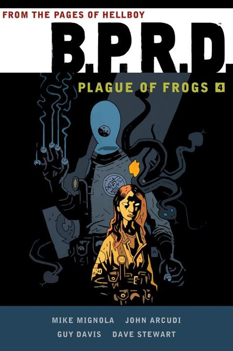MIKE MIGNOLA
</td>
<td rowspan="4">
November 7, 2012 (HC) May 20, 2015 (TPB)
</td>
<td>
Collects
</td>
<td rowspan="4">
ISBN 9781595829740 (HC) ISBN 9781616556419 (TPB)
</td>
</tr>
<tr class="even">
<td><ul>
<li><a href="TPB#BPRD10" title="wikilink"><em>B.P.R.D. – Volume 10: The Warning</em></a></li>
<li><a href="TPB#BPRD11" title="wikilink"><em>B.P.R.D. – Volume 11: The Black Goddess</em></a></li>
<li><a href="TPB#BPRD14" title="wikilink"><em>B.P.R.D. – Volume 14: King of Fear</em></a></li>
</ul></td>
</tr>
<tr class="odd">
<td>
Additional Material
</td>
</tr>
<tr class="even">
<td><ul>
<li><strong>Introduction by <a href="Scott_Allie" title="wikilink">Scott Allie</a></strong></li>
<li><strong>Afterword by <a href="John_Arcudi" title="wikilink">John Arcudi</a></strong></li>
<li><strong>Expanded Sketchbook</strong>
<ul>
<li>6 pages for <em>The Warning</em></li>
<li>13 pages for <em>The Black Goddess</em></li>
<li>29 pages for <em>King of Fear</em></li>
</ul></li>
<li><strong><em>“Latchkey Memories From Crab Point”</em> by Guy Davis</strong></li>
</ul></td>
</tr>
</tbody>
</table>

### *1946–1948*

A cover for a new omnibus was revealed at the San Diego Comic Convention 2014. The hardcover version came out June 2015.

<table>
<thead>
<tr class="header">
<th>
Cover
</th>
<th>
Date Published
</th>
<th>
Contents
</th>
<th>
ISBN
</th>
</tr>
</thead>
<tbody>
<tr class="odd">
<td rowspan="6" style="text-align: center;">
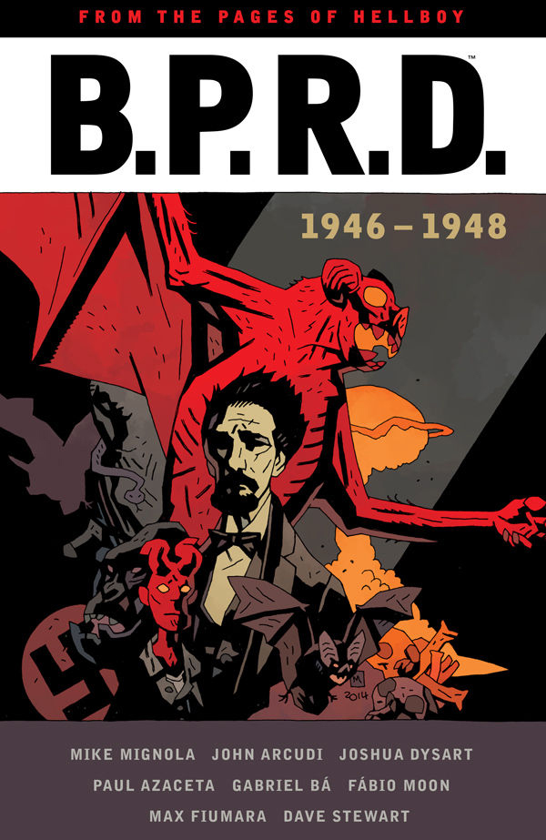MIKE MIGNOLA
</td>
<td rowspan="6">
June 10, 2015 (HC)
</td>
<td>
Collects
</td>
<td rowspan="6">
ISBN 9781616556464 (HC)
</td>
</tr>
<tr class="even">
<td><ul>
<li><a href="TPB#BPRD9" title="wikilink"><em>B.P.R.D.: 1946</em></a> (formerly Volume 9 of <a href="B.P.R.D._(series)" title="wikilink"><em>B.P.R.D.</em></a>)</li>
<li><a href="TPB#BPRD13" title="wikilink"><em>B.P.R.D.: 1947</em></a> (formerly Volume 13 of <a href="B.P.R.D._(series)" title="wikilink"><em>B.P.R.D.</em></a>)</li>
<li><a href="TPB#BPRD_1948" title="wikilink"><em>B.P.R.D.: 1948</em></a></li>
</ul></td>
</tr>
<tr class="odd">
<td>
Additional Material
</td>
</tr>
<tr class="even">
<td><ul>
<li><strong>Introduction by <a href="Scott_Allie" title="wikilink">Scott Allie</a></strong></li>
<li><strong>Afterword by <a href="Chris_Roberson" title="wikilink">Chris Roberson</a></strong></li>
<li><strong>Expanded Sketchbook</strong>
<ul>
<li>9 pages for <em>1946</em></li>
<li>31 pages for <em>1947</em></li>
<li>20 pages for <em>1948</em></li>
</ul></li>
</ul></td>
</tr>
<tr class="odd">
<td>
Additional Notes
</td>
</tr>
<tr class="even">
<td>
The stories were re-ordered for this volume in chronological order:

<ol>
<li><em><a href="And_What_Shall_I_Find_There?" title="wikilink">And What Shall I Find There?</a></em></li>
<li><em><a href="Bishop_Olek&#39;s_Devil" title="wikilink">Bishop Olek's Devil</a></em></li>
<li><em><a href="1946" title="wikilink">1946</a></em></li>
<li><em><a href="1947" title="wikilink">1947</a></em></li>
<li><em><a href="1948" title="wikilink">1948</a></em></li>
</ol></td>
</tr>
</tbody>
</table>

### *Hell on Earth*

The first omnibus (of five) was announced on [Crave Online](http://www.craveonline.com/entertainment/1231813-dark-horse-reveals-mike-mignolas-hellboy-hell-library-edition), March 15, 2017.

<table>
<thead>
<tr class="header">
<th>
#
</th>
<th>
Cover
</th>
<th>
Date Published
</th>
<th>
Contents
</th>
<th>
ISBN
</th>
</tr>
</thead>
<tbody>
<tr class="odd">
<td rowspan="4">
<strong>1</strong>
</td>
<td rowspan="4" style="text-align: center;">
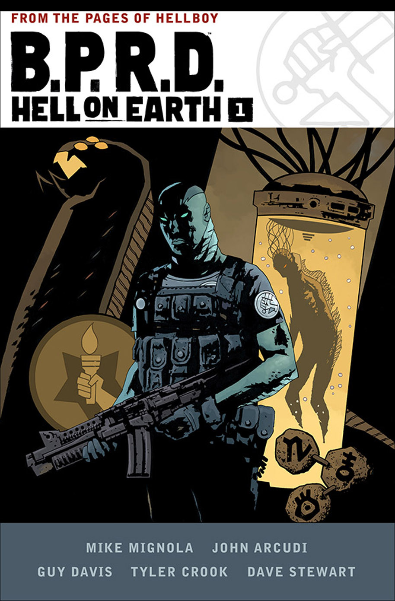LAURENCE CAMPBELL
</td>
<td rowspan="4">
December 27, 2017 (HC)
</td>
<td>
Collects
</td>
<td rowspan="4">
ISBN 9781506703602 (HC)
</td>
</tr>
<tr class="even">
<td><ul>
<li><a href="TPB#BPRD_HOE1" title="wikilink"><em>B.P.R.D. Hell on Earth – Volume 1: New World</em></a></li>
<li><a href="TPB#BPRD_HOE2" title="wikilink"><em>B.P.R.D. Hell on Earth – Volume 2: Gods and Monsters</em></a></li>
<li><a href="TPB#BPRD_HOE3" title="wikilink"><em>B.P.R.D. Hell on Earth – Volume 3: Russia</em></a></li>
</ul></td>
</tr>
<tr class="odd">
<td>
Additional Material
</td>
</tr>
<tr class="even">
<td><ul>
<li><strong>Introduction by <a href="John_Arcudi" title="wikilink">John Arcudi</a></strong></li>
<li><strong>Foreword by <a href="Mike_Mignola" title="wikilink">Mike Mignola</a></strong> (originally published in <em>B.P.R.D.: Hell on Earth – Volume 1: New World</em>.)</li>
<li><strong>Expanded Sketchbook</strong>
<ul>
<li>8 pages for <em>New World</em></li>
<li>22 pages for <em>Gods and Monsters</em></li>
<li>26 pages for <em>Russia</em></li>
</ul></li>
</ul></td>
</tr>
<tr class="odd">
<td rowspan="6">
<strong>2</strong>
</td>
<td rowspan="6" style="text-align: center;">
LAURENCE CAMPBELL
</td>
<td rowspan="6">
April 18, 2018 (HC) August 1, 2018 (corrected HC)
</td>
<td>
Collects
</td>
<td rowspan="6">
ISBN 9781506703886 (HC)
</td>
</tr>
<tr class="even">
<td><ul>
<li><a href="TPB#BPRD_HOE4" title="wikilink"><em>B.P.R.D. Hell on Earth – Volume 4: The Devil's Engine &amp; The Long Death</em></a></li>
<li><a href="TPB#BPRD_HOE5" title="wikilink"><em>B.P.R.D. Hell on Earth – Volume 5: The Pickens County Horror &amp; Others</em></a></li>
<li><a href="TPB#BPRD_HOE6" title="wikilink"><em>B.P.R.D. Hell on Earth – Volume 6: The Return of the Master</em></a></li>
</ul></td>
</tr>
<tr class="odd">
<td>
Additional Material
</td>
</tr>
<tr class="even">
<td>
* <strong>Introduction by <a href="Scott_Allie" title="wikilink">Scott Allie</a></strong>

<ul>
<li><strong>Expanded Sketchbook</strong>
<ul>
<li>24 pages for <em>The Devil's Engine &amp; The Long Death</em></li>
<li>30 pages for <em>The Pickens County Horror &amp; Others</em></li>
<li>33 pages for <em>The Return of the Master</em></li>
<li>3 pages for trade covers</li>
</ul></li>
<li><strong>Expanded Sketchbook</strong></li>
</ul></td>
</tr>
<tr class="odd">
<td>
Additional Notes
</td>
</tr>
<tr class="even">
<td>
The original print run had an error: <em>The Long Death</em> was missing its last page. A corrected print run is scheduled for an August 1, 2018 release.
</td>
</tr>
<tr class="odd">
<td rowspan="4">
<strong>3</strong>
</td>
<td rowspan="4" style="text-align: center;">
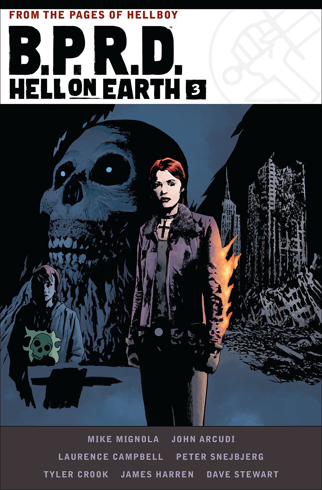LAURENCE CAMPBELL
</td>
<td rowspan="4">
October 17, 2018 (HC)
</td>
<td>
Collects
</td>
<td rowspan="4">
ISBN 9781506704906 (HC)
</td>
</tr>
<tr class="even">
<td><ul>
<li><a href="TPB#BPRD_HOE7" title="wikilink"><em>B.P.R.D. Hell on Earth – Volume 7: A Cold Day in Hell</em></a></li>
<li><a href="TPB#BPRD_HOE8" title="wikilink"><em>B.P.R.D. Hell on Earth – Volume 8: Lake of Fire</em></a></li>
<li><a href="TPB#BPRD_HOE9" title="wikilink"><em>B.P.R.D. Hell on Earth – Volume 9: The Reign of the Black Flame</em></a></li>
</ul></td>
</tr>
<tr class="odd">
<td>
Additional Material
</td>
</tr>
<tr class="even">
<td><ul>
<li><strong>Expanded Sketchbook</strong></li>
</ul></td>
</tr>
<tr class="odd">
<td rowspan="4">
<strong>4</strong>
</td>
<td rowspan="4" style="text-align: center;">
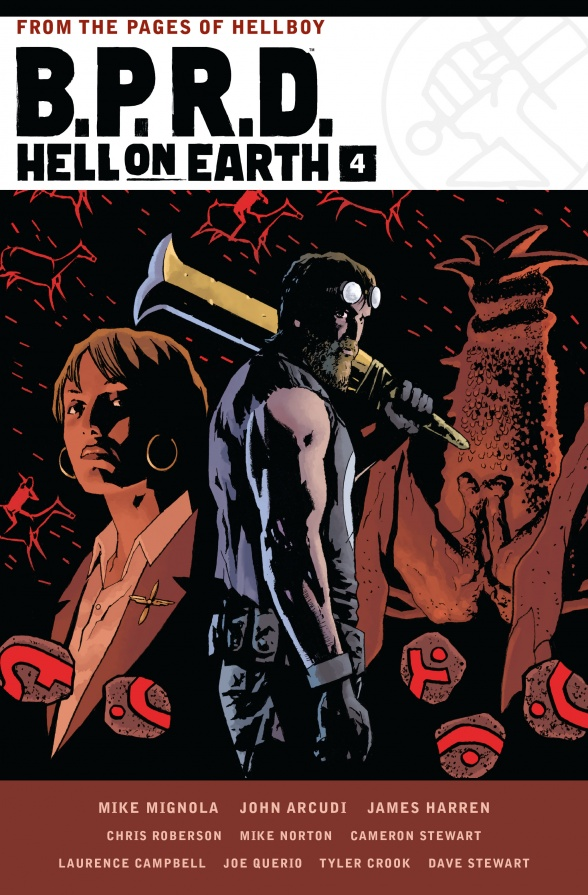LAURENCE CAMPBELL
</td>
<td rowspan="4">
December 26, 2018 (HC)
</td>
<td>
Collects
</td>
<td rowspan="4">
ISBN 9781506706542 (HC)
</td>
</tr>
<tr class="even">
<td><ul>
<li><a href="TPB#BPRD_HOE10" title="wikilink"><em>B.P.R.D. Hell on Earth – Volume 10: The Devil's Wings</em></a></li>
<li><a href="TPB#BPRD_HOE11" title="wikilink"><em>B.P.R.D. Hell on Earth – Volume 11: Flesh and Stone</em></a></li>
<li><a href="TPB#BPRD_HOE14" title="wikilink"><em>B.P.R.D. Hell on Earth – Volume 14: The Exorcist</em></a></li>
</ul></td>
</tr>
<tr class="odd">
<td>
Additional Material
</td>
</tr>
<tr class="even">
<td><ul>
<li><strong>Expanded Sketchbook</strong></li>
</ul></td>
</tr>
<tr class="odd">
<td rowspan="4">
<strong>5</strong>
</td>
<td rowspan="4" style="text-align: center;">
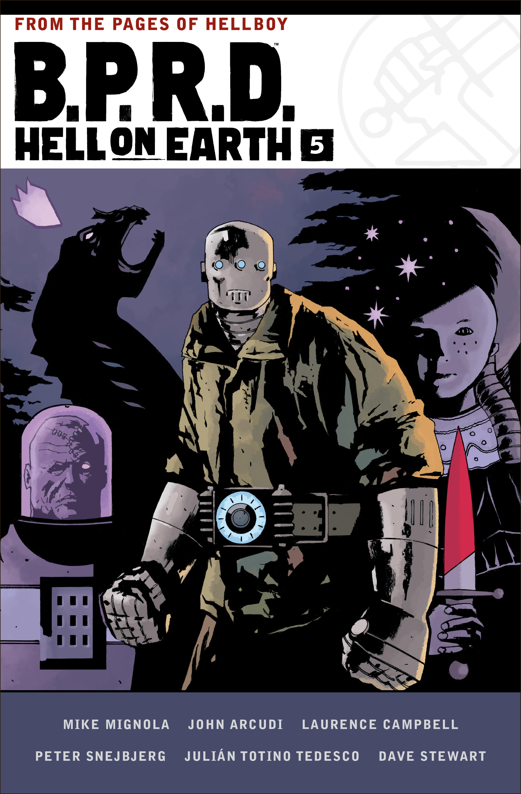LAURENCE CAMPBELL
</td>
<td rowspan="4">
2019 (HC)
</td>
<td>
Collects
</td>
<td rowspan="4"></td>
</tr>
<tr class="even">
<td><ul>
<li><a href="TPB#BPRD_HOE12" title="wikilink"><em>B.P.R.D. Hell on Earth – Volume 12: Metamorphosis</em></a></li>
<li><a href="TPB#BPRD_HOE13" title="wikilink"><em>B.P.R.D. Hell on Earth – Volume 13: End of Days</em></a></li>
<li><a href="TPB#BPRD_HOE15" title="wikilink"><em>B.P.R.D. Hell on Earth – Volume 15: Cometh the Hour</em></a></li>
</ul></td>
</tr>
<tr class="odd">
<td>
Additional Material
</td>
</tr>
<tr class="even">
<td><ul>
<li><strong>Expanded Sketchbook</strong></li>
</ul></td>
</tr>
</tbody>
</table>

## *Abe Sapien*

A pair of *Dark and Terrible* omnibuses were announced on [Freak Sugar](http://www.freaksugar.com/abe-sapien-dark-and-terrible-hardcovers-covers-first-look-dark-horse-max-fiumara/), April 12, 2017. This was later followed by a third omnibus in 2018 collecting all the flashback material from *[Abe Sapien](/entry/Abe%20Sapien%20%28series%29)*.

<table>
<thead>
<tr class="header">
<th>
Cover
</th>
<th>
Date Published
</th>
<th>
Contents
</th>
<th>
ISBN
</th>
</tr>
</thead>
<tbody>
<tr class="odd">
<td colspan="2">
<em>Dark and Terrible – Volume 1</em>
</td>
<td>
Collects
</td>
<td rowspan="4">
ISBN 9781506705385 (HC)
</td>
</tr>
<tr class="even">
<td rowspan="3" style="text-align: center;">
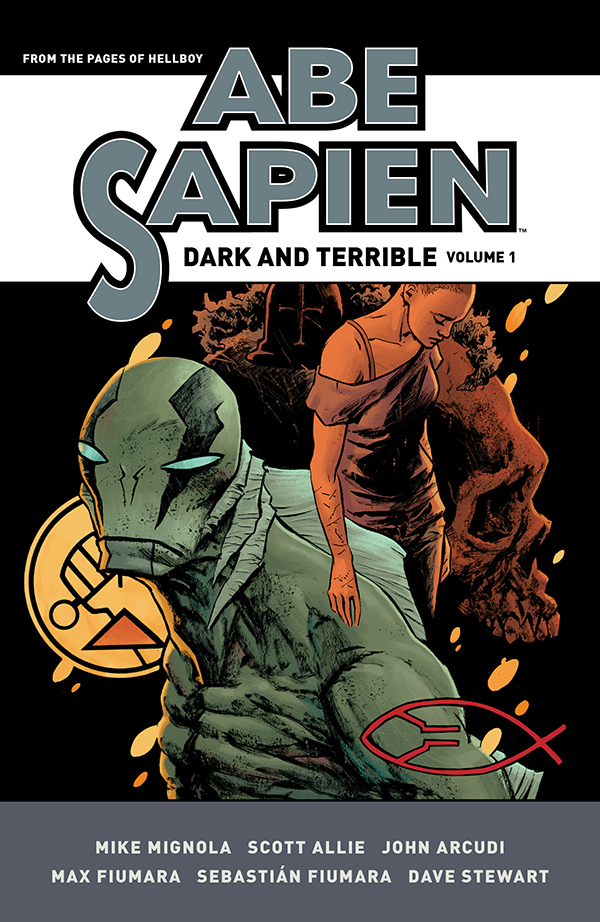SEBASTIÁN FIUMARA
</td>
<td rowspan="3">
November 8, 2017 (HC)
</td>
<td><ul>
<li><a href="TPB#Abe3" title="wikilink"><em>Abe Sapien – Volume 3: Dark and Terrible and The New Race of Man</em></a></li>
<li><a href="TPB#Abe4" title="wikilink"><em>Abe Sapien – Volume 4: The Shape of Things to Come</em></a></li>
<li><a href="TPB#Abe5" title="wikilink"><em>Abe Sapien – Volume 5: Sacred Places</em></a></li>
</ul></td>
</tr>
<tr class="odd">
<td>
Additional Material
</td>
</tr>
<tr class="even">
<td><ul>
<li><strong>Introduction by <a href="Scott_Allie" title="wikilink">Scott Allie</a></strong></li>
<li><strong>Expanded Sketchbook</strong>
<ul>
<li>30 pages for <em>Dark and Terrible and The New Race of Man</em></li>
<li>17 pages for <em>The Shape of Things to Come</em></li>
<li>33 pages for <em>Sacred Places</em></li>
</ul></li>
</ul></td>
</tr>
<tr class="odd">
<td colspan="2">
<em>Dark and Terrible – Volume 2</em>
</td>
<td>
Collects
</td>
<td rowspan="4">
ISBN 9781506703855 (HC)
</td>
</tr>
<tr class="even">
<td rowspan="3" style="text-align: center;">
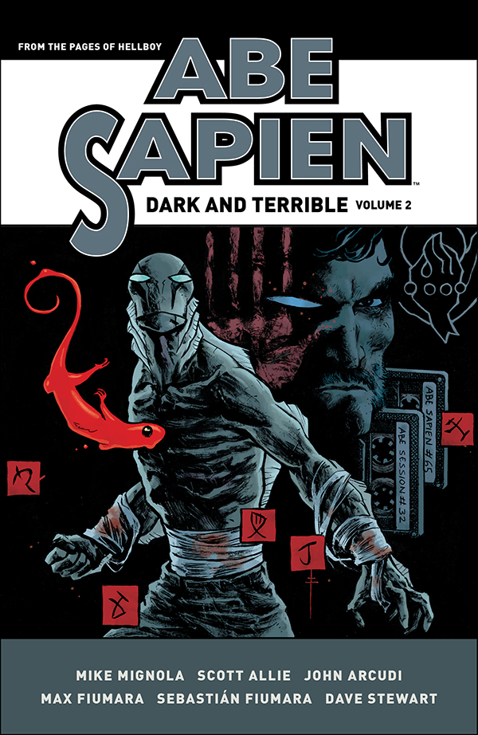SEBASTIÁN FIUMARA
</td>
<td rowspan="3">
March 21, 2018 (HC)
</td>
<td><ul>
<li><a href="TPB#Abe6" title="wikilink"><em>Abe Sapien – Volume 6: A Darkness so Great</em></a></li>
<li><a href="TPB#Abe7" title="wikilink"><em>Abe Sapien – Volume 7: The Secret Fire</em></a></li>
<li><a href="TPB#Abe8" title="wikilink"><em>Abe Sapien – Volume 8: The Desolate Shore</em></a></li>
</ul></td>
</tr>
<tr class="odd">
<td>
Additional Material
</td>
</tr>
<tr class="even">
<td><ul>
<li><strong>Introduction by <a href="Scott_Allie" title="wikilink">Scott Allie</a></strong></li>
<li><strong>Afterword by <a href="Scott_Allie" title="wikilink">Scott Allie</a></strong> (originally published in <em>Abe Sapien – Volume 8: The Desolate Shore</em>.)</li>
<li><strong>Expanded Sketchbook</strong>
<ul>
<li>17 pages for <em>A Darkness so Great</em></li>
<li>26 pages for <em>The Secret Fire</em></li>
<li>17 pages for <em>The Desolate Shore</em></li>
<li>9 pages for commissions</li>
</ul></li>
</ul></td>
</tr>
<tr class="odd">
<td colspan="2">
<em>The Drowning and Other Stories</em>
</td>
<td>
Collects
</td>
<td rowspan="6">
ISBN 9781506704883 (HC)
</td>
</tr>
<tr class="even">
<td rowspan="5" style="text-align: center;">
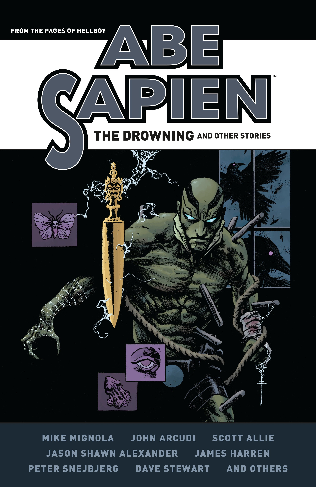SEBASTIÁN FIUMARA
</td>
<td rowspan="5">
July 11, 2018 (HC)
</td>
<td><ul>
<li><a href="TPB#Abe1" title="wikilink"><em>Abe Sapien – Volume 1: The Drowning</em></a></li>
<li><a href="TPB#Abe2" title="wikilink"><em>Abe Sapien – Volume 2: The Devil Does Not Jest and Other Stories</em></a></li>
<li><a href="TPB#Abe9" title="wikilink"><em>Abe Sapien – Volume 9: Lost Lives and Other Stories</em></a></li>
<li><em><a href="Casualties" title="wikilink">Casualties</a></em></li>
<li><em><a href="The_Calm_Before_the_Storm" title="wikilink">The Calm Before the Storm</a></em></li>
</ul></td>
</tr>
<tr class="odd">
<td>
Additional Material
</td>
</tr>
<tr class="even">
<td><ul>
<li><strong>Introduction by <a href="Scott_Allie" title="wikilink">Scott Allie</a></strong></li>
<li><strong>Expanded Sketchbook</strong>
<ul>
<li>8 pages for <em>The Drowning</em></li>
<li>20 pages for <em>The Devil Does Not Jest and Other Stories</em></li>
<li>12 pages for <em>Lost Lives and Other Stories</em></li>
<li>9 pages for covers</li>
</ul></li>
</ul></td>
</tr>
<tr class="odd">
<td>
Additional Notes
</td>
</tr>
<tr class="even">
<td>
The stories were re-ordered for this volume for a better reading order, as explained by <a href="Scott_Allie" title="wikilink">Scott Allie</a> in the introduction:

<ol>
<li><em><a href="The_Drowning" title="wikilink">The Drowning</a></em></li>
<li><em><a href="Casualties" title="wikilink">Casualties</a></em></li>
<li><em><a href="The_Haunted_Boy" title="wikilink">The Haunted Boy</a></em></li>
<li><em><a href="The_Land_of_the_Dead" title="wikilink">The Land of the Dead</a></em></li>
<li><em><a href="Witchcraft_&amp;_Demonology" title="wikilink">Witchcraft &amp; Demonology</a></em></li>
<li><em><a href="The_Abyssal_Plain" title="wikilink">The Abyssal Plain</a></em></li>
<li><em><a href="The_Devil_Does_Not_Jest" title="wikilink">The Devil Does Not Jest</a></em></li>
<li><em><a href="The_Ogopogo" title="wikilink">The Ogopogo</a></em></li>
<li><em><a href="Subconscious" title="wikilink">Subconscious</a></em></li>
<li><em><a href="Lost_Lives" title="wikilink">Lost Lives</a></em></li>
<li><em><a href="Icthyo_Sapien" title="wikilink">Icthyo Sapien</a></em> (extended for the omnibus)</li>
<li><em><a href="The_Calm_Before_the_Storm" title="wikilink">The Calm Before the Storm</a></em> (in sketchbook)</li>
</ol></td>
</tr>
</tbody>
</table>

## *Hellboy*

*Hellboy* is collected across a series of omnibus editions, four following his story from 1994 onwards (the primary storyline), and two additional volumes collecting the short flashback stories from the 1940s through to 1993. These six omnibuses will be paperback editions.

The *Hellboy* omnibuses collect the trade papaerbacks [*Hellboy: Volumes 1–12*](/entry/TPB), [*Hellboy in Hell: Volumes 1–2*](/entry/TPB), [*Hellboy in Mexico*](/entry/TPB), [*Hellboy: The Midnight Circus*](/entry/TPB), [*Hellboy: Into the Silent Sea*](/entry/TPB), and the one-shot story *[Being Human](/entry/Being%20Human)* from [*B.P.R.D.: Being Human*](/entry/TPB).

<table>
<thead>
<tr class="header">
<th>
#
</th>
<th>
Cover
</th>
<th>
Date Published
</th>
<th>
Contents
</th>
<th>
ISBN
</th>
</tr>
</thead>
<tbody>
<tr class="odd">
<td rowspan="4">
1
</td>
<td colspan="2">
<em>Seed of Destruction</em>
</td>
<td>
Collects
</td>
<td rowspan="4">
ISBN 9781506706665 (TPB)
</td>
</tr>
<tr class="even">
<td rowspan="3" style="text-align: center;">
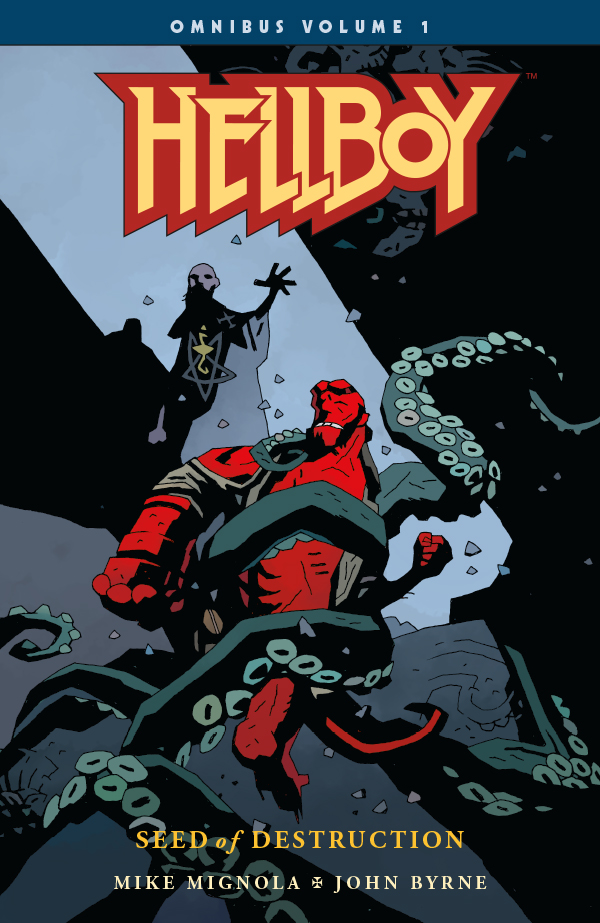MIKE MIGNOLA
</td>
<td rowspan="3">
May 9, 2018 (TPB)
</td>
<td><ul>
<li><em><a href="Seed_of_Destruction" title="wikilink">Seed of Destruction</a></em></li>
<li><em><a href="The_Chained_Coffin" title="wikilink">The Chained Coffin</a></em></li>
<li><em><a href="The_Wolves_of_Saint_August" title="wikilink">The Wolves of Saint August</a></em></li>
<li><em><a href="Wake_the_Devil" title="wikilink">Wake the Devil</a></em></li>
<li><em><a href="Almost_Colossus" title="wikilink">Almost Colossus</a></em></li>
<li><a href="World&#39;s_Greatest_Paranormal_Investigator_(SDCC)" title="wikilink">1993 Promotional Comic</a></li>
<li><a href="World&#39;s_Greatest_Paranormal_Investigator_(CBG)" title="wikilink">1994 Promotional Comic</a></li>
</ul></td>
</tr>
<tr class="odd">
<td>
Additional Material
</td>
</tr>
<tr class="even">
<td><ul>
<li><strong>Sketchbook</strong> (17 pages)</li>
</ul></td>
</tr>
<tr class="odd">
<td rowspan="4">
2
</td>
<td colspan="2">
<em>Strange Places</em>
</td>
<td>
Collects
</td>
<td rowspan="4">
ISBN 9781506706672 (TPB)
</td>
</tr>
<tr class="even">
<td rowspan="3" style="text-align: center;">
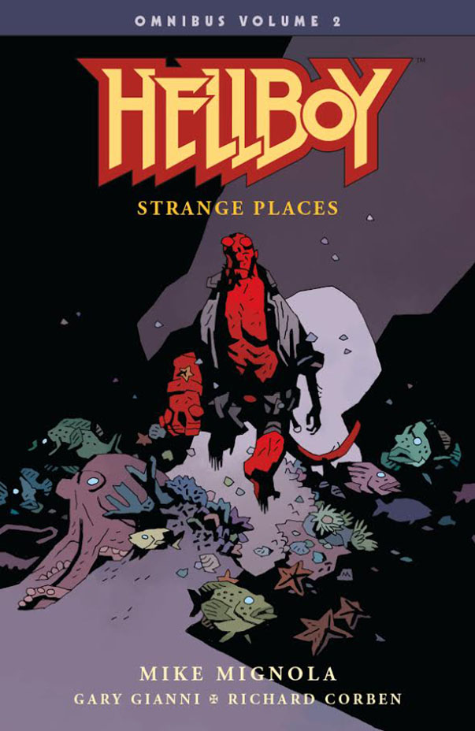MIKE MIGNOLA
</td>
<td rowspan="3">
June 20, 2018 (TPB)
</td>
<td><ul>
<li><em><a href="The_Right_Hand_of_Doom" title="wikilink">The Right Hand of Doom</a></em></li>
<li><em><a href="Box_Full_of_Evil" title="wikilink">Box Full of Evil</a></em></li>
<li><em><a href="Being_Human" title="wikilink">Being Human</a></em></li>
<li><em><a href="Conqueror_Worm" title="wikilink">Conqueror Worm</a></em></li>
<li><em><a href="The_Third_Wish" title="wikilink">The Third Wish</a></em></li>
<li><em><a href="The_Island" title="wikilink">The Island</a></em></li>
<li><em><a href="Into_the_Silent_Sea" title="wikilink">Into the Silent Sea</a></em></li>
</ul></td>
</tr>
<tr class="odd">
<td>
Additional Material
</td>
</tr>
<tr class="even">
<td><ul>
<li><strong>Sketchbook</strong> (13 pages)</li>
</ul></td>
</tr>
<tr class="odd">
<td rowspan="4">
3
</td>
<td colspan="2">
<em>The Wild Hunt</em>
</td>
<td>
Collects
</td>
<td rowspan="4">
ISBN 9781506706689 (TPB)
</td>
</tr>
<tr class="even">
<td rowspan="3" style="text-align: center;">
MIKE MIGNOLA
</td>
<td rowspan="3">
July 18, 2018 (TPB)
</td>
<td><ul>
<li><em><a href="The_Mole" title="wikilink">The Mole</a></em></li>
<li><em><a href="Darkness_Calls" title="wikilink">Darkness Calls</a></em></li>
<li><em><a href="The_Wild_Hunt" title="wikilink">The Wild Hunt</a></em></li>
<li><em><a href="The_Storm" title="wikilink">The Storm</a> and <a href="The_Fury" title="wikilink">the Fury</a></em></li>
</ul></td>
</tr>
<tr class="odd">
<td>
Additional Material
</td>
</tr>
<tr class="even">
<td><ul>
<li><strong>Sketchbook</strong> (9 pages)</li>
</ul></td>
</tr>
<tr class="odd">
<td rowspan="4">
4
</td>
<td colspan="2">
<em>Hellboy in Hell</em>
</td>
<td>
Collects
</td>
<td rowspan="4">
ISBN 9781506707495 (TPB)
</td>
</tr>
<tr class="even">
<td rowspan="3" style="text-align: center;">
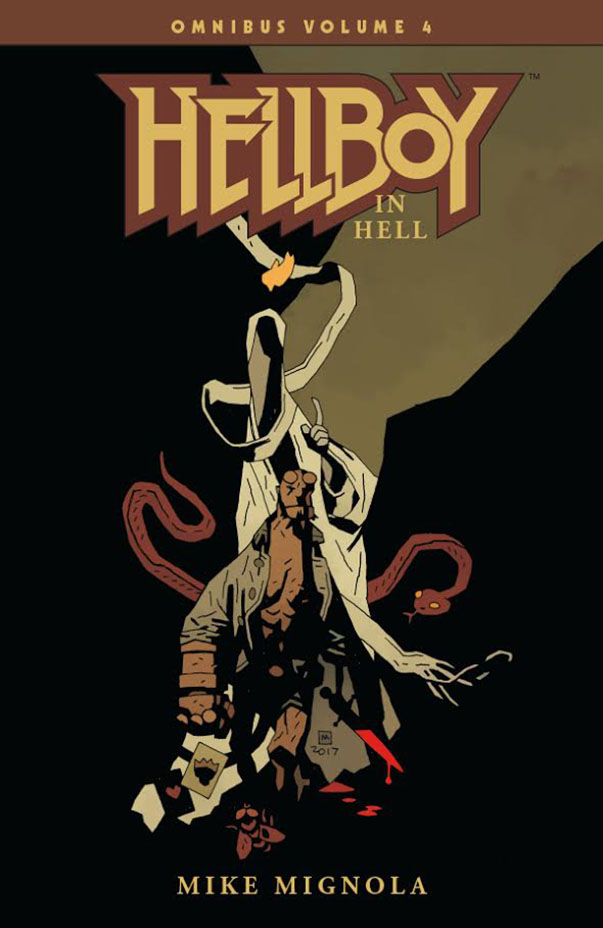MIKE MIGNOLA
</td>
<td rowspan="3">
September 5, 2018 (TPB)
</td>
<td><ul>
<li><em><a href="Hellboy_in_Hell_(first_story_arc)" title="wikilink">The Descent</a></em></li>
<li><em><a href="Hellboy_in_Hell_(first_story_arc)#Issue_2" title="wikilink">Pandemonium</a></em></li>
<li><em><a href="Hellboy_in_Hell_(first_story_arc)#Issue_3" title="wikilink">Family Ties</a></em></li>
<li><em><a href="Hellboy_in_Hell_(first_story_arc)#Issue_4" title="wikilink">Death Riding an Elephant</a></em></li>
<li><em><a href="The_Three_Gold_Whips" title="wikilink">The Three Gold Whips</a></em></li>
<li><em><a href="The_Death_Card" title="wikilink">The Death Card</a></em></li>
<li><em><a href="The_Hounds_of_Pluto#Part_One:_The_Trials_of_Dr._Hoffmann" title="wikilink">The Trials of Dr. Hoffmann</a></em></li>
<li><em><a href="The_Hounds_of_Pluto#Part_Two:_The_Hounds_of_Pluto" title="wikilink">The Hounds of Pluto</a></em></li>
<li><em><a href="The_Exorcist_of_Vorsk" title="wikilink">The Exorcist of Vorsk</a></em></li>
<li><em><a href="The_Spanish_Bride" title="wikilink">The Spanish Bride</a></em></li>
<li><em><a href="For_Whom_the_Bell_Tolls" title="wikilink">For Whom the Bell Tolls</a></em></li>
<li><em><a href="The_Magician_and_the_Snake" title="wikilink">The Magician and the Snake</a></em></li>
</ul></td>
</tr>
<tr class="odd">
<td>
Additional Material
</td>
</tr>
<tr class="even">
<td><ul>
<li><strong>TBD</strong></li>
</ul></td>
</tr>
</tbody>
</table>

### *The Complete Short Stories*

<table>
<thead>
<tr class="header">
<th>
#
</th>
<th>
Cover
</th>
<th>
Date Published
</th>
<th>
Contents
</th>
<th>
ISBN
</th>
</tr>
</thead>
<tbody>
<tr class="odd">
<td rowspan="4">
1
</td>
<td rowspan="4" style="text-align: center;">
MIKE MIGNOLA
</td>
<td rowspan="4">
June 13, 2018 (TPB)
</td>
<td>
Collects
</td>
<td rowspan="4">
ISBN 9781506706641 (TPB)
</td>
</tr>
<tr class="even">
<td><ul>
<li><em><a href="Pancakes" title="wikilink">Pancakes</a></em></li>
<li><em><a href="The_Midnight_Circus" title="wikilink">The Midnight Circus</a></em></li>
<li><em><a href="The_Nature_of_the_Beast" title="wikilink">The Nature of the Beast</a></em></li>
<li><em><a href="King_Vold" title="wikilink">King Vold</a></em></li>
<li><em><a href="Hellboy_in_Mexico" title="wikilink">Hellboy in Mexico</a></em></li>
<li><em><a href="Hellboy_versus_the_Aztec_Mummy" title="wikilink">Hellboy versus the Aztec Mummy</a></em></li>
<li><em><a href="Hellboy_Gets_Married" title="wikilink">Hellboy Gets Married</a></em></li>
<li><em><a href="The_Coffin_Man" title="wikilink">The Coffin Man</a></em></li>
<li><em><a href="The_Coffin_Man_2:_The_Rematch" title="wikilink">The Coffin Man 2: The Rematch</a></em></li>
<li><em><a href="House_of_the_Living_Dead" title="wikilink">House of the Living Dead</a></em></li>
<li><em><a href="The_Crooked_Man" title="wikilink">The Crooked Man</a></em></li>
<li><em><a href="The_Penanggalan" title="wikilink">The Penanggalan</a></em></li>
<li><em><a href="The_Corpse" title="wikilink">The Corpse</a></em></li>
<li><em><a href="Double_Feature_of_Evil" title="wikilink">Double Feature of Evil</a></em></li>
<li><em><a href="The_Iron_Shoes" title="wikilink">The Iron Shoes</a></em></li>
</ul></td>
</tr>
<tr class="odd">
<td>
Additional Material
</td>
</tr>
<tr class="even">
<td><ul>
<li><strong>Sketchbook</strong> (23 pages)</li>
</ul></td>
</tr>
<tr class="odd">
<td rowspan="4">
2
</td>
<td rowspan="4" style="text-align: center;">
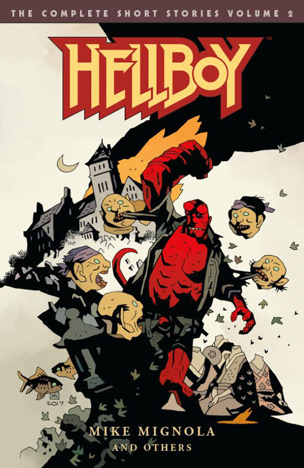MIKE MIGNOLA
</td>
<td rowspan="4">
August 15, 2018 (TPB)
</td>
<td>
Collects
</td>
<td rowspan="4">
ISBN 9781506706658 (TPB)
</td>
</tr>
<tr class="even">
<td><ul>
<li><em><a href="The_Hydra_and_the_Lion" title="wikilink">The Hydra and the Lion</a></em></li>
<li><em><a href="The_Troll_Witch" title="wikilink">The Troll-witch</a></em></li>
<li><em><a href="The_Baba_Yaga" title="wikilink">The Baba Yaga</a></em></li>
<li><em><a href="The_Sleeping_and_the_Dead" title="wikilink">The Sleeping and the Dead</a></em></li>
<li><em><a href="Heads" title="wikilink">Heads</a></em></li>
<li><em><a href="Goodbye_Mister_Tod" title="wikilink">Goodbye Mister Tod</a></em></li>
<li><em><a href="The_Vampire_of_Prague" title="wikilink">The Vampire of Prague</a></em></li>
<li><em><a href="The_Vârcolac" title="wikilink">The Vârcolac</a></em></li>
<li><em><a href="The_Bride_of_Hell" title="wikilink">The Bride of Hell</a></em></li>
<li><em><a href="The_Whittier_Legacy" title="wikilink">The Whittier Legacy</a></em></li>
<li><em><a href="Buster_Oakley_Gets_His_Wish" title="wikilink">Buster Oakley Gets His Wish</a></em></li>
<li><em><a href="They_That_Go_Down_to_the_Sea_in_Ships" title="wikilink">They That Go Down to the Sea in Ships</a></em></li>
<li><em><a href="A_Christmas_Underground" title="wikilink">A Christmas Underground</a></em></li>
<li><em><a href="Dr._Carp&#39;s_Experiment" title="wikilink">Dr. Carp's Experiment</a></em></li>
<li><em><a href="The_Ghoul" title="wikilink">The Ghoul</a></em></li>
<li><em><a href="In_the_Chapel_of_Moloch" title="wikilink">In the Chapel of Moloch</a></em></li>
<li><em><a href="Makoma" title="wikilink">Makoma</a></em></li>
</ul></td>
</tr>
<tr class="odd">
<td>
Additional Material
</td>
</tr>
<tr class="even">
<td><ul>
<li><strong>Sketchbook</strong> (25 pages)</li>
</ul></td>
</tr>
</tbody>
</table>

### *Weird Tales*

An omnibus collecting the non-canonical *[Weird Tales](/entry/Hellboy%3A%20Weird%20Tales)* stories, as well as two canonical short stories. It came out November 2014 in hardcover.

<table>
<thead>
<tr class="header">
<th>
Cover
</th>
<th>
Date Published
</th>
<th>
Contents
</th>
<th>
ISBN
</th>
</tr>
</thead>
<tbody>
<tr class="odd">
<td rowspan="4" style="text-align: center;">
MIKE MIGNOLA
</td>
<td rowspan="4">
November 26, 2014 (HC)
</td>
<td>
Collects
</td>
<td rowspan="4">
ISBN 9781616555108 (HC)
</td>
</tr>
<tr class="even">
<td><ul>
<li><em><a href="How_Koshchei_Became_Deathless" title="wikilink">How Koshchei Became Deathless</a></em></li>
<li><em><a href="Baba_Yaga&#39;s_Feast" title="wikilink">Baba Yaga's Feast</a></em></li>
<li><em>Hellboy: Weird Tales – Volume 1</em></li>
<li><em>Hellboy: Weird Tales – Volume 2</em></li>
</ul></td>
</tr>
<tr class="odd">
<td>
Additional Material
</td>
</tr>
<tr class="even">
<td><ul>
<li><strong>Gallery</strong> (16 pages)</li>
</ul></td>
</tr>
</tbody>
</table>

## *Hellboy and the B.P.R.D.*

On June 6, 2018, editor Katii O’Brien confirmed they had begun early planning for the *Hellboy and the B.P.R.D.* omnibus editions, and that the first volume would collect *[1952](/entry/1952)* to [*1954*](/entry/Trade%20Paperback%20Collections).[2] Unlike previous series, which didn't go to omnibuses until they were finished, *Hellboy and the B.P.R.D.* will be going to omnibuses as the series progresses.

<table>
<thead>
<tr class="header">
<th>
Cover
</th>
<th>
Date Published
</th>
<th>
Contents
</th>
<th>
ISBN
</th>
</tr>
</thead>
<tbody>
<tr class="odd">
<td colspan="2">
<em>1952–1954</em>
</td>
<td>
Collects
</td>
<td rowspan="4"></td>
</tr>
<tr class="even">
<td rowspan="3" style="text-align: center;"></td>
<td rowspan="3"></td>
<td><ul>
<li><a href="TPB#HBBPRD1952" title="wikilink"><em>Hellboy and the B.P.R.D.: 1952</em></a></li>
<li><a href="TPB#HBBPRD1953" title="wikilink"><em>Hellboy and the B.P.R.D.: 1953</em></a></li>
<li><a href="TPB#HBBPRD1954" title="wikilink"><em>Hellboy and the B.P.R.D.: 1954</em></a></li>
</ul></td>
</tr>
<tr class="odd">
<td>
Additional Material
</td>
</tr>
<tr class="even">
<td><ul>
<li><strong>TBD</strong></li>
</ul></td>
</tr>
</tbody>
</table>

## Links

Dark Horse entries:

- [*B.P.R.D.: Plague of Frogs – Volume 1* (hardcover)](http://www.darkhorse.com/Books/17-169/B-P-R-D-Plague-of-Frogs-Hardcover-Collection-Vol-1) / [(paperback)](http://www.darkhorse.com/Books/17-975/B-P-R-D-Plague-of-Frogs-Volume-1-TPB)
- [*B.P.R.D.: Plague of Frogs – Volume 2* (hardcover)](http://www.darkhorse.com/Books/17-524/B-P-R-D-Plague-of-Frogs-Volume-2-hardcover-collection) / [(paperback)](http://www.darkhorse.com/Books/17-976/B-P-R-D-Plague-of-Frogs-Volume-2-TPB)
- [*B.P.R.D.: Plague of Frogs – Volume 3* (hardcover)](http://www.darkhorse.com/Books/18-141/B-P-R-D-Plague-of-Frogs-Volume-3-HC) / [(paperback)](http://www.darkhorse.com/Books/18-143/B-P-R-D-Plague-of-Frogs-Volume-3-TPB)
- [*B.P.R.D.: Plague of Frogs – Volume 4* (hardcover)](http://www.darkhorse.com/Books/18-142/B-P-R-D-Plague-of-Frogs-Volume-4-HC) / [(paperback)](http://www.darkhorse.com/Books/18-144/B-P-R-D-Plague-of-Frogs-Volume-4-TPB)
- [*B.P.R.D.: 1946 – 1948* (hardcover)](http://www.darkhorse.com/Books/22-957/B-P-R-D-1946-1948-HC)
- [*B.P.R.D.: Hell on Earth – Volume 1* (hardcover)](https://www.darkhorse.com/Books/3001-039/B-P-R-D-Hell-on-Earth-Volume-1-HC)
- [*B.P.R.D.: Hell on Earth – Volume 2* (hardcover)](https://www.darkhorse.com/Books/3001-040/B-P-R-D-Hell-on-Earth-Volume-2-HC)
- [*B.P.R.D.: Hell on Earth – Volume 3* (hardcover)](https://www.darkhorse.com/Books/3001-041/B-P-R-D-Hell-on-Earth-Volume-3-HC)
- [*Abe Sapien: Dark and Terrible – Volume 1* (hardcover)](https://www.darkhorse.com/Books/3001-045/Abe-Sapien-Dark-and-Terrible-Volume-1-HC)
- [*Abe Sapien: Dark and Terrible – Volume 2* (hardcover)](https://www.darkhorse.com/Books/3001-046/Abe-Sapien-Dark-and-Terrible-Volume-2-HC)
- [*Abe Sapien: The Drowning and Other Stories* (hardcover)](https://www.darkhorse.com/Books/3001-047/Abe-Sapien-The-Drowning-and-Other-Stories-HC)
- [*Hellboy Omnibus – Volume 1: Seed of Destruction* (paperback)](https://www.darkhorse.com/Books/3002-363/Hellboy-Omnibus-Volume-1-Seed-of-Destruction-TPB)
- [*Hellboy Omnibus – Volume 2: Strange Places* (paperback)](https://www.darkhorse.com/Books/3002-364/Hellboy-Omnibus-Volume-2-Strange-Places-TPB)
- [*Hellboy Omnibus – Volume 3: The Wild Hunt* (paperback)](https://www.darkhorse.com/Books/3002-365/Hellboy-Omnibus-Volume-3-The-Wild-Hunt-TPB)
- [*Hellboy Omnibus – Volume 4: Hellboy in Hell* (paperback)](https://www.darkhorse.com/Books/3002-366/Hellboy-Omnibus-Volume-4-Hellboy-in-Hell-TPB)
- [*Hellboy: The Complete Short Stories – Volume 1* (paperback)](https://www.darkhorse.com/Books/3002-361/Hellboy-The-Complete-Short-Stories-Volume-1-TPB)
- [*Hellboy: The Complete Short Stories – Volume 2* (paperback)](https://www.darkhorse.com/Books/3002-362/Hellboy-The-Complete-Short-Stories-Volume-2-TPB)
- [*Hellboy: Weird Tales* (hardcover)](http://www.darkhorse.com/Books/24-712/Hellboy-Weird-Tales-HC)

## Notes

<references />

**Category:Comics**

[1] Stated by [Scott Allie](/entry/Scott%20Allie) in the [Hellmail](/entry/Hellmail) of *[Lost and Gone Forever](/entry/Lost%20and%20Gone%20Forever)* \#1

[2] <https://www.youtube.com/watch?v=0VCS7AWbOi4&feature=youtu.be&t=759>