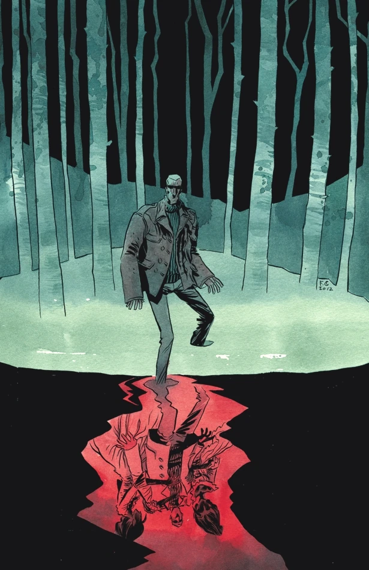
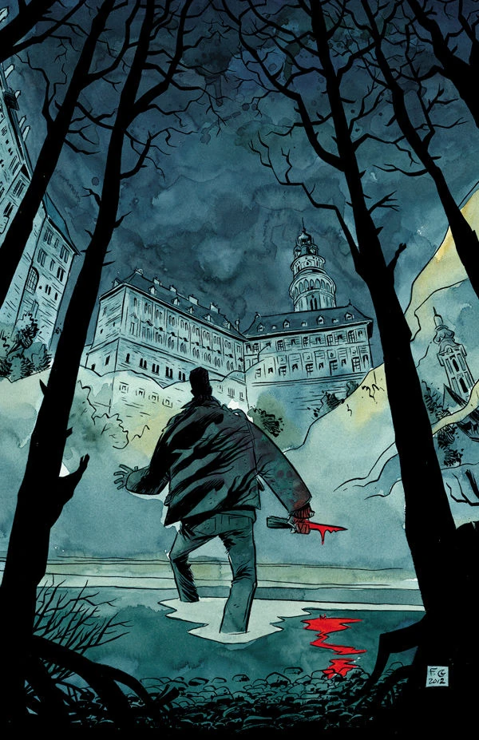
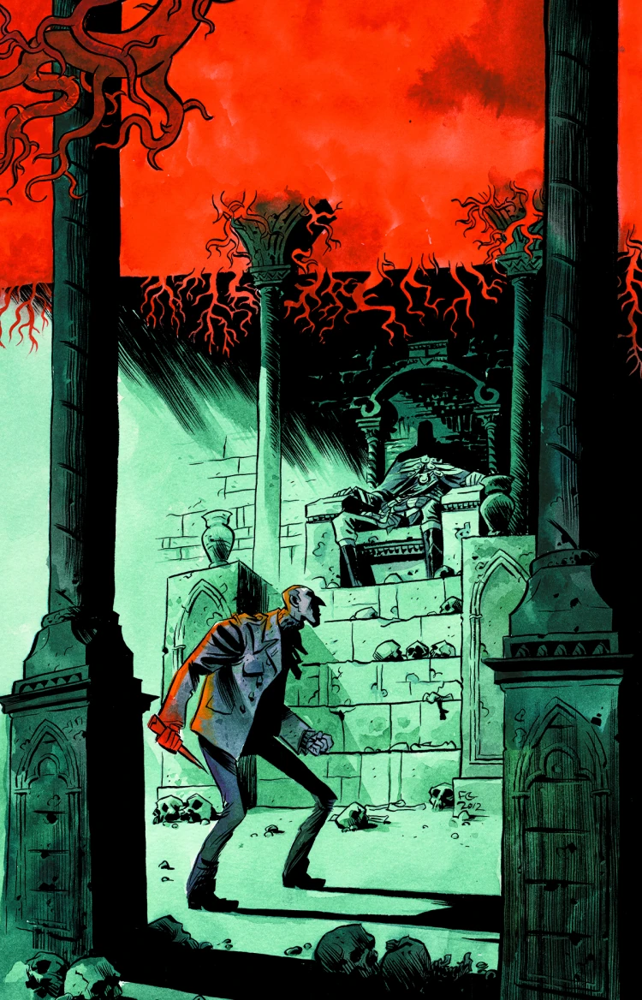
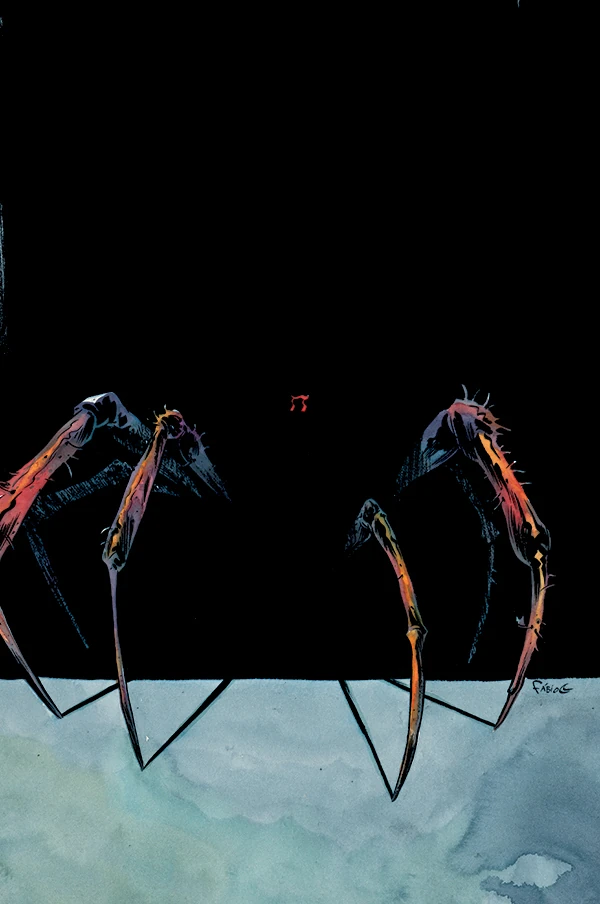
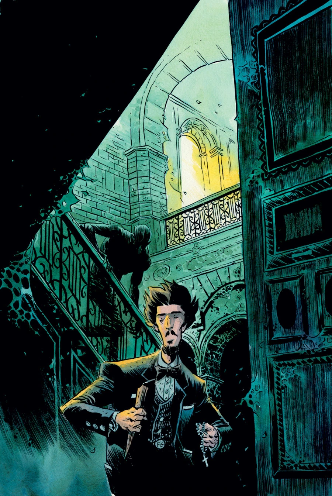

《**吸血鬼**》（Vampire）是一部五期限定迷你系列，是《[1948](/entry/1948)》的续作，同时也是 [B.P.R.D.](/entry/B.P.R.D._(series))《[吸血鬼](/entry/Vampire_(story_cycle))》故事环的第一个故事。

## 出版历史

《吸血鬼》于 2013 年 3 月推出，由加布里埃尔·巴（Gabriel Bá）与法比奥·穆恩（Fábio Moon）兄弟二人作画。

## 剧情简介

### 第一部

在《[B.P.R.D.：1948](/entry/1948)》那些骇人的事件之后，我们跟随一名注定走向毁灭的探员，踏上向一族吸血鬼、以及它们那长着戈耳工之眼的女王复仇的征途。

### 第二部

西蒙·安德斯一路追猎诅咒了他的吸血鬼氏族，在一座被某个恐怖家族的往事所纠缠的捷克小镇里，找到了他要的答案。

### 第三部

一名吸血鬼贵族因与邪恶女神[赫卡特](/entry/Hecate)（Hecate）立下一桩可怖的契约而捡回一命；如今，嗜血的[西蒙·安德斯](/entry/Simon_Anders)要让这笔致命的交易彻底了结。

### 第四部

两只吸血鬼被困在西蒙·安德斯的胸腔之中，他苦苦挣扎、竭力压制着它们，免得它们驱使他、连同一支女巫大军，一起卷入一场血腥屠戮。

### 第五部

林间那场血腥遭遇战之后，唯有布鲁滕霍尔姆教授本人才能够终结这场吸血鬼追猎，并彻查捷克克鲁姆洛夫（Český Krumlov）不死者之谜的真相。

## 画廊

封面均由加布里埃尔·巴（Gabriel Bá）与法比奥·穆恩（Fábio Moon）绘制。

\#1

\#2

\#3

\#4

\#5

**Category:B.P.R.D. story** **Category:Story** **Category:B.P.R.D.: Vampire story**
