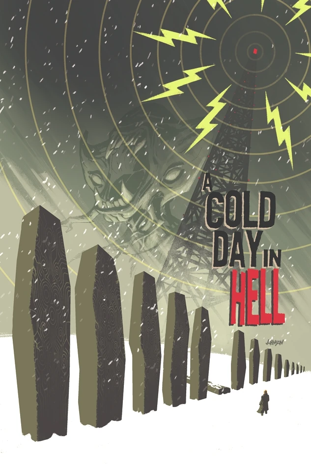
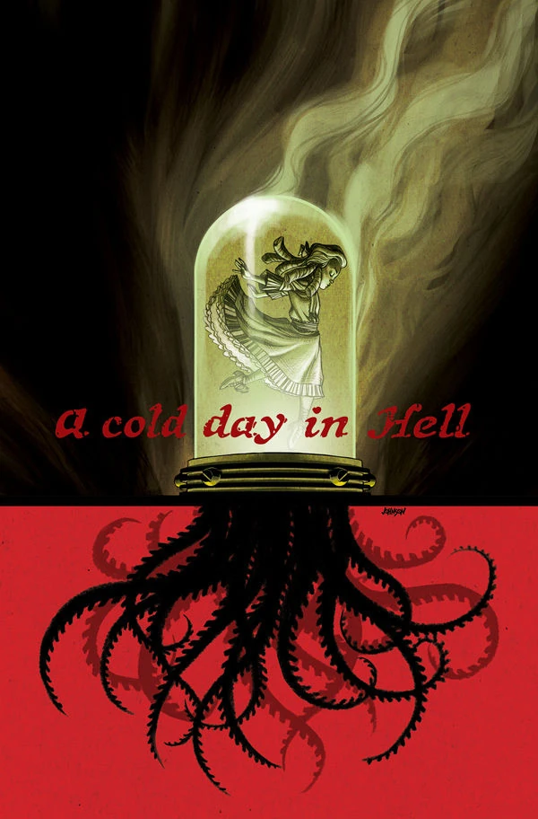

***《地狱寒冬》***（A Cold Day in Hell）是一个两期篇章，于 2013 年出版，作画为[彼得·斯奈比约](/entry/Peter_Snejbjerg)（Peter Snejbjerg），封面由[戴夫·约翰逊](/entry/Dave_Johnson)（Dave Johnson）绘制。

## 剧情简介

### 第一部

《[主人归来](/entry/The_Return_of_the_Master)》的致命事件之后，俄罗斯神秘科学部门的丧尸局长率领一支救援队穿行于暴风雪之中；与此同时，超自然调查防御署则与更多蝙蝠脸怪物展开激战。俄罗斯人为何对荒野中一座倒塌的无线电塔如此执着？

### 第二部

俄罗斯境内的超自然活动愈演愈烈：来自地狱的恶魔们加入战局，与俄罗斯神秘科学部门的丧尸局长交战，企图解救一位被囚禁在人间的高阶恶魔。

## 画廊

 \#1

 \#2

**Category:Story** **Category:B.P.R.D. story** **Category:B.P.R.D.: Hell on Earth story**
