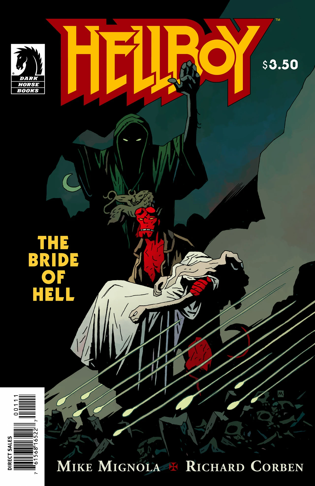

[Hellboy](/entry/Hellboy%20%28character%29) travels to France to rescue a young woman, but ends up learning about [the Knights of Saint Hagan](/entry/Order%20of%20the%20Knights%20of%20Saint%20Hagan).

## Publication History

*The Bride of Hell* was published as a single issue story in December of 2009. The story is reprinted in [Hellboy: vol. 11 The Bride of Hell and Others](/entry/TPB), first published in October 2011.

## Synopsis

In 1985, American tourist Teressa Cipriano disappeared while in France. American news reports say that officials do not have much information. However, the girl's father says that a special branch of the government is looking into the disappearance.

A group of men stand in a clearing. They are dressed in black robes and hold candles. In the center of their circle a girl, Teressa, dressed in white lays on a stone altar. As the ritual comes to is climax, [Hellboy](/entry/Hellboy) emerges from the shadows, but gets his foot caught in a bear trap. A demon flies to the clearing and grabs the girl. Hellboy shoots it and catches the girl.

He runs from the demon through the woods until he stumbles upon the ruins of a church to Saint Hagan.

A monk who happened to be sitting there tells Hellboy the story of St. Hagan;

  
In 1291 [Hagan Douglas](/entry/Hagan%20Douglas) was captured by the Mamelukes outside of the city of Acre during the Crusades. They killed him, cut off his head and sent the body back to the city to demoralize his men. However during the final battle over the city, Hagan rose up and fought headless. Though the city was lost, forty-seven knights witnessed the miracle and founded the [Order of the Knights of Saint Hagan](/entry/Order%20of%20the%20Knights%20of%20Saint%20Hagan).

<!-- -->

  
After Acre the Knights stayed in the Holy Land hunting servants of the evil one. Then in 1307 Pope Clement recalled them to France to oversee the arrest of the Knights Templar. Many continued as Inquisitors, but some went to this church and renounced violence. However, a devil had followed them from the Holy Land and one by one took the remaining monks.

Hellboy leaves the girl with the Monk and sets out to kill the demon. Hellboy tracks the demon to its lair, and the demon reveals that he is Asmodeus.

The story returns to the monk as he tells the sleeping girl about how King Solomon built his Temple;

  
God did not allow any iron tool to be used in the construction, but heard that there was a certain worm that could cut stone. He Conjured up demons and asked them, but they told him that their king, Asmodeus, would know. Solomon sent his warrior, Benaiah, to capture the demon. Solomon forced Asmodeus to reveal his secrets, but one day he was careless and the Demon hurled Solomon into the desert. Asmodeus rules Jerusalem in his place for three years.

<!-- -->

  
Afterward Asmodeus retreated to the desert. Men found him there and built him a house. He had many wives. Years later the Knight of Saint Hagan came and killed his wives. Asmodeus took his revenge and killed the men.

Hellboy replies that that seems fair, but that he has continued to steal more women. Asmodeus replies that he has never stolen anyone, that they all have given them selves to him and wear his sign. The next panel reveals that the girl bears Asmodeus's mark on her thigh.

Teressa wakes up, sees that she is in the ruins of a church and becomes enraged. The monk vanishes with a warning that no evil will remain there. A skeletal warrior rises from a tomb in the church, while at the same time Hellboy fights with the Demon. Hellboy defeats Asmodeus and runs off to protect the girl.

Hellboy arrives to see the warrior standing over Teressa's dead body. The skeleton crumbles to dust.

! colspan = 3 | [*Hellboy – Volume 11: The Bride of Hell and Others*](/entry/TPB)

**Bride of Hell, The** **Bride of Hell, The**