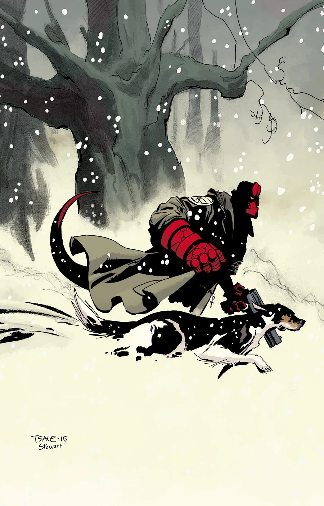

A comic special containing three stories. This comic is the Hellboy Universe debut of Tim Sale, Michael Walsh, Chris Roberson, and Chelsea Cain. This was the first issue of the annual *Hellboy Winter Special* anthology.

## Solicitation

Best-selling novelist Chelsea Cain writes and Michael Avon Oeming draws the first of three snowbound stories. Then Tim Sale visits Mignola’s prehistoric mythology, and in a lead-in to the upcoming issues of *[Hellboy and the B.P.R.D.: 1953](/entry/Beyond%20the%20Fences)*, Hellboy explores a haunted mine in the barren wastes of Wyoming.

## Featuring

- *[Broken Vessels](/entry/Broken%20Vessels)* written by Mike Mignola and Scott Allie with art by Tim Sale
- *[Wandering Souls](/entry/Wandering%20Souls)* written by Mike Mignola and Chris Roberson with art by Michael Walsh
- *[Mood Swings](/entry/Mood%20Swings)* written by Chelsea Cain with art by Michael Avon Oeming
- *Kung Pao Lobster* by Dean Rankine

## Gallery

文件:Hellboy Winter Special (Tim Sale cover).jpg|Tim Sale cover 文件:Hellboy Winter Special (Mike Mignola cover).jpg|Dark Horse 30th Anniversary cover 文件:Hellboy Winter Special (Ben Stenbeck cover).jpg|Ben Stenbeck variant cover 文件:Hellboy Winter Special (Michael Avon Oeming cover).jpg|Michael Avon Oeming variant cover

**Category:Comics**