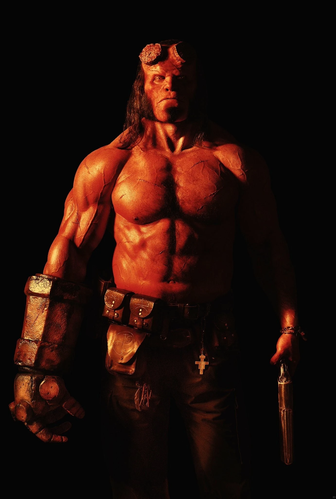

***Hellboy*** (formerly *Hellboy: Rise of the Blood Queen*) is a reboot of the *Hellboy* film series. Millennium Films will finance and distribute the film, which is being made with an R rating in mind.

## Cast

- David Harbour: [Hellboy](/entry/Hellboy%20%28character%29)
- Ian McShane: [Trevor Bruttenholm](/entry/Trevor%20Bruttenholm)
- Mila Jovovich: Nimue, the Blood Queen
- Sasha Lane: [Alice Monaghan](/entry/Alice%20Monaghan)
- Daniel Dae Kim: [Benjamin Daimio](/entry/Benjamin%20Daimio)
- Penelope Mitchell: Ganeida
- Brian Gleeson: [Merlin](/entry/Merlin)
- Sophie Okonedo: Lady Hatton
- Alistair Petrie: [Lord Glaren](/entry/Lord%20Glaren)

### Casting controversy

On August 21, 2017, The Hollywood Reporter[1] announced Ed Skrein was joining the film in the role of [Major Ben Daimio](/entry/Benjamin%20Daimio). Given the character's Japanese heritage, the casting of a white British man in the role was met with accusations of whitewashing. On August 28, Skrein dropped out of the film, issuing the following statement[2]:

  
*Last week it was announced that I would be playing Major Ben Daimio in the upcoming HELLBOY reboot. I accepted the role unaware that the character in the original comics was of mixed Asian heritage. There has been intense conversation and understandable upset since that announcement, and I must do what I feel is right.*

<!-- -->

  
*It is clear that representing this character in a culturally accurate way holds significance for people, and that to neglect this responsibility would continue a worrying tendency to obscure ethnic minority stories and voices in the Arts. I feel it is important to honour and respect that. Therefore I have decided to step down so the role can be cast appropriately.*

<!-- -->

  
*Representation of ethnic diversity is important, especially to me as I have a mixed heritage family. It is our responsibility to make moral decisions in difficult times and to give voice to inclusivity. It is my hope that one day these discussions will become less necessary and that we can help make representation in the Arts a reality.*

<!-- -->

  
*I am sad to leave Hellboy but if this decision brings us closer to that day, it is worth it. I hope it makes a difference.*

Lionsgate issued their own statement a few hours later[3]:

  
*Ed came to us and felt very strongly about this. We fully support his unselfish decision. It was not our intent to be insensitive to issues of authenticity and ethnicity, and we will look to recast the part with an actor more consistent with the character in the source material.*

## 中文资讯

**《地狱男爵：血皇后的崛起》更名为《地狱男爵》**[4]

作为2004年的影片《地狱男爵》的重启版，《地狱男爵：血皇后的崛起》有一个看上去像是续集一样的名字。毕竟吉尔莫·德尔·托罗所拍摄的续集，就叫做《地狱男爵：黄金军团》。所以，假若在“地狱男爵”四个字后面加上了“血皇后的崛起”，就会使得这部电影看上去是一部续集，而不是2004年《地狱男爵》的重启版。

为了打消观众的疑虑，制片方决定，将影片的名字进行“简化”。根据外媒报道，影片已经改名成为了《地狱男爵》，与2004年的影片，在标题上是相同的。同一个标题的重启版影片，在好莱坞并不鲜见。1932年、1999年和2017年，好莱坞都拍摄了名为《木乃伊》（The Mummy）的电影。《地狱男爵》系列此前拍摄过两部，第一部由哥伦比亚电影公司发行，第二部则由相对论传媒公司和环球影业共同发行。目前，第三部，也就是所谓的重启版《地狱男爵》将由狮门影业接手。前两部影片分别收获了1亿、1.6亿的全球票房。

地狱男爵是黑马漫画公司旗下的超级英雄，他为超自然调查防御署工作。地狱男爵的超能力来自于他的恶魔血统天赋，其中，他的“毁灭之右手”可以释放和控制孽龙邪神。据悉，本片将会被拍摄成一部R级电影，导演马歇尔表示R级的震撼度不会太大，但是他将遵从原著的设定，“我们已经得到拍摄R级的批准。对我来说，可以大大方方地放手一搏了，也就是说我可以在电影中进行自由创作，而不是为了R级去拍摄R级。我只要尽情投入到电影拍摄中去就可以了。”

## References

<references />

## External links

- [Hellboy: Rise of the Blood Queen](http://www.imdb.com/title/tt2274648/) at IMdB.com

de:Hellboy (2019)

**Category:Hellboy (2019 film)** **Category:Films**

[1] <http://www.hollywoodreporter.com/heat-vision/deadpool-actor-ed-skrein-joining-hellboy-reboot-1029857>

[2] <https://twitter.com/edskrein/status/902244967296491520>

[3] <http://variety.com/2017/film/news/ed-skrein-exits-hellboy-whitewashing-1202540677/>

[4] 网络新闻