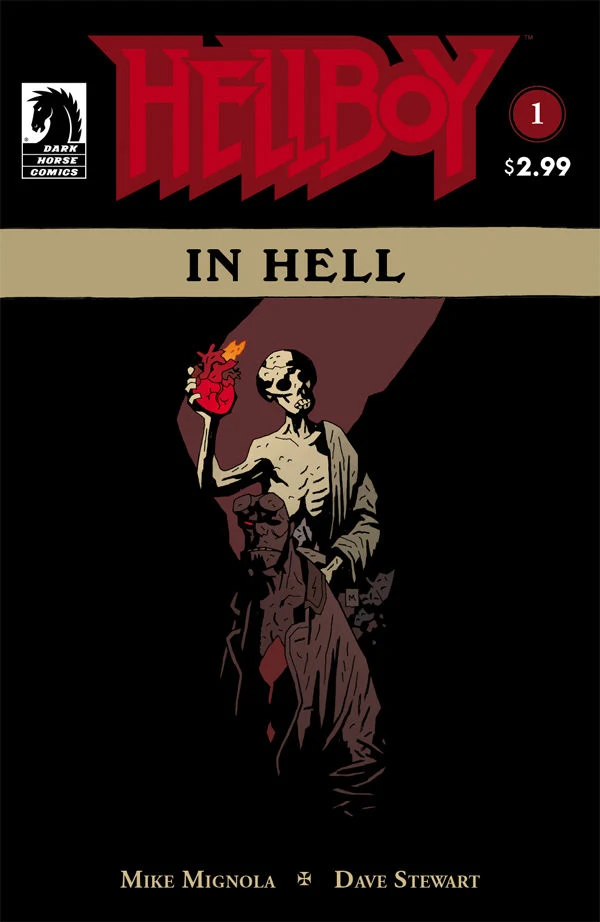
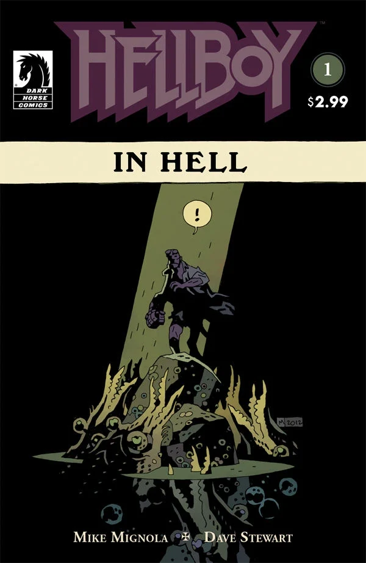
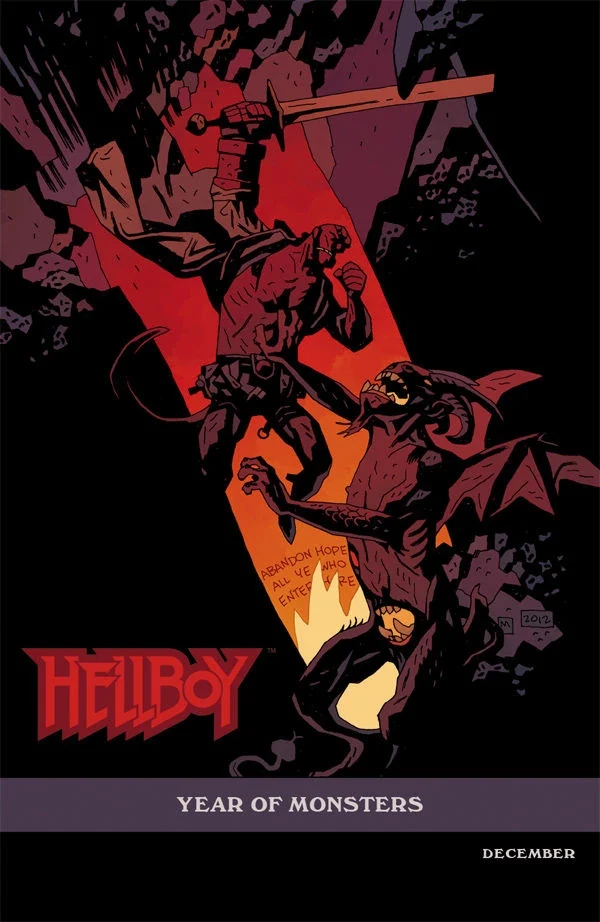
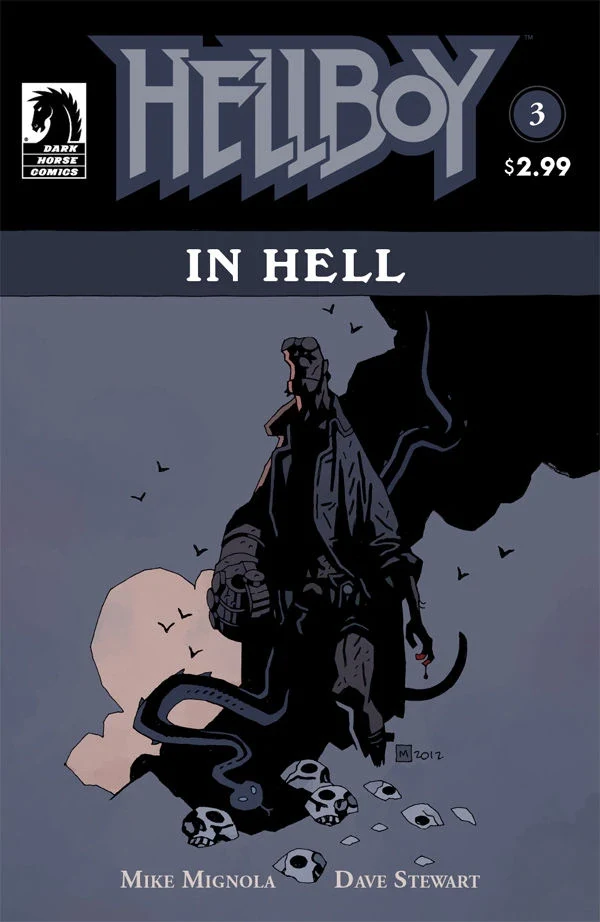

（魔族血统、地狱魔窟、家族纽带、骑象死神）

《**地狱男爵在地狱**》讲述地狱男爵在《[狂怒](/entry/The_Fury)》事件之后穿行地狱的旅程。本文介绍该系列的第一个故事篇章——有时被称作「降临」（The Descent），即收录《地狱男爵在地狱》前五期的平装合订本之名。官方上这个篇章并没有总标题，但耐人寻味的是，篇章里的每一章都各有名字。这种命名方式在众多《地狱男爵》产品线中是独一无二的。

## 出版历史

这个篇章标志着《地狱男爵》故事的一次重大转变：从一系列迷你系列的形式转为一部持续连载的系列。《地狱男爵在地狱》的前四期作为该系列的第一个篇章，按月推出。

## 剧情简介

### 第一章：《降临》

尽管地狱男爵在《[风暴](/entry/The_Storm)》与《[狂怒](/entry/The_Fury)》中拯救了世界，他最终还是被濒死的[尼姆薇](/entry/Nimue)所杀——她把他的心脏连同自己一起拖进了地狱。

本期开篇，[爱德华·格雷](/entry/Sir_Edward_Grey)与[芭芭·雅加](/entry/Baba_Yaga_(character))交谈，表示自己希望救下地狱男爵，帮他分担命运的重负。

地狱男爵抵达了「深渊」（The Abyss）——一个还算不上地狱、却无疑在通往地狱之路上的地方。他被一群巨型虾状怪物团团围住。爱德华·格雷现身，替地狱男爵挡下这些生物。然而，趁格雷分心之际，地狱男爵遭到[埃利戈斯](/entry/Eligos)的袭击——此魔本是摩根勒菲城堡的守桥恶魔，因在《[狂野狩猎](/entry/The_Wild_Hunt)》中被地狱男爵所杀而来寻仇。

地狱男爵挨了一顿痛打，最终格雷再度出手相救。格雷困住恶魔后，埃利戈斯警告说：若格雷站在他的敌人一边与他为敌，必将被毁灭。埃利戈斯挣脱了陷阱，格雷自觉不敌，便把自己与地狱男爵传送到一处避风港，把那恶魔独自留在黑暗之中。

到了避风港，格雷说那恶魔必会追来，而他打算等埃利戈斯抵达时，在此设伏、最好能将其消灭。地狱男爵说，他记得在《[狂怒](/entry/The_Fury)》事件期间的高塔上见过爱德华·格雷（尽管他当时并不知道他是谁）。格雷告诉他，自己已经观察他很久了，本盼着两人能稍作交谈；可还没等他们说上话，埃利戈斯便再度闯来。格雷与恶魔缠斗的同时，把地狱男爵弹出避风港以保其周全。

地狱男爵滚下几段楼梯，落地时映入眼帘的，竟是一场木偶戏，演的是《圣诞颂歌》里斯克鲁奇与马利重逢的一幕。一个通体素白的灵魂现身。地狱男爵问它可是「过去的圣诞之灵」，那灵魂答道：「差得远呢。」随即便把地狱男爵带上天空。

### 第二章：《万魔殿》

那灵魂带着地狱男爵离开地狱的诸般城池，渡过冥河之海（Stygian sea），抵达万魔殿（Pandemonium）——位于地狱心脏、撒旦的雄城。灵魂告诉地狱男爵，他不必担心在此遇袭：因为听说地狱男爵将至，除了一位之外，所有的亲王、大臣、公爵、侯爵、伯爵与骑士都已率领各自的军队逃离了万魔殿。

地狱男爵随后被带到「苍蝇要塞」（Citadel of the Fly）——万魔殿跳动的心脏。灵魂在此向他展示了本应属于他的王座、王冠、他父亲的佩剑与职权之戒。地狱男爵拒绝了这一切，灵魂对此似乎毫不意外。

灵魂接着把地狱男爵带到唯一留在万魔殿的恶魔面前——[撒旦](/entry/Satan)。它告诉地狱男爵，两千年来撒旦一直独自沉睡在万魔殿的深处，无人守卫，任由他那些低等造物治理地狱；随后它点出：要杀他，不过是举手之劳。灵魂递给地狱男爵一把匕首，匕首随即「当啷」落地，沾满鲜血。地狱男爵问，为何恶魔们一听说他要来就四散奔逃。灵魂避而不答，地狱男爵骤然被传送到科库托斯河（Cocytus）边，第二个灵魂在那里迎接他。

地狱男爵看到了寻常罪人的灵魂，它们像鱼一样在科库托斯河中游动，被「渔魂者」（Fisher of Souls）捕捞、锻造成地狱的士兵。灵魂告诉地狱男爵，这支大军将归他号令，而他的「毁灭右手」正是为这支军队注入生命之物，它将推倒隔开地狱、天堂与人间的壁垒。地狱男爵再次表示，这一切他一样都不想要。

第三个灵魂抓住他的手臂，地狱男爵立刻被拉回到 1617 年 10 月 5 日他出生的地方。他看见自己的母亲[萨拉·休斯](/entry/Sarah_Hughes)被吊在钩子上，面前是地狱男爵的恶魔父亲[阿撒泻勒](/entry/Azzael)、他的叔父[阿斯塔罗特](/entry/Astaroth)，以及两个哥哥[加蒙](/entry/Gamon)与[拉斯克](/entry/Lusk)。在她被焚烧之际，一个婴儿地狱男爵从烈焰中现身。父亲砍下婴儿的右手，一个通体素白的骷髅灵魂用「毁灭右手」替换了那只被砍去的手。

地狱男爵被带回当下，阿斯塔罗特正候着他，以一句「欢迎回家」相迎。

### 第三章：《家族纽带》

地狱男爵的叔父阿斯塔罗特一边试图说服他承袭本应属于他的力量，一边讲述了阿撒泻勒的下场与地狱男爵诞生之地的变故。其他亲王发现阿撒泻勒持有那只手、而且地狱男爵已经降生，便召唤毁灭天使前来覆灭这一家族。但他们还是太迟了——在被毁灭之前，阿撒泻勒把地狱男爵送走，后来在《[毁灭之芽](/entry/Seed_of_Destruction)》的开篇事件中，被[拉斯普京](/entry/Grigori_Rasputin)（或是他人间兄弟姐妹的鬼魂）阴差阳错地带到了人间。

他进一步解释：作为造出地狱男爵的惩罚，阿撒泻勒被剥夺一切力量，永远冰封囚禁。地狱男爵问阿斯塔罗特：「为什么是我？」就在此刻，阿撒泻勒的其他儿子们赶到（他的[女儿](/entry/Gamori)迦莫莉谢绝前来）。两人都觉得自己比地狱男爵更有资格得到王座与力量；阿斯塔罗特则坦言，他已经等得不耐烦了，不想再等地狱男爵承袭他与生俱来的权柄。两兄弟向地狱男爵发难，想杀了他、好把那只手据为己有。战斗异常艰苦，阿斯塔罗特放话：无论哪个兄弟夺到手，他都会从旁指引。他还说，与其看到地狱男爵如今这副模样，倒不如让阿撒泻勒当初死了的好。

加蒙这时插嘴，说阿撒泻勒是个老糊涂，居然挑了地狱男爵而不挑他。阿斯塔罗特闻言动怒，当即斩下加蒙的头颅，以惩其不敬。拉斯克对阿斯塔罗特的行径大为震惊，阿斯塔罗特却骂他软弱。在最后一次试图操纵之后，一头巨龙般的巨大恶魔[利维坦](/entry/Leviathan)从阿斯塔罗特、加蒙与拉斯克脚下的冰层中破出，把他们尽数吞下。

那个曾在《狂野狩猎》的桥头一役中助地狱男爵对抗埃利戈斯的小飞魔出现，告诉地狱男爵：阿斯塔罗特与利维坦之间早有旧怨，如今算是两清了。小飞魔抱怨说，地狱男爵来到自己王国时，没能信守「记住它相助之恩」的承诺——因为这王国根本就不存在。它接着告诉地狱男爵：有人偷偷潜入撒旦的寝殿，割断了他的喉咙。

随后画面里，地狱男爵走进撒旦寝殿，再一次，染血的刀刃「当啷」坠地。地狱男爵对这些经过毫无记忆。小飞魔告诉他：如今撒旦已死、万魔殿成了一座坟墓，地狱男爵再也无关紧要了。说罢，地狱男爵被送回深渊。

### 第四章：《骑象死神》

地狱男爵在深渊中漂浮，直到爱德华·格雷施展魔法，通过一面镜子把他带进自己在地狱中的居所。格雷透露，他已经把埃利戈斯困回两人当初交战之处，但愿能永远困住它。

地狱男爵被房间里一幅名为《骑象死神》（Death Riding an Elephant）的画所吸引。他回忆起自己第一次去伦敦时见过它——当时他去了白教堂区一家如今已被焚毁的酒馆，爱德华曾在那里办事。格雷说他不忍眼看这幅画付之一炬，便把它带回了这里。此刻地狱男爵终于把线索串了起来，意识到与自己交谈的正是传说中的爱德华·格雷。

地狱男爵问：若格雷是好人那一边的，怎么会落得身陷地狱的下场？格雷答道，人生本不总是公平，这一点地狱男爵应当比大多数人更能体会。格雷告诉地狱男爵，他知道是他杀了撒旦；地狱男爵想不想、需不需要记得自己做过这件事都无关紧要，重要的是事情已经做下。

格雷随后讲述了自己如何在 1916 年失踪、最终落入地狱：当时他破坏了[拉神日轮兄弟会](/entry/Heliopic_Brotherhood_of_Ra)一场召唤恶魔[阿姆杜西亚斯](/entry/Amdusias)（地狱大公爵之一）的仪式，那只被召唤到一半的造物把爱德华一同拖回地狱，诅咒他永生不死，又把他撕成碎片，撒落在阿刻戎河（Acheron）岸边的礁石之间。

后来，栖居在那些礁石中的奇异生物把他重新缝合起来，他如今便以它们为他重塑的形貌活着。早年他对自己命运的悔恨如今已然淡去——因为在漫长的生命里，他见识过种种不可思议之事。

他们交谈的这所宅子，原属一个名叫安格斯·韦尔（Angus Weir）的术士——此人出卖了灵魂，却又想耍诈、不让主人们拿到应得的报偿。它们便把他连同宅子一并掳到地狱。韦尔死时忏悔了自己的恶行，并在屋中刻满符文，使任何恶魔都无法入内。而地狱男爵竟能被允许进入，恰恰证明他远非寻常恶魔。

地狱男爵说不，他不过是自己生前那个模样的死后版本罢了；格雷却让他好好想想：在死亡之中，他终于自由了，而且世上再没有人觊觎他的右手。地狱男爵似乎接受了这番话，随后离去。

格雷接着与一个看似是安格斯·韦尔之魂的存在交谈——后者指责他对地狱男爵谎称他已自由。地狱男爵至少仍被缚着要去完成三件事；格雷却说，他愿把其中第一件重负担到自己肩上，哪怕要付出令自己万劫不复的代价。他又盼着其余几件事还遥遥无期，好让地狱男爵拥有属于自己的时光，暂时尝一尝自由的滋味。

## 画廊

封面均由 [迈克·米格诺拉](/entry/Mike_Mignola)（Mike Mignola）绘制。

\#1

\#1 变体封面

\#1 再版封面

\#3

**Category:Story** **Category:Hellboy story** **Category:Hellboy in Hell story**
