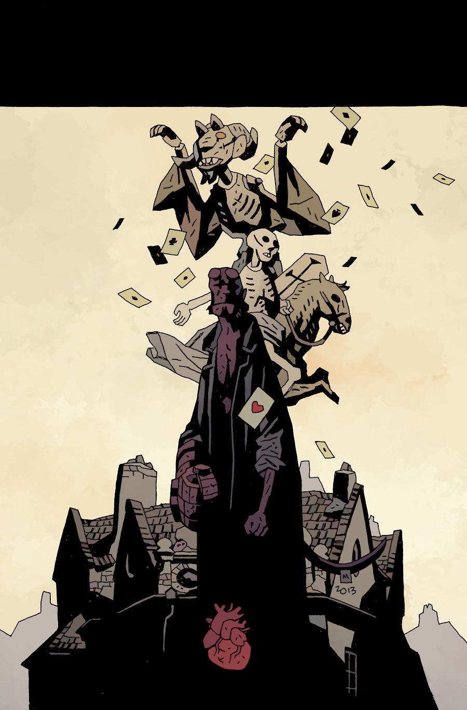

《**塔罗死神**》（The Death Card）是《[地狱男爵在地狱](/entry/Hellboy_in_Hell_(series))》系列中的一个单期完结故事。

## 出版历史

故事预定于 2014 年 5 月推出。

## 剧情简介

地狱男爵坐下来，与迪恩先生（Mr. Dean）和詹克斯（Jenks）商议绘制地狱地图这件全然徒劳的差事；其间，他不知不觉地与人打起了牌——直到他才认出，对手正是[多年前自己在布拉格所杀的那个吸血鬼](/entry/The_Vampire_of_Prague)。

**Category:Story** **Category:Hellboy story** **Category:Hellboy in Hell story**
