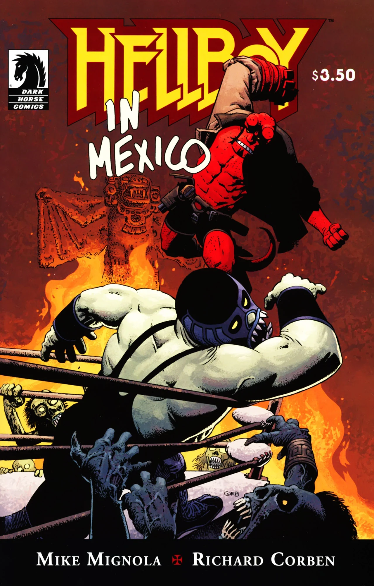

While in Mexico, [Hellboy](/entry/Hellboy%20%28character%29) tells [Abe Sapien](/entry/Abraham%20Sapien) about his adventures in the 1950s hunting monsters with luchadores.

## Publication History

(地狱男爵：墨西哥大冒险/漫长的宿醉）  

*Hellboy in Mexico* (or *A Drunken Blur*) was published as a one-shot on May 5th, 2010. The issue was released with two different covers, one by [Richard Corben](/entry/Richard%20Corben), and a variant by [Mike Mignola](/entry/Mike%20Mignola).

The story was published to coincide with Cinco de Mayo, a day which in the United States has become a day to celebrate the culture and experiences of Americans of Mexican ancestry.

The story is reprinted in [Hellboy: vol. 11 The Bride of Hell and Others](/entry/TPB), first published in October 2011. It was later recollected with all the other stories from Hellboy's five-month "drunken weekend" in the [*Hellboy in Mexico* trade paperback](/entry/TPB).

## Synopsis

In 1982 Hellboy and Abe Sapien sit outside in Mexico waiting for the [B.P.R.D.](/entry/Bureau%20for%20Paranormal%20Research%20and%20Defense) to pick them up. To get out of the sun the pair enter an abandoned building nearby. Inside they find an old statue of the Virgin Mary, with pictures of Mexican wrestlers, luchadores, tacked up all around. Abe finds one picture with Hellboy and three luchadores and asks Hellboy about it. Hellboy tells Abe about his adventure in Mexico in 1956.

Hellboy was sent to Mexico to deal with large outbreak of supernatural activity. Many people were killed and Hellboy did what he could. He teamed up with three luchador brothers who had received a vision from the Virgin Mary to quit wrestling and start fighting monsters. The four fought monsters all day and drank all night. One night the youngest brother wandered off and was taken by the monsters. The remaining three looked for him but could not find any trace.

Then they found a message left for Hellboy to go to a Mayan temple and fight the evil luchador Camazotz alone. Hellboy went and immediately realized that the man he was to fight was in fact the missing brother. Surrounded by Zombies and monsters of every kind, the pair began to fight. Camazotz removed his mask revealing that he had been transformed into a vampire. Hellboy impaled him on a wooden stake, killing the brother, but also returning him to his human form.

Hellboy helped bury the dead brother, and the luchadores left. After that Hellboy was in a drunken stupor for a few months until the B.P.R.D. found him.

Back in 1982, a helicopter arrives for Hellboy and Abe.

In a small theater in Mexico three children watch an old movie filmed in Guadalajara, on August 3, 1956. Hellboy, wearing a luchador mask, wrestles another luchador in a panther costume.

## Chronology

The frame takes place in 1982. This is the same year as the *[Hellboy](/entry/Hellboy%20%28series%29)* stories *[The Vârcolac](/entry/The%20V%C3%A2rcolac)* and *[The Vampire of Prague](/entry/The%20Vampire%20of%20Prague)* and the *[Abe Sapien](/entry/Abe%20Sapien%20%28series%29)* story *[The Haunted Boy](/entry/The%20Haunted%20Boy)*.

The main story takes place in 1956. This is the same year as *[King Vold](/entry/King%20Vold)*.

## Notes

<references />
! colspan = 1 | [Vol. 10 The Crooked Man and Others](/entry/TPB) ! colspan = 2 | [Vol. 11 The Bride of Hell Others](/entry/TPB)

**Category:Story** **Category:Hellboy story**