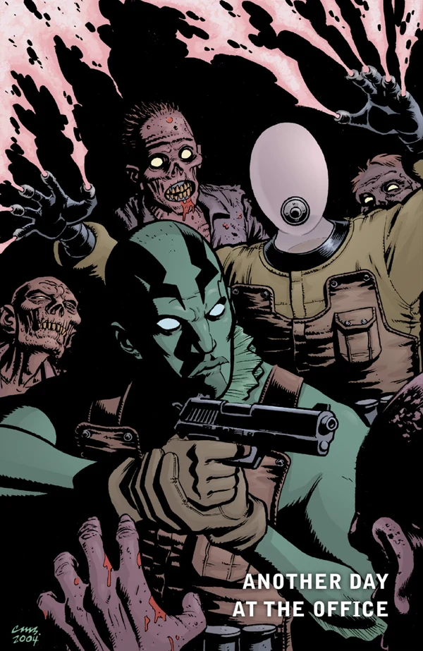

在***《外勤探员的日常》***（Another Day at the Office）中，[亚伯·塞皮恩](/entry/Abe_Sapien)与[约翰·克劳斯](/entry/Johann_Kraus)前往摩尔达维亚调查丧尸事件。

## 出版历史

2004 年 8 月，当四个 *[B.P.R.D.](/entry/B.P.R.D._%28series%29)* 单篇故事被收录进《B.P.R.D.：威尼斯之魂及其他故事》（*[B.P.R.D.: The Soul of Venice & Other Stories](/entry/Trade_Collections)*）合订本时，[迈克·米格诺拉](/entry/Mike_Mignola)专门为这本合集创作了这篇 8 页的故事。后来它又被重印于《地狱男爵 20 周年纪念样册》（*[Hellboy 20th Anniversary Sampler](/entry/Hellboy_20th_Anniversary_Sampler)*）。

## 剧情简介

[亚伯·塞皮恩](/entry/Abe_Sapien)和[约翰·克劳斯](/entry/Johann_Kraus)抵达摩尔达维亚的博尔格勒（Bolgrad）。前一天，一群丧尸走进了镇子，但当地人已经把它们解决了，只留下最后一只丧尸供检查。约翰断定，一个名叫罗伯特·亨特利（Robert Huntley）的人和库里亚（Kurya）是这些丧尸的幕后黑手——库里亚曾是 15 世纪当地的一个暴君。两人前往埋葬他的修道院，却在那里发现了更多丧尸。在礼拜堂里，他们找到了被库里亚骨骸附身的亨特利。亚伯用麻醉镖射中亨特利，平息了这场祸事。

## 内容

### 角色

- [超自然调查防御署](/entry/Bureau_for_Paranormal_Research_and_Defense)（B.P.R.D.）
  - [亚伯·塞皮恩](/entry/Abraham_Sapien)
  - [约翰·克劳斯](/entry/Johann_Kraus)
  - 蕾切尔·特纳（Rachel Turner）
- 丧尸
- 罗伯特·亨特利（Robert Huntley）
- 叶戈尔·库里亚（Yegor Kurya，附身于罗伯特·亨特利的亡魂）
- 博尔格勒其他居民

### 地点

- 乌克兰（Ukranie）
  - 博尔赫拉德（Bolhrad）
    - 库里亚修道院（Kurya Monastery）

## 趣闻

漫画把故事发生地称作"摩尔达维亚的博尔格勒"，这在字面上并不算错，因为摩尔达维亚是一个历史地区，如今分属摩尔多瓦、罗马尼亚和乌克兰三国。博尔赫拉德（Bolgrad 是其罗马尼亚语/保加利亚语/俄语名称）自 1944 年起位于该地区的乌克兰部分，因此更准确的地点表述应是"乌克兰的博尔赫拉德"。这或许是地狱男爵宇宙与现实世界的差异所致，但更可能只是一处"笔误"。
