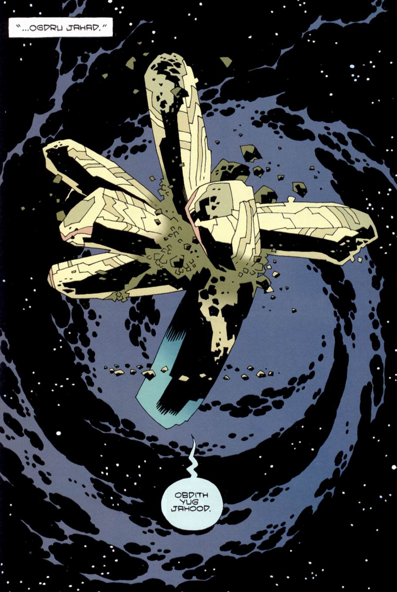
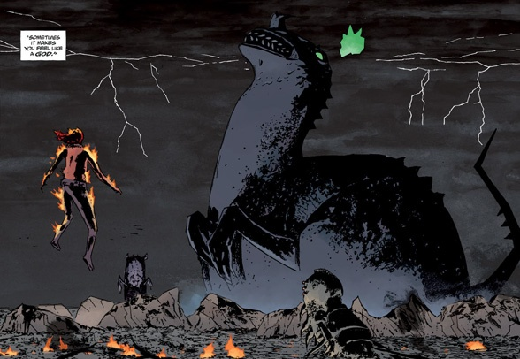

The **Ogdru Jahad**, also sometimes called the Ogdru eb Jurhad[1], are the Dragon of Revelation, and are destined to bring about the end of the world. They were imprisoned in golden cocoons by the [Right Hand of Doom](/entry/Hellboy%20%28character%29) shortly after the creation of Earth, but not before they spawned 369 children, known as the Ogdru Hem.

## Overview

Mostly inspired by the Great Old Ones of H. P. Lovecraft's Cthulhu Mythos (with some ancient Egyptian influences as well), the Ogdru Jahad are serpentine/crustacean entities which once resided on, and presided over, Earth. They are pitiless, chaotic, bent on destruction and subjugation and often so horrific in appearance that the mere sight of one of them sometimes induced madness. They are listed as follows:

- *Adad-Jahad*
- *[Amon-Jahad](/entry/Ogdru_Jahad))*
- *Belili-Jahad*
- *Irra-Jahad*
- *Namrat-Jahad*
- *Nergal-Jahad*
- *Nunn-Jahad*

## History

The Ogdru Jahad's cocoon-like prison.

In the beginning of time, [God](/entry/God) created an order of spirits. Of these, many of the greater spirits were sent to newborn Earth to oversee it as Watchers. One of these spirits, [Anum](/entry/Anum), created the Ogdru Jahad out of fire and mud. The other spirits proceeded to set spells and wards about the Dragon, and even infused it with fire once again, but still the being remained lifeless. However, when night-time came, the Ogdru Jahad awoke and was instilled with purpose and function, giving birth to the Ogdru Hem who become Earth's first life forms. The watchful spirits, upon seeing the creation of these abominations, went to war with them. The Ogdru Hem were eventually all disposed of, with many of them barely clinging to existence in some fashion, with the Ogdru Jahad sealed by their creator in a prison of crystal and placed in the heart of the Abyss. The other Watchers, however, no longer trusted Anum and so they struck him down and destroyed all his remnants, save for one: [his right hand](/entry/Hellboy%20%28character%29). After that, God looked down in fury on what had happened, and exacted his retribution on the Watchers for botching their task: some were cast down into the pit, while others were stranded on the Earth to breed monsters.

Of the original spirits, many of the lesser ones were now given substance by God and took up residence on Earth as the Hyperboreans, the first race of men who predate humanity. Finding Anum's hand, they took it to the land of Hyperborea where it became a holy object and, at the request of their king [Thoth](/entry/Thoth), was attached to a great statue. The statue stood for ten thousand years, until finally Hyperborea became corrupted as a result of [Hecate](/entry/Hecate) exposing what Thoth kept from his people. This leads to multiple cults dedicated to Hecate, whose horrific acts caused the statue to leave its place in Thoth's garden and slaughter the people before finally hurling itself over a cliff. The Hyperborean people soon faded into legends during the Ice Age, with some passing their knowledge to the second race of men (humanity) that emerged.

The hand of Anum, later renamed the "*Right Hand of Doom*" as it is the key to freeing the Ogdru Jahad from their prison and thus triggering the apocalypse, ended up in Hell where the demon [Azzael](/entry/Azzael) had it grafted onto the arm of his newborn son [Anung Un Rama](/entry/Hellboy%20%28character%29) before he was summoned by [Rasputin](/entry/Rasputin) who attempted to use the renamed Hellboy during the events of *[Seed of Destruction](/entry/Seed%20of%20Destruction)*. Though the attempt failed, it set events in motion as the crystal prisons collided into each other. This event causes Hellboy to learn about his right hand, and make him aware that he must keep the hand as it would be more dangerous to try to rid himself of it. Attempts have already been made to separate Hellboy from his arm, both to protect the world and to hasten its destruction. Hellboy believes he is the best protection the arm can have.

While certain events have made it clear that the Right Hand of Doom is the Key to releasing the Ogdru Jahad, despite there being failures, the actions of [Herman von Klempt](/entry/Herman%20von%20Klempt) summoning the [Conqueror Worm](/entry/Conqueror%20Worm) and the frog monsters in conjuring [Katha-Hem](/entry/Katha-Hem) suggest that there are other conditions needed to be fulfilled for the Ogdru Jahad to make their return. During the events of *[The Fury](/entry/The%20Fury)*, the Ogdru Jahad possessed the body of the Queen of Blood, in order for the woman to serve as their host through which they intended to prematurely return, to fight Hellboy before their host was killed in battle. But that event was revealed to be how the end of the world will begin and that the Ogdru Jahad have only been hindered and would appear in the world later in their full glory.

An Ogdru Jahad on Earth|centre

## Plans of the Ogdru Jahad

As an immortal and vastly powerful entity whose true nature defies description, with even its nature as multiple beings being ambiguous, the motivations of the Ogdru Jahad may not be possible to represent in human terms. As such, the human and quasi-human inhabitants of the Hellboy universe have expressed a variety of opinions on what the Ogdru Jahad wants beyond freedom, which it desires above all other things.

From the varied attempts of [Rasputin](/entry/Rasputin) and [Project Ragna Rok](/entry/Project%20Ragna%20Rok) to free the Ogdru Jahad, it is readily apparent that their release is closely tied to the fall of mankind. But the question of mankind's fall varies: [Herman von Klempt](/entry/Herman%20von%20Klempt) believing the Ogdru Jahad would be released by the freed Ogdru Hem once man has been destroyed. A common vision all share is that the Ogdru Jahad will do something akin to "burning the earth to a cinder" so it is possible they are all referring to some common vision of the dragon's release but are guessing at how the prophecy is fulfilled.

Beyond that, there is much dissent as to precisely what the Ogdru Jahad will do upon release. The aliens that watch the cosmic prison of the Ogdru Jahad apparently perceive Earth as a focal point necessary to maintaining the prison. If the Ogdru Jahad are released, they will destroy Earth and then the entire Universe. Rasputin, is given the notion that desire of the Ogdru Jahad is to create a new, perfect world out of the ashes of the old one, where the final race of man will live. Both Hecate, who sees herself by Hellboy's side as the world ends, and the Daoine Sidhe concur that humanity will be replaced by a new race. The Ogdru Jahad, through the Ogdru Hem, make attempts to create the new race in the form of Frog monsters, though they are a flawed form compared to [Abraham Sapien](/entry/Abraham%20Sapien).

## In other media

### Film

In the film *[Hellboy](/entry/Hellboy%20%28film%29)*, the Ogdru Jahad were mentioned by name only once by [Rasputin](/entry/Rasputin). They were portrayed as amorphous, tentacled creatures encased in crystal shells. At the conclusion of the film, their prisons were shattered and the Ogdru Jahad began their assault on Earth. Before the final lock could be unsealed by Hellboy, he regained his senses and the Ogdru Jahad dissipated.

### Animated

In *[Hellboy: Sword of Storms](/entry/Hellboy%3A%20Sword%20of%20Storms)*, the Ogdru Jahad (or possibly Ogdru Hem) made a cameo as the brothers of Thunder and Lightning. Though not mentioned by name, they were referred to as the "Dragons".

## Gallery

<File:E0080086.jpg%7COne> of the seven Ogdru Jahad <File:Ogdru_Jahad.jpg>

## Notes

<references/>

de:Ogdru Jahad

**\*** **Category:Species** **Category:Mythical Creature** **Category:Deities** **Category:Monsters** **Category:Hellboy Animated Characters**

[1] *[The Third Wish](/entry/The%20Third%20Wish)* \#2