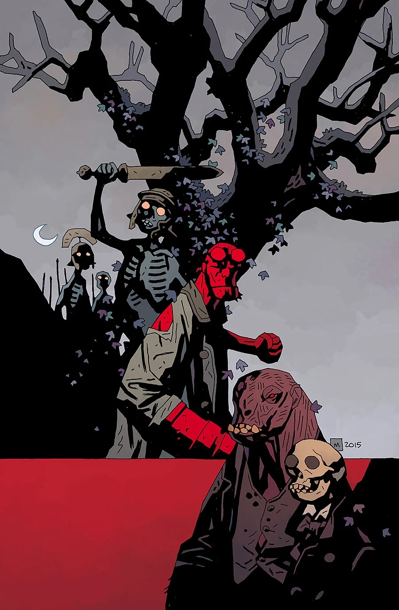

《**妖兽与血骨**》（Rawhead and Bloody Bones）是一部短篇故事，由迈克·米格诺拉（Mike Mignola）编剧、本·斯滕贝克（Ben Stenbeck）作画。它是构成《[地狱男爵与 B.P.R.D.](/entry/Hellboy_and_the_B.P.R.D.)：1953》的数个故事之一。

## 画廊

《1953》第 2 期

**Category:Story** **Category:Hellboy story** **Category:Hellboy and the B.P.R.D. story** **Category:B.P.R.D. story**
