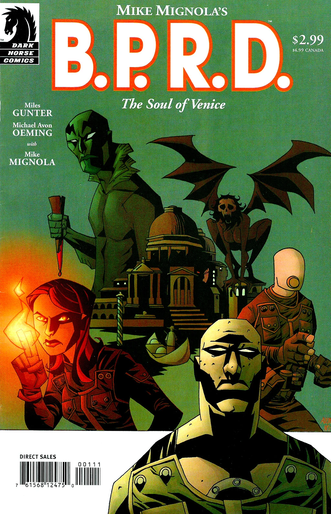

在***《威尼斯之魂》***（The Soul of Venice）中，[丽兹·舍曼](/entry/Elizabeth_Sherman)、[亚伯·塞皮恩](/entry/Abe_Sapien)、[罗杰](/entry/Roger)与[约翰·克劳斯](/entry/Johann_Kraus)前往威尼斯，调查城中的水体究竟出了什么问题。

## 出版历史

《[空心地球](/entry/Hollow_Earth)》之后，*B.P.R.D.* 漫画将走向何方一度并不明朗。2003 年 5 月至 11 月间，每隔一个月推出一篇单篇故事，共四篇：《威尼斯之魂》、《[黑水之域](/entry/Dark_Waters)》、《[午夜列车](/entry/Night_Train)》和《[床下有鬼](/entry/There%27s_Something_Under_My_Bed)》。与此同时，在"休刊"月份，黑马漫画出版了[脱离正传时间线](/entry/Hellboy_Comics)的选集《地狱男爵：怪谈》（*Hellboy: Weird Tales*）。

《威尼斯之魂》于 2003 年 5 月出版，后于 2004 年 8 月被收录进合订本《B.P.R.D.：威尼斯之魂及其他故事》（*[B.P.R.D.: The Soul of Venice & Other Stories](/entry/Trade_Collections)*）。

## 剧情简介

[丽兹·舍曼](/entry/Elizabeth_Sherman)、[亚伯·塞皮恩](/entry/Abe_Sapien)、[罗杰](/entry/Roger)与[约翰·克劳斯](/entry/Johann_Kraus)来到[威尼斯](/entry/Venice)。他们发现运河有些不对劲，却无法确定原因。罗杰看到一尊女子雕像，被告知那是[克洛阿西娜](/entry/Cloacina)（Cloacina）——传说中负责维护运河的罗马女神。

约翰感应到邪恶中心是一栋宅子，小队随即展开调查。这栋宅子曾属于罗穆卢斯·迪乔瓦尼（Romulus Diovanni）——此人为求永生，曾折磨一名吸血鬼并饮下其血。在宅子里，小队在棺材中发现了迪乔瓦尼的尸体，并用木桩刺穿了这个身影。吸血鬼拔出木桩，制伏了全队。

罗杰醒来，看到吸血鬼要把被束缚的神灵克洛阿西娜献给恶魔[沙克斯](/entry/Shax)（Shax），以此换取更强大的力量。沙克斯不屑与这个卑微的吸血鬼为伍。罗杰打碎了封印克洛阿西娜的罐子；失去那股力量后，吸血鬼被击败，恶魔也因契约解除而离去。克洛阿西娜对罗杰微微一笑，随即消失。

克洛阿西娜获释后，威尼斯恢复了正常。故事结尾，罗杰坐在故事开头那尊克洛阿西娜雕像之下。

## 内容

### 角色

- [克洛阿西娜](/entry/Cloacina)（Cloacina）
- [超自然调查防御署](/entry/Bureau_for_Paranormal_Research_and_Defense)（B.P.R.D.）
  - [罗杰](/entry/Roger)
  - [约翰·克劳斯](/entry/Johann_Kraus)
  - [丽兹·舍曼](/entry/Elizabeth_Sherman)
  - [亚伯拉罕·塞皮恩](/entry/Abraham_Sapien)
- [吸血鬼](/entry/Vampire_%28creature%29)
  - [罗穆卢斯·迪乔瓦尼](/entry/Romulus_Diovanni)（Romulus Diovanni）
  - 罗马吸血鬼（回忆出场）
- [圣殿骑士团](/entry/Knights_Templar)（回忆出场）
- [恶魔](/entry/Demon)
  - [沙克斯](/entry/Shax)（Shax）
- [地狱男爵](/entry/Hellboy_%28character%29)（仅被提及）

### 地点

- 意大利
  - 威尼斯
    - 迪乔瓦尼宅邸
    - 圣马可广场（回忆出场）

## 趣闻

在迪乔瓦尼的庄园里，丽兹看到一幅孩童肖像，画中孩子与 B.P.R.D. 宇宙中的重要角色——恶魔[瓦尔瓦拉](/entry/Varvara)（Varvara）惊人地相似。画中人随即活了过来袭击探员，被罗杰一拳摧毁。约翰·克劳斯称它"不过是一个被禁锢在这栋房子的邪恶之中的受诅咒灵魂"。
