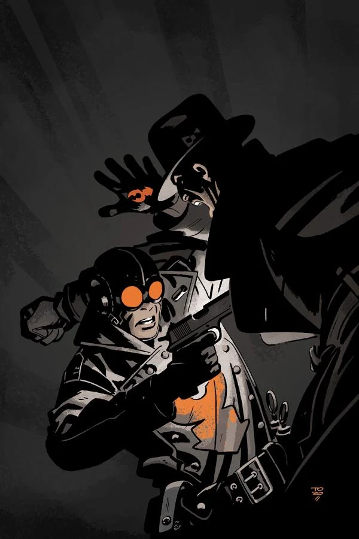

The story takes place early in [the Lobster's](/entry/The%20Lobster) career as a crime fighter in the 1930s.

## Publication History

This one-shot will be published in August 2012, featuring a cover by Tonči Zonjić.

## Synopsis

The Heliopic Brotherhood of Ra hold a Victorian themed party complete with the unrolling of a mummy, with decidedly unexpected results, including a gun-blazing vigilante promising justice!

## Gallery

<File:The_Prayer_of_Neferu.jpg%7CCover>

! colspan = 2 | [ Vol. 3 Satan Smells a Rat](/entry/TPB) ! colspan = 1 | [ Vol. 4 Get the Lobster!](/entry/TPB)

**Prayer of Neferu, The** **Prayer of Neferu, The**