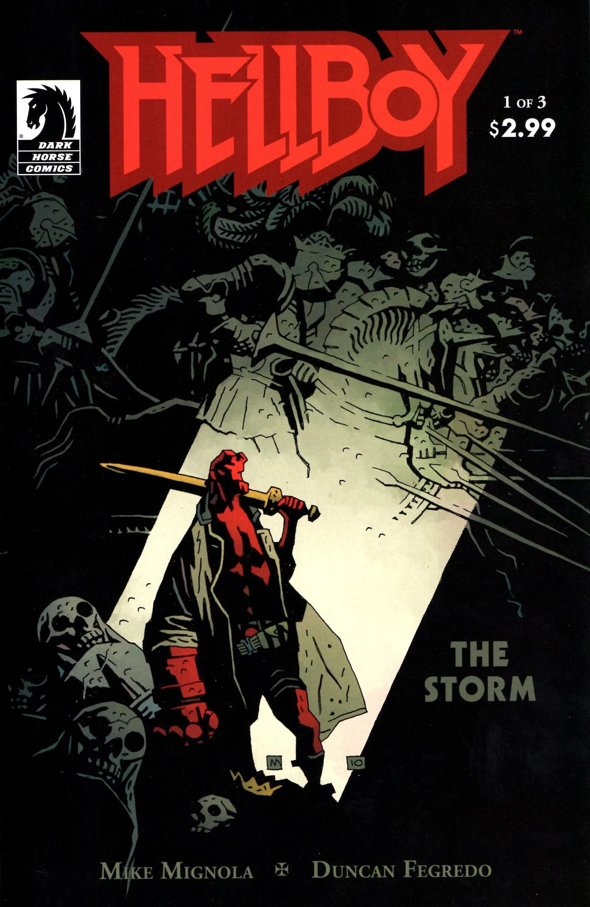

[Hellboy](/entry/Hellboy%20%28character%29) confronts his destiny as the bearer of the sword [Excalibur](/entry/Excalibur). [Gruagach](/entry/Gruagach) learns his fate, and [Nimue](/entry/Nimue) continues to gather her strength.

## Publication History

*The Storm* (together with *[The Fury](/entry/The%20Fury)*) is the third act in the "trilogy" of *[Hellboy](/entry/Hellboy%20%28series%29)* stories drawn by [Duncan Fegredo](/entry/Duncan%20Fegredo). *[Darkness Calls](/entry/Darkness%20Calls)* and *[The Wild Hunt](/entry/The%20Wild%20Hunt)* make up the first two parts. Due to the fan reaction to the delay in the middle of *[The Wild Hunt](/entry/The%20Wild%20Hunt)*, the final part of the trilogy was split into two three-issue series; *The Storm* served as the first half of this final arc, while *[The Fury](/entry/The%20Fury)* will served as the second half.

*The Storm* was published as a three-issue miniseries from July to September 2010. It is currently collected in the trade paperback [*Hellboy: The Storm and the Fury*](/entry/TPB) with a short epilogue by Mike Mignola.

A special black and white cover version of *The Storm* \#1 was made available to members of the B.P.R.D. fan club at the 2010 San Diego Comic-Con during a meet up on Thursday July 22.

## Synopsis

### Part One

[Hellboy](/entry/Hellboy) and [Alice Monaghan](/entry/Alice%20Monaghan) travel to a church in England only to find that the noble dead of England are in fact rising from their graves. Hellboy briefly recounts his travels since leaving the [B.P.R.D.](/entry/Bureau%20for%20Paranormal%20Research%20and%20Defense) to Alice. They drive off, but are stopped by a creature in armor on the road. Hellboy and the creature fight. The creature says that he serves the Queen of Blood and that the war is beginning.

Meanwhile, [Gruagach](/entry/Gruagach) walks alone in the woods. He stumbles in front of a robed man who says Gruagach is now standing on his grave. Gruagach bows and calls the man his master. He asks the man for forgiveness, but the man refuses.

### Part Two

The man talks to [Gruagach](/entry/Gruagach) and tells him the story of the Queen of Blood. [Nimue](/entry/Nimue) tricked [Merlin](/entry/Merlin) into teaching her all of his secrets, and with them buried him alive. The power drove her insane and the other witches killed her.

The man, who looks like Merlin from the flashback, blames Gruagach for freeing her and allowing the the war to happen. The man shows him that her army of creatures is already forming. He blames Gruagach for [Dagda](/entry/Dagda)'s death and reveals that Mab was killed as well. Her blood was put on the talking Hedgehog by Nimue turning him into her champion. She sent him to kill [Hellboy](/entry/Hellboy).

The man, curses [Gruagach](/entry/Gruagach) that he will live to see the future he cause to pass. A world destroyed and inhabited by the Ogdru Hem.

A man in armor and a crown, most likely [King Arthur](/entry/King%20Arthur), appears in the English Church. He says that traitors will suffer the most now that war is coming.

Meanwhile [Hellboy](/entry/Hellboy) is still fighting Nimue's champion. Alice throws him [Excalibur](/entry/Excalibur). Although Hellboy is impaled on the creature's spear, Hellboy still manages to kill the champion. As the creature dies, he tells Hellboy that Nimue will win no matter what. She was once the Queen of Blood and is now a Goddess of War, but is becoming something else. Not even Nimue knows this but the creature learned from Mab's blood. He dies before he reveals the secret.

[Hellboy](/entry/Hellboy) and Alice find an inn to rest. On television Hellboy sees the creature in Salton Sea, California (as seen in [*B.P.R.D.: King of Fear* \#5](/entry/King%20of%20Fear%20%28story%29)). He remembers back to his childhood talking to [Trevor Bruttenholm](/entry/Trevor%20Bruttenholm) about how he would grow up to fight monsters. Hellboy and Alice look out the window to see the royal dead of England gathered around the inn.

### Part Three

[Hellboy](/entry/Hellboy) decides that he will not lead the army of the royal dead. He tells Alice that his gut feeling is that he must face [Nimue](/entry/Nimue) alone, even though he does not know how. He also tells her to get rid of the sword [Excalibur](/entry/Excalibur). Hellboy kisses her goodbye and heads off into the woods.

Hellboy finds [Gruagach](/entry/Gruagach) hanging by his neck from a tree. The creature asks Hellboy to kill him. Hellboy shoots him many times but still, as [Merlin](/entry/Merlin) said Gruagach will not die.

Next Hellboy comes to the demon [Astaroth](/entry/Astaroth), at first disguised in the form of a poor man. He shows Hellboy [Nimue](/entry/Nimue)'s army and tells him that only way to get through her army is to free the army of Hell. Hellboy again refuses to lead this army.

Finally Hellboy comes to [the Baba Yaga](/entry/Baba%20Yaga%20%28character%29). She offers to take Hellboy past [Nimue](/entry/Nimue)'s army. However Hellboy must give her his eye to repay the eye he shot out of her (as seen in *[The Baba Yaga](/entry/The%20Baba%20Yaga)*). After thinking about his options, Hellboy allows Baba Yaga to take his left eye.

In her tower Nimue prays to the [Ogdru Jahad](/entry/Ogdru%20Jahad) using the same words as [Rasputin](/entry/Rasputin) in *[Seed of Destruction](/entry/Seed%20of%20Destruction)*. One of the witches speaks up and finishes her words. Infuriated, Nimue yells at the witch. The witch says that Nimue is honored above all the others chosen by the Ogdru Jahad; as they will be reborn out of her body. As Nimue begins to transform she attacks the witch, telling her to stop the trick, but in the end she sees that this is no trick. The form of the seven entrapped creatures burst out of the tower and the assembled army cheers below.

## Gallery

文件:The Storm 1.jpg|Issue \#1 文件:The Storm 2.jpg|Issue \#2 文件:The Storm 3.jpg|Issue \#3 文件:Storm 1 members.jpg|Issue \#1 B.P.R.D. member cover

! colspan = 1 | [Vol. 11 The Bride of Hell and Others](/entry/TPB) ! colspan = 2 | [Vol. 12 The Storm and the Fury](/entry/TPB)

**Storm, The** **Storm, The**