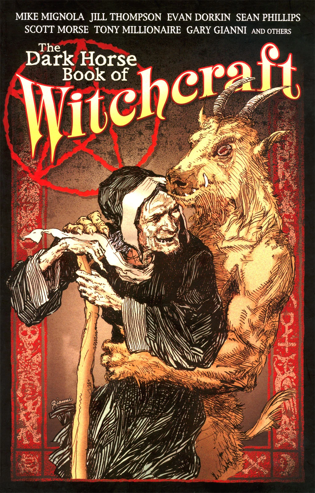

Hellboy travels to Norway in 1963 and speaks to the Troll-Witch.

## Publication History

*The Troll-Witch* was first published as part of the anthology *The Dark Horse Book of Witchcraft* in June 2004. The volume is part of \[<https://en.wikipedia.org/wiki/The_Dark_Horse_Book_of>... *Dark Horse Book of...*\] series of horror anthologies.

## Synopsis

In 1963 in Norway, Hellboy is investigating a number of gruesome murders. He enters the house of the "troll-witch". She asks if he plans on killing her. Hellboy responds "maybe". The towns people had said trolls were responsible for the killings, and sent Hellboy to the witch. The witch proceeds to tell her story.

Once a woman who could not have children asked a witch for help. The witch gave her two flowers, and told her to eat only one and she would have a child. She ate the flower and bore a beautiful daughter. But she wanted another child and ate the other flower. Her second daughter was born stunted and troll like. The parents wanted the troll-like girl destroyed, but the daughters loved one another.

Years later trolls fought outside of their house. The ugly girl went out to fight with them, much against her mother's warnings. The beautiful girl looked out of the window to see what was happening and a troll grabbed off her head and put a cow head in its place. The girl turned into a cow. The ugly girl traveled to the troll fortress and killed many trolls. She also took back her sister's head.

Hellboy interrupts to tell how the story ends; the cow turns back into a beautiful girl and marries a prince. The witch replies that the girl remained a cow and later died. The witch shows Hellboy her sisters dried head, flowers line her brow. The witch says that one day a woman will come to her to bear children, and she will eat the flowers and all her children will be beautiful.

She gives Hellboy the weapon she used to kill the trolls so many years ago, and instructs Hellboy to place it blocking the entrance to the troll cave. The trolls will not cross, and when the sun rises they turn to stone.

! colspan = 3 | [*Hellboy – Volume 7: The Troll Witch and Others*](/entry/TPB)

**Troll Witch, The** **Troll Witch, The**