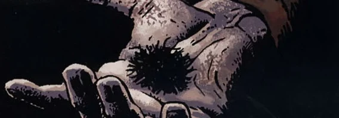

Lo and beware, a Witchball

A Witchball is a spiky, urchin-like object imbued with black [magic](/entry/Magic) to enact a curse upon whomever the witch strikes with it. To remove the curse, the ball must be burned and the victim's clothes need to be boiled while the witch's name is recited.

**Category:items**